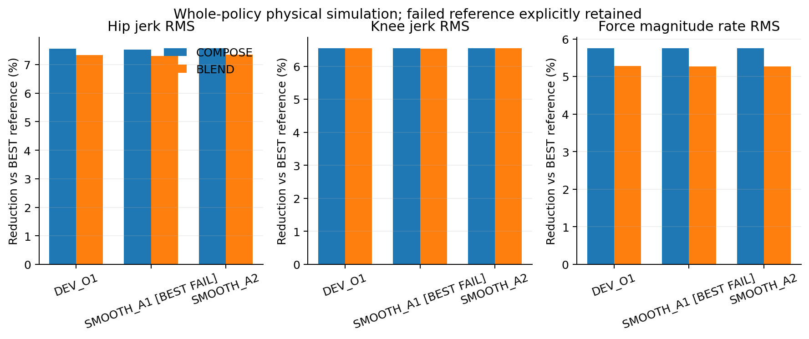
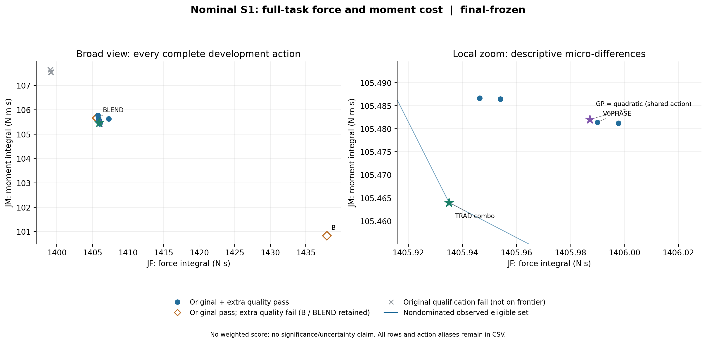
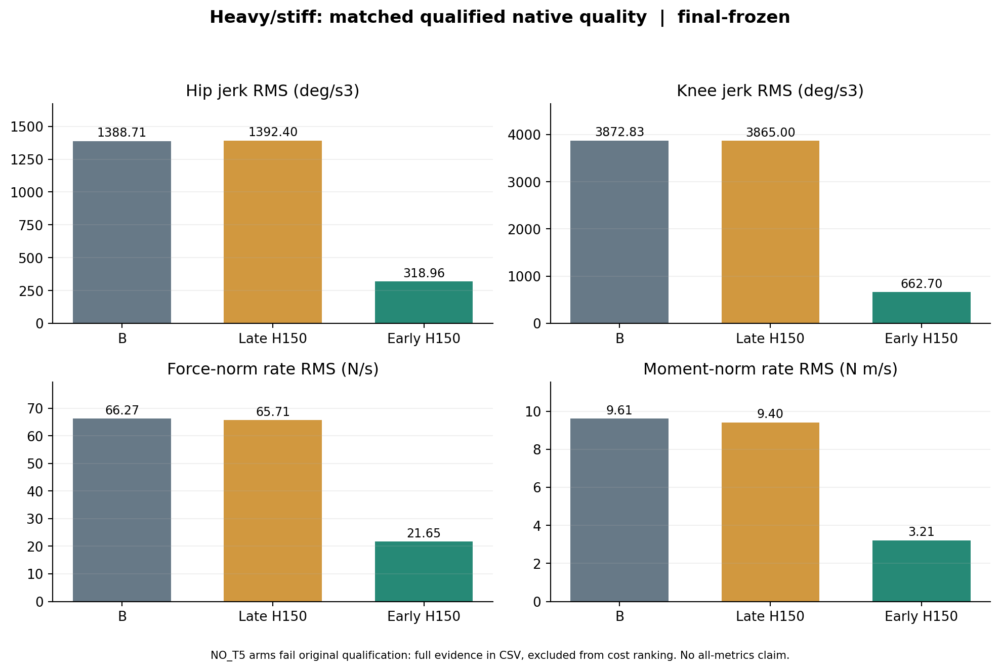
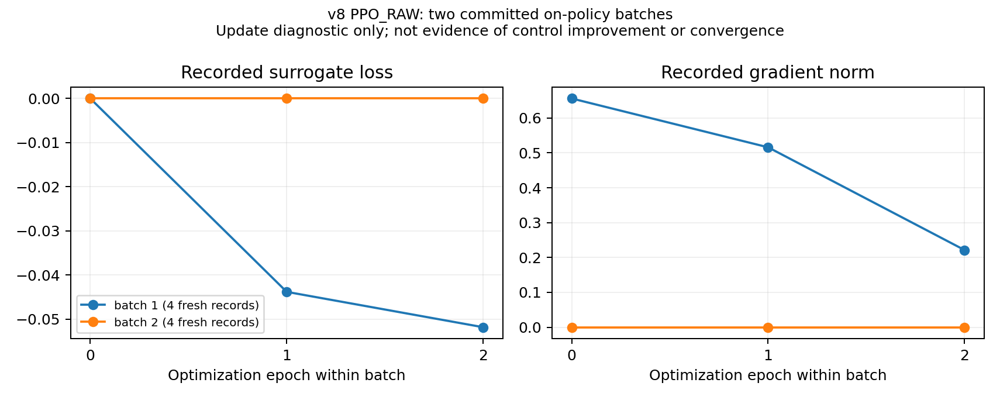

# 实验与证据：保留了什么，能够支持什么结论

本阶段最可靠的结论是：传统控制已经形成多种经完整任务验证的可执行权衡；在 v1–v8 已测范围内，尚未建立 Learning 超过强传统及简单等效对照的稳定独立收益。不同 Human、prefix、激活时点和动作权限之间不存在可直接合并的总排行榜。下列数值均来自原研究包，不代表全局理论最优、硬件效果或患者安全。

本页的 `CONFIRMED` 指有对应源码、原记录或数值复核；`SUPPORTED` 指受现有证据支持的有限解释；`HYPOTHESIS` 指待验证解释；`NOT_RUN / NOT_TESTED` 保留原未执行范围。原报告中的科学结论与本次归档的重新验证分开记录。远端干净 clone 的实际结果以 [ARCHIVE_VERIFICATION.md](ARCHIVE_VERIFICATION.md) 为准。

## 评价合同与实验身份

所有本页主要现代比较保持完整 **19.03 s TASK**：OUTBOUND/HOLD/RETURN 约为 **9.005 / 1.020 / 9.005 s**。commissioning、冷 parent 和继承前缀的额外物理步不算作新增 TASK 时长，也不能把一个父状态的多动作 fork 当作独立患者。

原 measured cuff wrench 取 5 ms trace 中 `stage == TASK` 的数据，包含 HOLD，使用左积分：

\[
J_F=\sum_{i=0}^{N-2}\|F_i^{measured}\|_2(t_{i+1}-t_i),\qquad
J_M=\sum_{i=0}^{N-2}\|M_i^{measured}\|_2(t_{i+1}-t_i).
\]

JF 单位为 N·s，JM 为 N·m·s。原 motion 使用未滤波 **0.25 ms native** Human velocity，按原 `numpy.gradient(..., edge_order=2)` 连续求 acceleration 和 jerk，保留边界、峰值及 p95 等门。native truth 只用于评价，不能注入 Learning 的实时状态。JF/JM、髋膝 motion、clearance、torque、admission、安全与执行因果门必须分别检查。**JM 比值≤1.25 的资格条件不等于 JM 不增加；原门通过也不自动满足额外研究 quality 门。**

一个可比较记录至少需要 `{package, attempt_id, case/config SHA, seed, actual parent/prefix, fork phase/slot, action recipe, planner/source SHA, clock mode, completion, original qualification, extra objective}`。仅动作名、近似成本、相同 seed 或文件名不足以证明相同执行。`SCIENTIFIC_EXECUTION_CAUSAL_VALID=PASS` 与 `HOST_EXECUTION_CAUSAL_VALID=NOT_EVALUABLE` 可以同时成立；不把科学仿真升级成 host realtime 或真实机器人验证。

合同及实现： [v7 合同](research_archive/packages/autonomous_learning_smoothness_v7/EXPERIMENT_CONTRACT.md)、[v8 合同](research_archive/packages/deep_learning_method_exploration_v8/EXPERIMENT_CONTRACT.md)、[原始指标实现](research_archive/packages/autonomous_learning_smoothness_v7/source/v7_metrics_v3.py)。完整任务失败或 partial 的低积分不得进入成功排名。

## 传统控制的代表性结果

### 历史强方案与固定平顺性

以下第一组来自 v5 原轨迹、在 v6 重新分析。它们保留了从低 JF 向平顺性转移的实际路径；每行适用于对应原实验身份，不能与 v7 的 OUT1 新父状态直接排名。

| 原执行 ID | 原门 | JF | JM | 髋 / 膝 jerk RMS (°/s³) | native force norm-rate RMS (N/s) |
|---|---|---:|---:|---:|---:|
| HANDOFF01_BEST | PASS | 1398.034615 | 107.971017 | 320.151 / 678.366 | 19.3341 |
| HANDOFF01_BOTHLOW | PASS | 1401.756380 | 107.779354 | 299.533 / 635.530 | 18.7538 |
| OPT01_PATTERN011 | PASS | 1402.725729 | 106.179593 | 297.824 / 634.251 | 18.4351 |
| COMPOSE01_PAIR01 | PASS | 1406.093249 | 106.066137 | 296.041 / 633.957 | 18.2222 |

来源：[v6 平顺性对照](research_archive/packages/smoothness_critic_integration_v6/SMOOTHNESS_BASELINE_COMPARISON.md)。v6 固定阶段规则是 **OUT1 使用 HANDOFF，后续共同 COMPOSE**，并非全程 HANDOFF。PHASE_RULE_S1/S2 对 COMPOSE 分别得到 ΔJF −1.314003/−1.305442，ΔJM −.152203/−.153598，两例通过原门及事先冻结的额外界。参照状态存在部分暴露，因此原作者只称配对复核，不称全新未见的 Critic 泛化。

### 当前名义状态：B、phase、传统微调与 GP/quad

以下四行是 **v7 / DEVPC02 / 同实际 OUT1 父状态**，应一起保留。所有行完整且原门通过。

| ID 后缀 | JF | JM | 髋 / 膝 jerk RMS (°/s³) | force norm-rate RMS (N/s) |
|---|---:|---:|---:|---:|
| B | 1437.971420 | 100.829734 | 305.097 / 715.575 | 20.8754 |
| V6PHASE | 1405.990071 | 105.481425 | 296.249 / 635.141 | 18.2940 |
| TRAD_COMBO | 1405.935078 | 105.464006 | 296.433 / 635.566 | 18.2918 |
| SHARED_GP_QUAD | 1405.987192 | 105.482013 | 296.223 / 635.070 | 18.2938 |

**CONFIRMED：** TRAD_COMBO 对 phase 的 ΔJF=−.05499342、ΔJM=−.01741937；髋膝 jerk 约增加 .0622%/.0668%，在冻结额外 .1% 界内。它是有限条件下的传统局部改进，幅度很小，不是全部运动指标下降。GP 与 quadratic 实际同选一个动作，JF 微降而 JM 上升，未超过简单传统组合。所有这些降 JF 方案的 JM 都高于 B。

两冻结 prefix 中，TRAD_COMBO 对同状态 phase 的 ΔJF/ΔJM 分别为 −.05529679/−.01744766 和 −.06034078/−.01794088；在 short_segments 反转为 **+.04003417 / +.00939960**。原门及额外 quality 均通过不能掩盖目标反转。两 prefix 仍属同一 nominal Human，并伴随预定 RETURN0 变化，不能当作患者泛化或纯初态单因素试验。

来源：[v7 完整传统结论](research_archive/packages/autonomous_learning_smoothness_v7/BASELINE_AND_PAIRED_OPTIMIZATION.md)、[144 候选完整数值 CSV](research_archive/packages/autonomous_learning_smoothness_v7/analysis/evidence_final_v4/ALL_CANDIDATE_METRICS.csv)、[逐条 JSON](research_archive/packages/autonomous_learning_smoothness_v7/analysis/evidence_final_v4/ALL_CANDIDATE_EVIDENCE.json)。该 JSON 保留非成功结果，不能把全体行直接作成功前沿。

### H150 的部署时点与 18D 简化

以下为 **v7 / EARLYH01 / heavy_stiff / 同 OUT0 父状态**，原case为 `high_rom_matrix_heavy_stiff_sync_v1.json`，三条均完整原合格：

| ID 后缀 | JF | JM | 髋 / 膝 jerk RMS (°/s³) | force norm-rate RMS (N/s) |
|---|---:|---:|---:|---:|
| B | 1661.045665 | 115.660506 | 1388.713 / 3872.833 | 66.2702 |
| LATE_H150 | 1623.978610 | 121.893646 | 1392.404 / 3864.999 | 65.7073 |
| EARLY_H150 | 1619.095307 | 122.098966 | 318.960 / 662.698 | 21.6503 |

**CONFIRMED：** 更早 H150 相对晚启大幅降低 native jerk/wrench 波动，JF 降约4.883302，JM 增约.205319。其 JM 仍高于 B。因此本归档保留为重要强传统复现目标及讨论材料，不声明所有指标支配。

同父 `EARLYABL01_EARLY_18D` 与 T5_ONLY 的 JF/JM 分别为 **1619.160881 / 123.283174** 和 **1619.162214 / 123.262117**，原门通过；完整 H150 在已测成本、jerk 和 wrench 指标上更好。这里的 EARLY_18D 仍包含 T 底层 OUTBOUND terminal×1.5，不能称 bare 18D。对 nominal，早启 H150 原 excursion 失败；对轻型 LS，early 候选均原 motion 失败。适用条件不能省略。

在旧 OUT1 决策前，重型轨迹已发生约95–96%的髋 jerk²、97–98%的膝 jerk²、89–90%的 force-rate²。已有累计负担限制晚决策能改善的完整 RMS，但只在 past 与样本数保持不变的条件下成立，不是可达到的控制最优下界。更早参考/物理分叉的实际记录支持时点作用；“guard 是唯一中介”仍为 HYPOTHESIS。

来源：[motion/force/moment 分列](research_archive/packages/autonomous_learning_smoothness_v7/MOTION_FORCE_MOMENT_TRADEOFF.md)、[原 heavy 数值 CSV](research_archive/packages/autonomous_learning_smoothness_v7/analysis/figures_final_v3/02_heavy_all_five_attempts.csv)。

## Learning：训练、改变动作和超过基线分别验收

| 范围 | 实际发生 | 控制证据与限制 |
|---|---|---|
| v6 Critic | 训练、短窗修正、完整菜单续跑审计 | 对短窗可纠正选择；四状态选择与强固定 phase 规则等效，未建立学习独有增量；为取得完整参照仍执行整个菜单，不能称在线省试 |
| v7 GP / quadratic | 五独立目标 GP、二次面真实拟合；共享提案实际执行 | 同动作、JM 前瞻方向失败，未胜 TRAD_COMBO；固定动作两 prefix/SS 的 JM 目标持续失败 |
| v7 两因果 stump | 实际训练，预测与 if 阈值比较 | classifier 未部署；训练资格与 benefit 标签重合，CF 开发中 benefit 不及常数 B；资格可预测不证明完整收益可预测 |
| v8 categorical PG | 32 fresh policy rollout；四臂共16次参数更新；两批提交 | 五 recipe 的真正新采样和 PPO/REINFORCE机制成立；新轻型条件四臂 parent/first/last 均选 B；无强传统外收益 |
| v8 Beta | 第一批16完整样本全部 motion 失败、reward均−1；8次更新调用参数不变 | 去均值后 advantage/gradient 为零；余量reward的离线反事实恢复梯度。第二批有partial和三个安全 UNKNOWN，未提交，不能当作成功训练 |
| v8 BC / 终末 SAC / Neural Q | 覆盖/归一化、actor/同 Q greedy/soft-Q、三 seed与固定端点比较 | 预登记 BC OLD_NORM 主法新两条件1/2；SAC/NQ固定 final 各1/2，轻型同选 B/H 简单动作。OUT0 聚合不是逐步 DAgger；done=True终末问题不是多步连续 SAC |
| v8 E2 时间域模型 | matched D4/DFull 真实拟合、schema canary、物理选择 | 更长时间域改善部分预测；新 DFull raw 1/2，risk 变体0/2；尚无合法长时闭环模型规划或强传统外增量 |

数据入口：[v6 Critic 对照](research_archive/packages/smoothness_critic_integration_v6/SMOOTHNESS_CRITIC_COMBINED_RESULTS.md)、[v7 方法审计](research_archive/packages/autonomous_learning_smoothness_v7/LEARNING_METHODS_AUDIT.md)、[v8 总报告](research_archive/packages/deep_learning_method_exploration_v8/REPORT.md)。表内训练量来自各包原结账报告，本次归档没有重新训练或重新执行这些物理尝试。

### 代表性训练记录

本次从 `GENUINE_V1/GENERATION_0003/PPO_RAW.json` 的 `finished_batches` 提取两批真实提交，每批4 fresh records、3优化 epoch，绘出原 `loss` 和 `gradient_norm`。**本图只覆盖 PPO_RAW 单臂8个样本/6次update调用；第二批的3次调用梯度均为0，不能把调用次数当作有效权重位移，也不能把四臂合计32/16写成本图规模。** 取消的 batch0 仍在原 checkpoint 中，未生成伪训练点。两批 reward baseline 分别为−.5与0，但这不是测试收益曲线；短 loss 曲线不能说明收敛或控制质量提升。

原权重：[parent](research_archive/packages/deep_learning_method_exploration_v8/families/ppo_reward/onpolicy_runs/GENUINE_V1/GENERATION_0000/PPO_RAW.json)、[first](research_archive/packages/deep_learning_method_exploration_v8/families/ppo_reward/onpolicy_runs/GENUINE_V1/GENERATION_0002/PPO_RAW.json)、[last](research_archive/packages/deep_learning_method_exploration_v8/families/ppo_reward/onpolicy_runs/GENUINE_V1/GENERATION_0003/PPO_RAW.json)。提取数据：[CSV](figures/ARCHIVE_PPO_RAW_UPDATE_HISTORY.csv)。完整策略训练应遵循 [Learning 历史](LEARNING_METHODS_HISTORY.md) 中各版本的实际语义，不能借该代表性小图替代早期训练历史。

### v8 两个新虚拟参数条件与真实连续 ILC

v8 冻结新条件只有 **heavy065、light035 两份参数测试**。六作业、多 seed、重复父任务和多个模型引用都不能增加独立条件数。JF 主 A1/A2/A3/A5 各0/2合格；A4 2/2均为 B 零增量；BC OLD_NORM主法1/2；SAC/NQ final各1/2。重型多非B为 `KNEE_REFERENCE_MUST_BE_CONSTANT` 原断言 partial；轻型多个phase选择为完整但 motion 失败，须分开。

light035 冷条件：B=**1360.417482 / 95.666539**，固定 EARLY_H150=**1323.213957 / 101.447711**。原 Beta 12逻辑均值全部λ=.5，共用一个付费完整结果 **1333.056546 / 100.645502**；不是12个独立物理成功或学习更新收益。六个余量 mean 各付费合格，JF约1333.008642–1333.058951，仍不胜固定 H150 的JF；fixedλ=.5本来合格，不能宣称资格率提高。

真实持续 `V8CONVAL02` 保持模拟器/控制对象连续，从本臂已完成 T2_H150 经20 native边界步进入 T3。它是程序在新虚拟参数上的实际试验，包含当次合法拟合，不是固定权重纯推理，也不是患者试验。以下 **同父 T3** 全部完整原合格，不能与上述冷条件混排：

| T3 方法 | x3 | JF | JM |
|---|---:|---:|---:|
| H150 / ZERO_MODAL | 0 | 1323.983165095 | 101.781535783 |
| ILC gain .25 | −.042917650644 | 1323.902035051 | 101.791027066 |
| ILC gain .10 | −.017167060258 | 1323.950724080 | 101.785330300 |
| history-disabled | −.104280307397 | 1323.786406774 | 101.804329553 |
| 固定−.25 | −.25 | 1323.510983590 | 101.836060465 |
| 固定+.25 | +.25 | 1324.451769316 | 101.727712399 |

**CONFIRMED：** 自身历史改变了参考并进入真实执行；gain .25 相对 H150 降JF .081130044、增JM .009491283。它未超过 disabled/固定−.25的降力，后两者也付出更高JM，因此不作严格双成本支配声明。heavy065 在 T2 H/zero partial 后没有 T3，后续 ILC/BO保持 NOT_RUN。

BO 实际冻结 V2 要求相对 H150 的保守 JM 上界不增、保守JF超过已测最佳固定点至少.01、预测motion余量三门；±.125同时被三门拒绝而 **ABSTAIN，0新增候选**。未执行点不能标为实际运动失败；该目标也不能与允许JM取舍的ILC直接排名。2σ尚未校准，不是证书。

来源：[持续程序完整报告](research_archive/packages/deep_learning_method_exploration_v8/HISTORY_CONDITIONED_RESULTS.md)、[冻结对照](research_archive/packages/deep_learning_method_exploration_v8/BASELINE_COMPARISON.md)、[v8 原两参数图](research_archive/packages/deep_learning_method_exploration_v8/figures/TWO_ORIGINAL_PARAMETER_FORCE_MOMENT_V1.png)。

## 失败材料、矛盾和不能删去的限制

| 现象 | 有证据的机制 / 保留限制 |
|---|---|
| LS phase | 膝excursion对B差 .511014°，超过原 .5°；三个路径修订、去T5/R4及四合法terminal factor均未恢复原门。不得四舍五入成通过，或用低JF补偿 |
| 重型晚决策 | 大量native jerk/wrench负担已在OUT1前发生；更早H150改善支持时点影响，但guard唯一中介未识别 |
| Critic准确却无独有价值 | 纠正弱短窗不代表超过强phase；菜单全执行也不能推导真实节约 |
| Beta reward floor | 同批全−1使去均值advantage为0；余量奖励恢复非零梯度只支持优化机制，不证明动作轴存在合格支持 |
| 共享更新干扰 | 旧两context核分解显示跨context梯度改变Light更新方向；geometry修正是有限自定义比较，未证明普遍方差改善或泛化 |
| SAC优化变好而控制不变好 | 同凸目标精确求解下降约98.17%，选择仍不如原actor；不能把控制失败全归因于优化不足 |
| 新flag避免中止仍不合格 | POSTAPP两条件各5child全部完整，但只有B合格；light原合格H加flag后excursion失败，故修补不能替换旧H结果 |

原包包含阶段报告和保留的旧版本。已发现并明确保留的口径差异：

1. v8 `BASELINE_COMPARISON.md` 后部仍保留“进行中”及“BC聚合主法0/2”的旧段；最终 REPORT 与页首澄清，**预登记主法为 OLD_NORM，1/2；NEW_DEV_NORM变体0/2**。归档不删除旧记录，不将旧段误当最终主结果。
2. v7 `DEVRC01_B` 原worker工程失败但后来独立物理资格恢复PASS，仍不排名；`DEVRT02_B` 在后续路径检查失败之前已原合格；`HOLDSS01_B` 属于HOLDSS02且缺原motion结论，不能补资格。以 [最终分类协调 V2](research_archive/packages/autonomous_learning_smoothness_v7/analysis/FINAL_EVIDENCE_CLASSIFICATION_RECONCILIATION_V2.json) 为索引，工程成功与科学资格分列。
3. v7 figure输入快照仍记录部分配对分析 `ONGOING`；图是当次冻结快照。LSTF最终alias与资格分类以最终分析为准，不能把图的旧状态字样升级为最终结账结果。
4. v8 Beta第二批 external pending 是冻结数据状态，三个安全 UNKNOWN 保持，不能因后来另一次同类开发试验通过而回填。它不表示服务器上仍有训练进程，也不是继续训练许可。
5. v7/v8分别记170与238次START；这是各自账本的物理单位，含冷父、fork、partial与boundary，不能相加当完整独立实验成功率。完整全局CPU/GPU与峰值遥测缺口保留 UNKNOWN。

参照：[FAILURE_ANALYSIS.md](FAILURE_ANALYSIS.md)、[v7 原结账](research_archive/packages/autonomous_learning_smoothness_v7/REPORT.md)、[v8 原结账](research_archive/packages/deep_learning_method_exploration_v8/REPORT.md)。所有 Learning 家族仍是有限范围 `NOT_FULLY_EXPLORED`；本阶段负证不能推导“所有RL/WM/BO无效”。

## 本次实际保留与重新核验

[evidence_selection.json](evidence_selection.json) 列出 **122个原文件、151,544,024 bytes**，每个原相对路径、字节数、SHA256和保留理由均明确；另有本次从真实数据提取的图/CSV/脚本约1.8MB。源码、文档及参数依赖闭包由总归档清单另记，不包含在此代表性数据预算内。

- **两套完整原raw/scorer材料：** `DEVPC02_B`、`DEVPC02_TRAD_COMBO`。各自保留 `runtime_artifacts.json.gz`、`trace.npz`、`native_reference.npz`、`summary.json`、config snapshot、physical audit、transition记录、原结果及六种output JSON（metric、DATA、DECISIONS、ISSUED_REFERENCE、REFERENCE_OBJECTS、CAUSAL_STATE）。完整raw含commissioning/继承prefix，不能只看压缩文件名当TASK-only。
- **八份完整native运动数组：** 上述B/组合、heavy B/late/early H150、EARLYABL01_EARLY_18D，以及v8真实light T3 H150/ILC gain .25。native-only材料支持完整轨迹及运动分析；没有其全raw的条目，不能独立重放全部ownership、安全与执行因果scorer，相关最终指标为保留的历史证据。
- **原图和完整表：** v7最终nominal、heavy、past burden、qualification矩阵及144候选CSV/JSON；v8冻结迁移、两原新参数、梯度机制、持续历史和开发固定轴图；v6平顺性/Critic/native图；v3 clearance和v4 horizon counterexample。只选final版本，保留图注对开发、测试和反事实的区分。
- **代表性Learning权重和标签：** v7GP/quad、stump模型/数据/fit账；v8 genuine PPO_RAW parent/first/last JSON及closure。权重格式为JSON，并非所有学习模型都用`.pt`。其余代码/配置代表性保留由总manifest约束，不声称保全全部历史checkpoint。

本次读原数组独立重算两条轨迹的JF/JM，误差均小于1e−8；原native jerk RMS对已保存指标误差小于1e−7，完整0.25ms网格与19.03s时长通过。这里只是数值交叉核对，**不能替代完整原scorer重放或干净clone的新物理复现**。实际回执：[ARCHIVE_EVIDENCE_CHECK.json](figures/ARCHIVE_EVIDENCE_CHECK.json)，数值：[CSV](figures/ARCHIVE_NUMERIC_CHECK.csv)。

完整native点全部用于绘图；易读CSV仅导出每20个native点的一次原始观测（5ms，无滤波），全部0.25ms原数组仍保留。PDF/SVG与PNG同名，脚本 [rebuild_archive_evidence.py](figures/rebuild_archive_evidence.py) 在归档后以 `--source-root research_archive/packages --output-dir /tmp/ihear-evidence` 运行即可重建。本图与短PPO记录图均没有训练、没有新物理rollout、没有补写实验结果。
