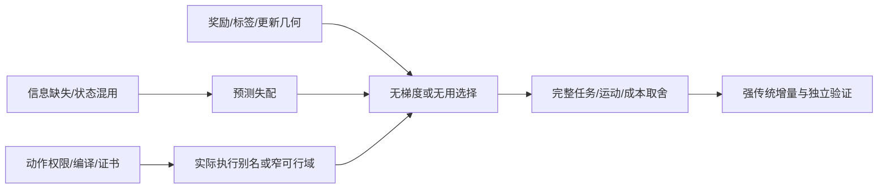

# 失败机制、证据与未解矛盾

当前核心问题不是“有没有训练”，而是训练产生的信息能否在同权限、完整任务和强传统对照下形成可靠的执行增量。已有失败包含接口/合同、动作可行性、信用分配、预测目标、风险支持和泛化六层；不能全归于一个算法，也不能用低力失败轨迹制造成功。

本文的“确认”限现存源码与指定MuJoCo实验。未做真机/患者验证；历史报告和本次远端复现分别记录。原始阈值与失败保留，本文不提出本轮修改或训练。

## 1. 总体因果链

此图是整理框架，不是单个统计因果模型。每个箭头是否已验证，须按以下案例判断。

## 2. 已确认或有明确限定支持的机制

|机制|实际证据|能够得出的结论|仍不能得出的结论|
|---|---|---|---|
|动作proposal被certificate/准入屏蔽|v5旧PPO出程modal与负时序pattern实际reference/物理相同|参数不同不代表执行不同|所有学习失败均由准入造成|
|参考交接q保持而dq非零|v5 issued/activated/receipt与native/wrench邻窗；提前降pass speed干预|合法执行前协调可降低部分真实jerk和波动|交接独占所有jerk；更低jerk即患者舒适|
|clearance包络非光滑|v3/v4解析几何、函数重放、微参数真实分支及native torque|端点min连续但不可微，差分跨支可放大曲率并影响实际修正|gap跳变；数值曲率等于真实人体加速度；新guard已安全替换|
|H前已发生不可逆motion失败|v5出程H前峰值；v6absorbing接口|低tail成本不能抵消过去极值|observer峰值足够完整预测原native资格|
|Critic状态缩放/覆盖不足|v5训练恒定时钟scale .001导致15ms外推；敏感性查询|缩放确有影响但不足修复选错|删除时间便解决问题；更大网络自动有效|
|错误独立分组|v6 O3与TAILOT真实父状态相同；job名不同|CV/新状态必须按实际prefix去重|新seed/配置字符串等于新患者|
|Beta失败reward塌缩|v8首批16条motion失败、r=−1、batchmean后零adv/梯度/位移|该批原目标无策略梯度信号；余量可恢复非零梯度|PPO家族无效；非零梯度必然完成任务|
|共享参数跨context更新干扰|v8同四行为数据的Gram/方向分解，LOO与几何修正|条件baseline本身不消除特征耦合|几何修正保证所有新context同向改善|
|拟合目标优化不足且不充分|v8 terminal SAC同凸目标精确解下降约98.17%，控制仍不及原actor|原solver有缺口；修solver不能单独保证控制|所有SAC失败；更深/更长训练没有价值|
|短训练时间域外推|v8 matched E2同8点/初始化，DFull改善长时预测|训练覆盖是严重外推误差的一个真实因素|已获得可合法闭环规划的World Model|
|冷部署schema遗漏|v8 E2真实外层model/normalizer与旧adapter不符|synthetic数学parity未覆盖真实序列化路径|模型数学失效；canary通过等于新条件控制成功|

来源：[v3](research_archive/packages/representation_execution_v3/REPORT.md)、[v4](research_archive/packages/constraint_geometry_learning_v4/REPORT.md)、[v5](research_archive/packages/smoothness_critic_research_v5/REPORT.md)、[v6模型审计](research_archive/packages/smoothness_critic_integration_v6/CRITIC_MODEL_AUDIT.md)、[v8 PPO](research_archive/packages/deep_learning_method_exploration_v8/PPO_REWARD_RESULTS.md)、[v8动力学](research_archive/packages/deep_learning_method_exploration_v8/LEARNING_ASSISTED_OPTIMIZATION.md)。

## 3. 原guard：几何、数值和闭环不能合并

袖套最低端点包络可写为：

\[
g(q)=s(q)-L|a_z(q)|.
\]

它连续，在轴水平处不可微；原方向二阶差分h=10μs跨端点模板，v3的C19/PPO9数值曲率分别约−1432.356/−449.598m/s²。该量进入shortfall/加速度box、filter/allocator及实际torque，对原motion确有影响。这是计算曲率，不是同数值的真实人体加速度。

v3小微扰物理分支与负对照支持机制：C19的±.0001参数仍失败，±.001避开跨模板而过；很小JF变化对应jerk大变化。但没有仅替换曲率的物理中介干预，故不能断言唯一原因。v4双光滑端点证明点态等价与解析导数，却仍缺采样间保护、observer误差、最终饱和torque响应和可行backup；替代guard物理NOT_RUN。[几何与合同](research_archive/packages/constraint_geometry_learning_v4/CLEARANCE_GEOMETRY_ANALYSIS.md)、[双端点保护缺口](research_archive/packages/constraint_geometry_learning_v4/DUAL_ENDPOINT_CONSTRAINT_STUDY.md)

## 4. 为什么低JF不等于更好控制

原合同是多门约束：task、HOLD/端点、motion/dose、receipt/native因果与safety分别评估。JF/JM为完整TASK measured wrench 5ms左积分；原native motion不滤波、不删瞬态。部分低force点jerk RMS或excursion失败，必须保留原完整积分但排除成功排名。

v1 `OPTIMIZATION_B_013/C_015` 完整JF=1400.530418，但原jerk RMS门失败；预测/physics负荷排序不能替代motion资格。v5 COMPOSE改善jerk/wrench波动，相对strong JF约+8.058633、JM约−1.904880；不能称所有负担全面下降。v4局部force更低也增JM。更低力、平顺、治疗等效和完整原资格不是同一目标。[v1反例](research_archive/packages/learning_guided_motion_improvement_v1/REPORT.md)、[v5原表](research_archive/packages/smoothness_critic_research_v5/MOTION_FORCE_MOMENT_TRADEOFF.md)

## 5. Critic的三个结构限制

第一，标签是指定continuation的value。v5当前一次干预后回B；v6使用COMPOSE后续时必须匹配upstream。B上游直接接COMPOSE后续的15个完整候选全部excursion失败；改变后续不是换一个标签名称即可。第二，候选H状态及short成本通常已由真实仿真获得，尚无廉价合法预测器，因而没有实际省去菜单物理。第三，风险头不能把相关窗口当独立患者。

v6风险CV的1281窗口来自12父状态族，仅3族含失败，混淆计数TP18/FN32/FP14/TN1217；出程12个失败窗口、HOLD6个全漏检。高总体准确率不能掩盖低支持失败域。旧临时jerk max_abs标签错误已封存，未进入operative测试；原jerk门为RMS/p95。已有risk分数、ensemble分歧与OOD距离均未校准为安全概率。[状态审计](research_archive/packages/smoothness_critic_integration_v6/CRITIC_STATE_AND_LABEL_AUDIT.md)、[模型及错误标签审计](research_archive/packages/smoothness_critic_integration_v6/CRITIC_MODEL_AUDIT.md)

## 6. PPO为何不稳定：已知与未知

旧41D多seed从50到80集出现冻结退化，执行层reference回退/准入差异有证据；唯一优化/奖励根因尚未识别。动作正态采样、Box clipping和实际接受分布必须分开，actor mean通过不能推出stochastic可靠。STD消融有实际资格差异，但不是普遍安全或最佳STD定理。[050/080](research_archive/packages/rl_b_matched_recovery_stability_v1/REPORT.md)、[STD实际配对](research_archive/packages/rl_b_std_ablation_handoff_v1/REPORT.md)

v2 modal8旧reward未在正确strong anchor下饱和，错误B anchor推论已被精确重放否定。v7私有Adam八步只诊断更新方向/尺度，没有新fresh rollout或部署checkpoint。v8Beta零梯度则有精确机制：

\[
r_i=-1\ \forall i\ \Longrightarrow\ A_i=r_i-\overline r=0\ \Longrightarrow\nabla L=0.
\]

这个结论限该批及baseline，不等于所有失败奖励必然零梯度。gain20对固定failure floor无作用；可行性margin给出信息，却不自动找到完整合格动作。在已曝光开发两条件的固定网格/旧采样点上没有合格非B支持，有限点覆盖仍不能证明整个连续域不可行。[reward与更新原记录](research_archive/packages/deep_learning_method_exploration_v8/PPO_REWARD_RESULTS.md)

## 7. 学到信息仍不胜强传统的原因

以下为证据支持的解释组合，不是唯一根因：

- 低维局部同父问题可被pattern、二次面或固定phase覆盖；v1GP与physics prior同最佳，v7GP/quad同提案。
- 上层可行权限小且有执行平坦区、离散证书和窄motion边界；光滑名义cost改善与实际资格可能脱节。
- 输入包含有效commissioning参数，但真实独立context很少；同父多候选和时间窗口不增加患者数。
- 模型降低成本误差或改变分数，却同选固定H/B；context个体化可能没有被当前标签识别。
- 合格/低JF/低JM/平顺性目标并不一致。BO严格JM不增加、ILC允许JM取舍时，不能作同目标优劣结论。
- 泛化评价常受权限、activation、continuation和state alias混杂，须先对齐合同才能解释算法差异。

## 8. 必须保留的矛盾和未知项

|事项|保留的最终口径|
|---|---|
|“PPO没学会任务”与pilot成功|旧PPO有有限任务信号/冻结成功；强传统完整增量与稳定泛化尚未立|
|“History从未实施”与更早side-study|更早确有History Value/ILC/BO；主要weights/raw部分缺档，性能仅SUPPORTED|
|v8 BC主法滚动面板冲突|精确fit manifest和helper证实主法OLD_NORM1/2；NEW_DEV_NORM0/2另列|
|Neural Q早期2/2、最终1/2|不事后改主端点；E200为固定最终主法|
|O3新状态声明|实际prefix与训练父别名，降为重放，原FAIL审计保留|
|v8Beta第二批父前缀|commissioning人加速度/session clearance/active sleeve gap三scope UNKNOWN；pending未取消未提交，不能回填安全PASS|
|新recipe applicability避开断言|能避开本次中止，仍可能motion失败；不是通用安全修复|
|理论可重建与归档复现|旧报告成功不等于本次clean-clone运行通过；最终逐项核验记录|

相关更正集中见 [v8最终报告](research_archive/packages/deep_learning_method_exploration_v8/REPORT.md)、[历史缺档审计](research_archive/packages/autonomous_learning_smoothness_v7/agent_reviews/rl_history/HISTORY_VALUE_ILC_BO_AUDIT.md)。

## 9. 决定下一研究前必须回答的问题

先找到至少两个完整合格动作，其相对收益随合法可得context或已完成history发生可重复排序翻转，再问模型是否能预测并改变有用选择。若固定动作或简单规则已等效，继续扩网络无法构成独立证据。对需要探索的方向，先补可行支持、累计失败可观测性、标签/后续策略和净成本合同；不以当前局部最小值宣称全局理论上限。
