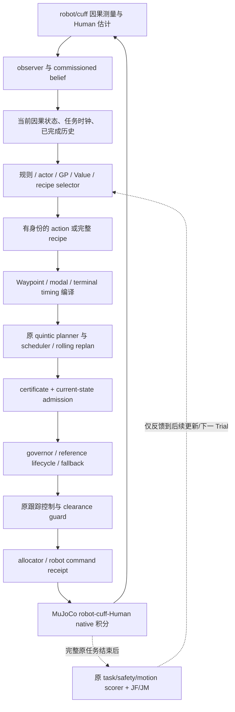

# Learning 实际架构与数据合同

本项目的 Learning 已多次真实训练、生成动作并进入 MuJoCo 执行；尚未建立稳定超过强传统方案的独立增量。它的主要接入位置是**高层参考提案、完整策略配方选择和成本/风险预测**。原机器人 torque 执行链仍由传统控制负责。本文依据源码重建调用关系；历史仿真结果与本次归档复现须分开，以 [ARCHIVE_VERIFICATION.md](ARCHIVE_VERIFICATION.md) 为本次核验结果。

## 1. 先分清三类系统

|系统|实际决策|输入与输出|不能混用的语义|
|---|---|---|---|
|早期 RL-B native-event PPO|在原 planner request 事件发生时决策多次|41D 因果观测 → 两关节独立 progress fractions|不是 torque policy；不是父类旧 50ms 进度控制；不是 modal8|
|v1–v7 协调/平顺性系列|局部参数优化；一次承诺完整 modal；或指定 slot 的一次干预|固定父上下文/合法估计 → 2D、18D、modal8 或完整 recipe|动作权限、激活时点、后续策略各不相同|
|v8 方法家族|大多在 OUT0 选择一次完整 recipe；部分连续 Trial 更新|commissioned25/KIN33/WRENCH39 → 离散 recipe、Beta 标量 λ 或下一次 x3|一次决策的终末 Q/SAC 不等于多步 Bellman/TD；旧41D评价桥未因新接口而自动闭合|

实际旧训练入口是包根目录的 [pilot_run.py](research_archive/packages/rl_b_first_ppo_pilot_v1/pilot_run.py)、[pure_rl_env.py](research_archive/packages/rl_b_first_ppo_pilot_v1/pure_rl_env.py)、[native_rl_env.py](research_archive/packages/rl_b_first_ppo_pilot_v1/native_rl_env.py)。同包 `source/.../online_gym.py` 为 47D、零 reward 的接口 smoke，不能拿它描述真实 41D PPO。

## 2. 从 Learning 到实际执行



上层 proposal 可能被拒绝，可能等待 activation，也可能落成与另一参数相同的执行。必须分别核对 proposal、issued reference、admission、activation、positive-step receipt、实际 torque、Human 响应。候选参数变化、模型权重变化或 JF 相近均不能代替执行证据。

某些历史 receipt 的 request ID 实存 null；不能将两个 null 当作唯一 join key。可用 learning interval、activation、q/dq reference 和 native ownership 支持有限区间联系，但不能补造逐请求归属。[v7 接口与原限制](research_archive/packages/autonomous_learning_smoothness_v7/LEARNING_CONTROL_INTERFACE_GUIDE.md)

## 3. 状态到底是什么

### 3.1 41D native-event 状态

`PureCoordinationEnv._observation` 组合 observer Human q/dq、测量 robot q/dq、当前 owned reference q/dq/ddq、phase one-hot、公开目标、task/phase 时钟、measured force/moment、前次 raw action/intent/拒绝及 source age，使用固定物理尺度归一化。native Human 真值、未来 torque/receipt、完整任务结果不进入 actor。`NativeProposalEnv._callback` 继承这一观测，覆盖决策节奏与动作回调；不能直接按父类 `_callback` 的周期映射解释实际训练。

### 3.2 OUT0 的 commissioned25 与扩展状态

v8 基础顺序为：

```text
beta11 → effective geometry4 → residual weights10
```

geometry4 为 hip plane x/z、thigh length、knee-to-cuff effective distance；residual 为 hip/knee 各五个基系数。33 项 QA 是来源、可得性和拟合质量说明，不自动成为 actor 特征。更丰富的合法 KIN33/WRENCH39 必须绑定对应实时捕获与验证器。

完整 77D helper 在部分 OUT1 payload 有效，在 OUT0 缺已发 reference/TASK history 等字段而继续 **INVALID**。合法25D不能把77D改判有效；不得补零或从未来填齐。beta 是受先验、ridge、边界与限幅影响的有效参数，不等于无偏恢复人体参数；effective geometry 不能拆分真实 shank 长度和 cuff 比例。[源接口](research_archive/packages/deep_learning_method_exploration_v8/families/critic_value/source/value_api.py)、[字段来源与限制](research_archive/packages/autonomous_learning_smoothness_v7/LEARNING_CONTROL_INTERFACE_GUIDE.md)

### 3.3 Critic 的 H 状态

v5 在候选执行 H=0.5s 后捕获 100D 合法状态，含估计、reference/active suffix、scheduler/governor、belief、上次执行增量和 pending 等执行记忆。v6 扩为126字段，增加过去 measured JF/JM、observer 差分峰值、q范围及已完成 guard/refusal/fallback 历史。observer 差分峰值不是原 native motion 真值，完整状态充分性仍未证明。

v6 真实选择入口是 [v6_selection.select](research_archive/packages/smoothness_critic_integration_v6/source/v6_selection.py)，而不是 `v6_model.py` 中遗留的旧 `select`。它只读因果输入和已发生 short JF；风险/OOD 不支持时 ABSTAIN；已知原合同失败为吸收状态，低未来成本不能清除过去失败。[状态/标签审计](research_archive/packages/smoothness_critic_integration_v6/CRITIC_STATE_AND_LABEL_AUDIT.md)

## 4. 动作权限与实际映射

### 4.1 两 progress fractions

每维 `a∈[-1,1]` 转为 `(a+1)/2`，乘原 planner 在当前 native request 允许的最大 normalized progress，再由当前 internal goal 的剩余进度截断。原 HOLD、certificate、admission 和 fallback 保留；actor 无法用一个值直接跳过 dwell。[实现](research_archive/packages/rl_b_first_ppo_pilot_v1/native_rl_env.py)

### 4.2 局部协调、modal8 与时序

v1 将冻结 H150 的18D differential 系数1、6各加 `0.002*x_O/R`。v2/后续 modal8 的去/回每相位包含 common path、relative path、局部时间和 pass speed；归一化参数通常 `[-1,1]`，局部幅度路径0.30°、时长±8%、通过速度±12%。逐关节 endpoint lock 和 retiming compiler 会影响真实可执行族；“8个方向参考有差异”不等于在18D外新增8个全局独立维度。

v3 证明新编译权限存在，但旧完整18D有近性能合格替代；v4 的 endpoint lock×duration compiler 因子进一步区分权限影响。不能把权限扩展的收益归于 Learning，也不能从拟合没找到运动推断其不可达。[v2表示/实际执行](research_archive/packages/autonomous_coordination_learning_v2/REPORT.md)、[v3构造证据](research_archive/packages/representation_execution_v3/REPORT.md)

### 4.3 v8 完整 recipe 与标量 Beta

离散 recipe 包含 action、candidate overrides 后的基配方、激活时点、FROZEN_18D、参数映射和 planner/source 身份。仅相同 tag 不构成同动作。categorical policy 使用合法上下文经线性 softmax 选择一个完整 recipe；v8 fresh 分支使用五动作。

Beta 为一维 `λ∈[0,1]` 分布：缩放18D vector 和 posture，duration factor 按 `1+λ*(factor−1)` 插值；保留 T base、native residual plateaus、OUTBOUND repair factor=1.5，以及零 intent 条目。因此 **λ0 不是 B**，也不是18D联合密度；λ1与H150实际逐raw等效仍需实验验证。[精确映射](research_archive/packages/deep_learning_method_exploration_v8/families/ppo_reward/continuous_scale_v1/axis_mapping.py)

## 5. 训练、rollout、评分与反馈

原任务典型为19.03s，OUTBOUND/HOLD/RETURN=9.005/1.020/9.005s。保持原 measured cuff wrench 5ms 左积分：

\[
J_F=\sum_{k\in TASK}\|F_k^{measured}\|_2\Delta t_k,\quad
J_M=\sum_{k\in TASK}\|M_k^{measured}\|_2\Delta t_k.
\]

原 motion 使用未滤波0.25ms native 信号与原求导/比较器。reference jerk、5ms估计 jerk、4kHz measured wrench 辅助分析均需单列。JM/B≤1.25的资格门允许一定JM增加，不是“双成本下降”。完整 motion PASS 也不是临床舒适度或实时资格。[v8合同](research_archive/packages/deep_learning_method_exploration_v8/EXPERIMENT_CONTRACT.md)

```text
freeze(input schema, action family, model, objective, continuation, scorer)
commission legal parent; capture current causal payload
for proposal in registered sequence:
    freeze proposal and prediction identity before START
    run original planner → admission → governor → guard → MuJoCo
    retain rejected / fallback / partial / complete outcomes
    join owner; independently score complete raw
    record START/END, actual new native steps, physical and compute costs
    update only from this arm's completed feedback
freeze predeclared endpoint; evaluate on new legal state without retuning
```

Linux live-address-space fork 确保同父反事实所需的 observer/RNG/pending/scheduler 状态；它不是跨机器可持久化恢复，不是患者可复制的未来。父保持静止、child唯一owner和真实新增native步要一起审计。不能仅从 q/dq 重建同一活状态。

### 5.1 真实训练机制

|实现|训练与标签|
|---|---|
|旧41D PPO|SB3 32×32 actor/value，完整episode transition；4 epochs、batch16、gamma1、GAE .95、clip .2；奖励含进度、成功/失败、JF和估计加速度成本；v3失败成本下限在训练前冻结|
|v2 modal8 PPO|单固定context，tanh对角Gaussian的8维mean/std及标量value；一完整任务一个RL决策；精确变换logprob，Adam与KL停止；完整合格reward `5*tanh((JF_strong−JF)/5)`，失败另罚|
|v8 categorical RF/PPO|线性softmax；fresh on-policy和offline table明确分账；REINFORCE一epoch、PPO三epoch，clip .2、lr .15、gradient norm≤1；没有另一个value loss或Adam|
|v1 GP / v2 BO|完整已完成轨迹的JF/JM、motion/完成标签；对proposal做预序预测后再更新；固定同父context不学习跨患者泛化|
|v5/v6 Critic|完整真实后缀监督回归；预测tail JF/JM/时间，绑定后续B或COMPOSE策略；风险独立训练；不是Bellman或全局最优value|
|v8 terminal SAC/Q|一决策 `done=True,next_state=None`，Q target为终末reward；独立risk/JF/JM heads；没有多步bootstrap|
|v8 BC/context aggregation|从已执行菜单的教师选择监督分类；OUT0上下文聚合，未进行逐访问状态的DAgger交互|
|v8持续 ILC/BO|同一plant连续Trial，上一trial已完成的估计误差投影为下一x3；BO用同父action−H150分量差；含boundary探索成本|

源码依据：[modal PPO](research_archive/packages/autonomous_coordination_learning_v2/source/acl2_ppo.py)、[categorical](research_archive/packages/deep_learning_method_exploration_v8/families/ppo_reward/categorical_policy.py)、[terminal SAC](research_archive/packages/deep_learning_method_exploration_v8/families/il_dagger_sac/discrete_sac_v1/source/terminal_discrete_sac.py)、[GP](research_archive/packages/learning_guided_motion_improvement_v1/source/optimizers.py)。

### 5.2 Critic 公式的适用条件

\[
\widehat C(a\mid z_0,\pi_c)=C_{0:H}^{actual}(a)+\widehat V^{\pi_c}(z_H(a)),\qquad\gamma=1.
\]

`π_c` 是冻结后续策略身份。v5 的B后续和v6的COMPOSE后续不混标签。当前比较往往需要**先真实执行所有候选到H甚至完整tail**；没有廉价合法 `z_H(a)` 预测器，故不是已经部署的实时MPC critic，也未实际省去这部分物理。

## 6. 建议保留的数据结构

下列为文档化接口，实际键名以各包源码为准，不声称已存在统一SDK。

```python
CausalContext = {"time_s": float, "phase": str, "feature_names": list,
                 "values": list, "qa": dict, "truth_used": False}
Proposal = {"action": dict, "recipe_sha256": str, "policy_sha256": str,
            "continuation_policy": str, "predicted_before_start": dict}
Outcome = {"complete": bool, "original_qualified": bool,
           "JF": float | None, "JM": float | None, "motion": dict | None,
           "failure_reason": str | None, "actual_new_native_steps": int,
           "receipt_paths": list, "source_config_scoring_identity": dict}
```

工程建议是将这些身份与原runtime联接，而非删减旧模块或以新接口改写历史结果。重新启动时先运行 [REPRODUCTION_GUIDE.md](REPRODUCTION_GUIDE.md) 的固定传统复现，再加载一个已冻结Learning接口；本轮不启动新训练。

## 7. 归档提供的已训练接口smoke

[deployment/check_learning_interface.py](deployment/check_learning_interface.py) 使用冻结已训练的 [VALUE_FAMILY_V1_FROZEN.json](research_archive/packages/deep_learning_method_exploration_v8/families/critic_value/models/VALUE_FAMILY_V1_FROZEN.json)，实际调用原 `value_api.predict`。输入为原EARLYN01_B捕获的25D context精确副本，移除数据行中的标签，只保留context与来源指针；fixture、源码、checkpoint三者均校验SHA。

```bash
python -B deployment/check_learning_interface.py --repo . --output /tmp/ihear-value-interface-001
```

`--output`必须是新目录。结果记录输入shape、feature names、真实分量/risk/support预测、所选recipe或ABSTAIN、模型身份与0训练/0物理。归档准备时已在仅含上述三份文件的干净临时目录，用全新科学环境实际通过：shape=[25]，JF_QUALIFIED选择EARLY_PHASE，STRICT_JM选择B。这是**训练context的已训练接口重放**，不是独立新状态、完整控制或物理资格；最终远端clone的对应核验仍以 [ARCHIVE_VERIFICATION.md](ARCHIVE_VERIFICATION.md) 为准。
