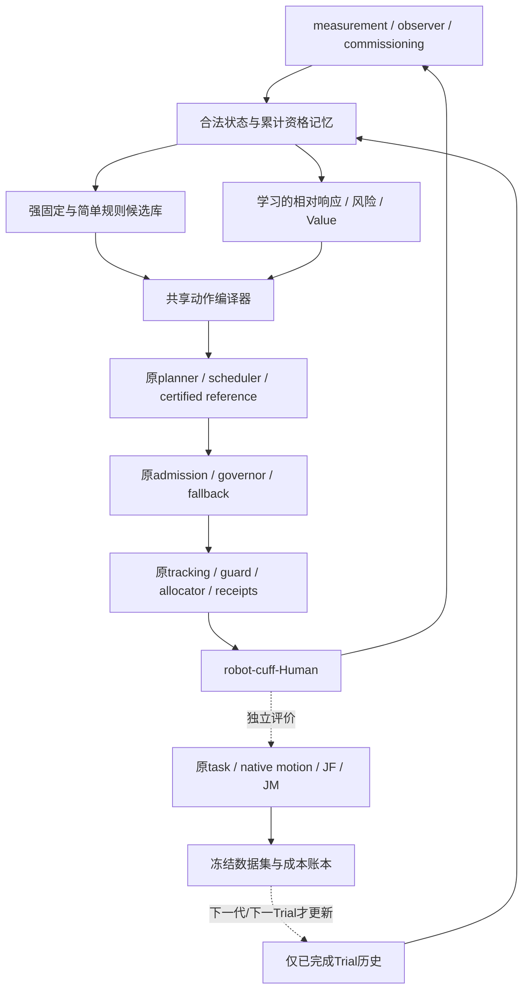

# 下一代架构：待和教授讨论的研究假设

本文件是设计讨论，不是本轮新增算法、训练或安全资格。传统固定方案、完整MuJoCo模型与原评价逻辑是重启起点；先完成 [REPRODUCTION_GUIDE.md](REPRODUCTION_GUIDE.md)，再决定是否立项。已测局部方案不等于全局理论最优，当前学习无增量也不能推出整个Learning家族无价值。

## 1. 研究问题先于模型名称

建议将中心问题表述为：**在相同治疗任务、动作权限和原安全/运动合同内，合法可得的当前状态与少量已完成历史，能否帮助选择比强固定/简单规则更好的完整动作，并减少累计尝试负担？**

目前已知：传统执行前协调能改善真实jerk/wrench波动但有JF/JM取舍；少量模型能预测部分成本，未建立稳定独有收益。v6 Critic相对强phase实际选择差异0/4；v8多类模型同选B/H，真实ILC不胜固定−.25。因此下一代第一道门应是“有无可学习且有用的状态相关排序”，不能只定义更大网络。[v6证据](research_archive/packages/smoothness_critic_integration_v6/REPORT.md)、[v8结论](research_archive/packages/deep_learning_method_exploration_v8/REPORT.md)

## 2. 建议保留的控制分层



**假设A：** Learning优先预测相对响应和适用域，控制可执行性仍由明确编译器与原执行层裁决。不能将未校准risk替代原门。将来若讨论Learning直接控制torque，应另立模型、传感与执行安全合同，当前证据不支持直接继承资格。

## 3. 先把动作编译变成清楚的研究对象

当前proposal经过quintic、scheduler、retiming、endpoint lock、certificate和admission后才形成参考，可能被屏蔽或与其他参数合并。v3/v4已经证明新旧表示含编译权限变化。建议将“想做什么”和“允许签发什么”分开记录，但使用同一原执行链：

\[
a^{intent}\xrightarrow{\mathcal C(z,\cdot)}
(r_{issued},T_{issued},v_{pass},status),\qquad
u=\mathcal E(z,r_{active},receipt).
\]

`𝒞`需给出endpoint、duration下限、certificate拒绝和fallback原因；`ℰ`保留原torque/receipt ownership。比较算法时共享 `𝒞` 和同动作box，完整recipe包含activation与continuation身份。仅比较参数维数不足以证明公平。

**待验证假设B：** 分支/编译感知响应模型可能比光滑名义cost更能预测真实资格。先检验相同intent是否产生相同issued reference，是否存在可学习的离散切换；不要把已知compiler逻辑全部交给网络重新拟合。

## 4. 状态：估计可得、历史充分与真值隔离

建议的研究状态写成：

\[
z_t=(\hat q_t,\hat{\dot q}_t,w_t,r_t,
\hat\theta_{comm},mode_t,receiptMemory_t,
qualificationMemory_t,h_{completed}).
\]

这是候选schema，非已验证Markov充分状态。应逐字段注明数值、单位、source time、可得性和质量；缺失保持None/UNKNOWN。完整77D在OUT0无效的历史不能被新schema遮蔽。native truth继续只作监督/独立评价。

**待和教授讨论：** 原motion包含native RMS/p95、excursion、累计travel和阶段边界量，哪些能从真实传感器以可接受频率可靠估计？若原门只能离线真值计算，实时风险模型只能提供有限建议；须明确其误差和无法观察的范围。累计已知失败应吸收，不能由更低value“赎回”。

## 5. 学什么：差值、分量和失败支持

建议先研究同父、同权限的分量响应：

\[
\Delta\mathbf J(z,a)=
(J_F(z,a)-J_F(z,a_0),\ J_M(z,a)-J_M(z,a_0)),
\]

并单独预测运动/执行资格。common prefix offset不应由模型误学成动作收益；直接delta-wrench取范数不等于delta-JF，不能借真实未来B轨迹部署。

候选比较至少包含：固定强动作、最强phase rule、同权限pattern/二次面、history-disabled、nearest/simple threshold、学习模型。风险与cost目标分开；完整失败保留成本与原因，partial不造完整标签。当前风险分数和ensemble spread都未校准。[v8Value API语义](research_archive/packages/deep_learning_method_exploration_v8/families/critic_value/API_GUIDE.md)

**假设C：** 只有当动作优势随context/history真实翻转且简单规则不能解释时，复杂学习才有明确增量空间。若所有case成本最低都为固定H，而motion只决定回B，则首先比较“H-else-B”规则，而非默认引入长期RL。

## 6. 何时需要Value、Policy和World Model

|候选方向|立项前应有的缺口|合理最小比较|当前未具备的证据|
|---|---|---|---|
|有限recipe Value/ranking|至少两个合格动作存在状态相关排序|paired ridge/quad、nearest、固定phase、风险单独校准|超强简单规则的稳定选择价值|
|多决策Value/TD|同一任务有后续可控策略造成的真正序列credit gap|明确continuation/absorbing失败、短窗与固定完整策略|Bellman/TD/FQI实际闭环收益|
|PPO/连续policy|存在足够合格支持、reward能区分动作，且监督/BO不足|固定同轴、同权限传统搜索、raw/margin reward、sample/mean分别评价|多方向稳定收益及完整41D公平桥|
|ILC/少次history|同plant重复条件可靠，历史误差和目标负担响应可识别|KEEP、disabled、fixed±扰动、boundary累计成本|force梯度/收敛、少次试验净收益|
|受约束BO|可量化患者内响应噪声、独立可行性支持|同预算pattern/quad、cost/风险分开、弃权有成本|校准约束与真实净省试|
|World Model/MPC|合法候选未来reference及模式/receipt状态能预测，长时误差可控制|运动学/持久值、direct horizon、matched coverage、固定H-else-B|概率模型/规划闭环、合法推理与收益|
|BC/DAgger/SAC|teacher/数据覆盖不足是已识别瓶颈|matched teacher/normalizer、真正访问状态聚合、同Q actor/greedy/soft|逐步DAgger、连续多步SAC|

模型家族选择依赖上述缺口，不能以方法名称替代问题定义。v8 E2是conditional trajectory surrogate；升级成闭环World Model需额外证明状态转移、控制条件、自由展开、误差/不确定性和真实决策价值。[E2证据](research_archive/packages/deep_learning_method_exploration_v8/LEARNING_ASSISTED_OPTIMIZATION.md)

## 7. 真实连续Trial的建议合同

保持同一plant/observer/updater，经明确inter-trial boundary继续，禁止由外层B或q/dq重建冒充本臂真实末态。下一trial只使用前trial已完成历史；模型/normalizer/disabled population来源事前冻结。

最小记录：T1/B初始成本、T2已执行动作与原完整资格、boundary的force/moment/native成本、T3 KEEP/固定/disabled/learning结果、所有失败和最终累计负担。fork是仿真反事实工具，实际患者没有同状态复制；若研究“只需两三次运动”，必须按真实可执行顺序统计总试次，不能把离线几十个fork标签藏在离线训练之外。

v8投影ILC是合法第一步，但 `force_gradient_identified=False`；其参考误差减小与JF梯度需分开。是否值得识别低维force/JM响应，还是先选固定动作，是具体可讨论问题。[现存投影](research_archive/packages/deep_learning_method_exploration_v8/families/history_conditioned/modal_ilc_projection_v1.py)

## 8. 评价和停止门

建议保留七层证据：实现正确 → 学到信息 → 改变实际执行 → 完整原门 → 强传统增量 → 新合法条件 → 包含训练/失败/恢复的净效率。每层有独立PASS/FAIL/UNKNOWN；不要自动升级。

最小前瞻协议：

```text
1. 固定传统复现与全部评价合同
2. 在开发集检查动作权限、可行支持、真实状态相关排序
3. 冻结输入/归一化/动作/目标/teacher/主端点/continuation
4. 使用真实采样的数据或明示offline数据；所有成本计账
5. 冻结模型后打开新参数/合法prefix，保留全部失败
6. 比较强固定/同权限规则/disabled及学习；不事后挑checkpoint
7. 若无额外决策价值，记录限定负结果并停止该变体扩张
```

新case必须核对实际模型/commissioning/native prefix指纹；标签、seed、case key和job名不同不足证明独立。训练集已经读过的stock-case不再充当后训练模型的独立测试。临床舒适度、治疗等效性、硬件安全和host实时另立验证，不从仿真门继承。

## 9. 和教授优先讨论的五项决定

1. 主科学目标是JF、JM、平顺性、治疗等效，还是少次适应的累计负担？允许何种Pareto取舍，原motion非劣门的生物/临床依据是什么？
2. 应先统一动作编译/执行资格，还是存在必须扩大表达的具体任务缺口？如何建立共同运动子族而非仅共同参数维数？
3. 是否存在真实合法context中两个合格动作的排序翻转？若没有，个体化Learning问题是否尚未形成？
4. 原native评价中哪些有真实传感器在线对应？风险模型在剩余不可观测范围下能承担什么角色？
5. 若要长期模型/多步RL，应如何明确continuation、未来reference、失败吸收态与实际试次成本，使复杂模型可被简单基线证伪？

本轮不执行这些提议；归档保证未来能重新搭建系统并据证据选择下一问题。
