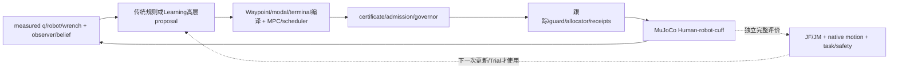

# iHEAR Lab 教授技术讨论简报

项目已形成一套MuJoCo Human–robot–cuff闭环研究系统。传统层有可执行的Waypoint/MPC、scheduler、rolling/replan、certificate/admission、governor、guard/fallback及完整原task/motion评分。Learning已在高层进度、协调参数、完整recipe、成本/风险和下一Trial更新上实际接入；**尚未建立稳定超过强传统方案的独立增量，亦未证明净省试**。所有结果为仿真；不是真机、真实患者或临床舒适度结论。

本简报区分历史研究证据与本次归档核验；clean-clone实测通过项目、仓库分支和SHA以 [ARCHIVE_VERIFICATION.md](ARCHIVE_VERIFICATION.md) 与 [FINAL_HANDOFF.md](FINAL_HANDOFF.md) 为准。

## 1. 当前系统如何工作

Learning不直接输出motor torque。proposal可拒绝、延迟activation或fallback，参数不同可能执行相同。评价保持原19.03s任务（9.005/1.020/9.005s），JF/JM为measured wrench范数5ms左积分；motion为未滤波0.25ms native。原JM/B≤1.25允许JM增加，不能称双成本都降低。[当前接口](LEARNING_ARCHITECTURE.md)

## 2. 哪些传统结果应作为讨论基线

没有跨条件/权限/全部指标的单一赢家。B、H150、低JF协调方案、HANDOFF、PATTERN、COMPOSE与固定phase各有适用范围：

|同一原名义开发合同中的身份|JF N·s|JM Nm·s|解释|
|---|---:|---:|---|
|B|1436.4565|101.2537|原motion比较分母；JM较低|
|H150|1402.6432|107.0723|强历史传统父；降JF并增JM|
|v2 BEST|1398.0346|107.9710|局部协调/回退方案；不是全局理论最优|
|v5 HANDOFF|1401.7564|107.7794|更低交接通过速度，改善实际平顺性|
|v5 PATTERN|1402.7257|106.1796|同权限传统搜索，平顺性/成本取舍|
|v5 COMPOSE|1406.0932|106.0661|进一步改善jerk/wrench，JF高于低力BEST|

这些数值来自各包明确身份的同链名义结果，不用于跨患者排行。v5名义COMPOSE相对BEST髋/膝native jerk RMS约下降7.53%/6.55%，4kHz力模长变化率约下降5.75%；相对JF却增加约8.06N·s。v6固定phase在两配对中相对COMPOSE平均ΔJF=−1.309722、ΔJM=−.152900，仍不等于对原B全面降低负担。[v5原表及合同](research_archive/packages/smoothness_critic_research_v5/REPORT.md)、[v6配对](research_archive/packages/smoothness_critic_integration_v6/REPORT.md)

主复现方案及其条件由 [TRADITIONAL_CONTROL.md](TRADITIONAL_CONTROL.md) 给出；不要把局部最小JF自动设为所有科研目标的最强基线。

## 3. Learning究竟做过什么

|方法|实际实施|关键结论|
|---|---|---|
|native-event PPO|41D因果观测→两progress fractions；pilot50集，后续三seed各80集|确有任务学习信号；继续训练可退化；完整强B/H150评价桥仍有历史缺口|
|v2 modal8 PPO|一完整任务一个tanh-Gaussian 8D动作，64个真实决策|末次mean原合格JF1399.918272，小幅胜旧strong，未胜本轮最强传统|
|GP/BO|v1二维prior+residual、v2modal8、v5平顺性、v7GP/quad|能改变选择/改善拟合，未显示同预算强传统外独立价值|
|Critic/Value|v5/v6真实tail回归、累计历史/风险，v8目标/状态/覆盖分解|可纠正短窗排序；v6对强phase实际动作变化0/4，独立增量0|
|History/ILC|更早history×action ridge/ILC/BO；v8真实同plant连续Trial|确实实施；部分早期weights/raw缺档；v8ILC有微小降JF但不胜disabled/固定−.25|
|BC/DAgger/SAC/Q|v8教师/归一化/上下文聚合、终末离散SAC、matched Neural Q|不是逐步DAgger或连续多步SAC；两新条件主BC/SAC/Q有限1/2，未立强基线增量|
|World Model方向|因果自由展开、直接时域、matched D4/DFull轨迹代理|完整训练时间域改善预测；尚无合法模型闭环规划或净收益|

数字与源码、标签、状态/动作、失败和未探索变体见 [方法历史](LEARNING_METHODS_HISTORY.md)。以上不同接口不能直接混排算法百分比。

## 4. 已找到的关键限制

**执行与可行性。** 参考编译、证书、endpoint lock、retiming和guard决定真实动作；光滑参数或名义inverse dynamics不足以代表闭环。clearance包络连续但不可微，原差分跨端点分支可影响实际torque/jerk。双端点点态等价已推导，采样间/最终actuator保护未闭合，故新guard没有物理替换。

**目标与信息。** 降低tail误差不能修复H前已失败的motion；低JF和低JM/低jerk不同。OUT0全77D缺字段，合法25D不能补成全状态。风险支持很少，v6相关窗口CV有明显漏检，不是安全概率。

**优化与决策。** v8Beta首批16个完整样本全motion失败，奖励均−1，减批均值后零advantage/梯度；margin恢复信号仍不等于任务收益。SAC同拟合目标精确下降约98.17%仍未改善控制，说明“优化得更好”与“选得更好”分开。多个模型最终同选固定H/B，未形成个体化决策。

**证据与成本。** 同父多动作、多horizon、job名或seed变化不能扩大独立患者数。critic菜单全部真实执行不算实际省试；fork只为仿真反事实，患者不能克隆。v8两新参数条件已实际执行，仍不构成患者总体泛化。[机制与未解矛盾](FAILURE_ANALYSIS.md)

## 5. 建议讨论的下一代问题

1. **先明确目标。** 研究主张要优化完整JF、JM、平顺性、治疗等效，还是少次适应的累计负担？哪些取舍可接受，原motion门的生理依据需要怎样补足？
2. **确认Learning需求。** 能否找到至少两个完整合格动作，其优势随合法context/已完成history真实翻转，而固定phase/简单规则不足？这是投入更复杂模型前的关键证据。
3. **分离编译与预测。** 保留共享可执行编译器，学习相对action响应与风险；先解决proposal→reference→receipt可追溯，再谈更高维policy。
4. **补在线可观测性。** 原native评分哪些可由真实传感器可靠在线估计？历史峰值、累计剂量与失效吸收态如何形成可部署记忆？
5. **按缺口选择模型。** 有序列决策缺口才讨论Bellman/TD；有可行支持与reward信息才扩PPO；有合法未来reference/模式模型才升级World Model/MPC；真实连续ILC须与KEEP/disabled/固定扰动及累计探索成本比较。

这些是待验证假设，不是本轮已实施方案。[下一代详细设计与判据](NEXT_GENERATION_ARCHITECTURE.md)

## 6. 归档后如何继续

先从远端独立clone并按复现指南加载MuJoCo模型、完成B与强传统完整任务、复算原JF/JM/native motion，再调用一个纯冻结Learning接口。选择研究问题后另冻结输入、动作、标签/reward、continuation、主端点、强对照和独立条件；保留失败、partial及所有探索成本。不要从旧checkpoint自动恢复未提交pending训练，也不要以本归档为新训练/服务器操作许可。
