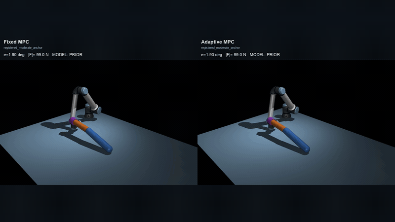
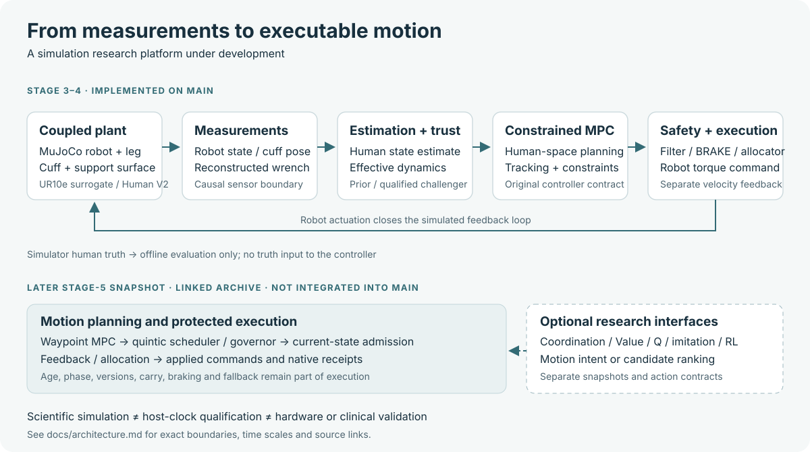

# Adaptive Traction MPC for Robot-Assisted Lower-Limb Rehabilitation

**Work in Progress · Simulation-Based Research**

A robotics research repository for lower-limb rehabilitation, combining coupled
human–robot dynamics, adaptive model predictive control, motion planning, and
learning-based control research. The long-term goal is to generate useful
rehabilitation motion while managing interaction loads under uncertain human
dynamics.

The project is still developing. Current evidence comes from MuJoCo simulation;
robot hardware, human testing, and clinical use have not been validated.

**Start here:** [Project overview](docs/overview.md) ·
[Architecture](docs/architecture.md) · [Development roadmap](docs/development-roadmap.md)

> **Where is Stage 5?** This branch contains the Stage 1–4 implementation.
> The later Stage-5 work and research packages are retained in the
> [2026-10-28 archive](https://github.com/Block-O2/adaptive-traction-mpc/tree/archive/research-closure-20261028).
> Use the [Stage-5 source and guide](https://github.com/Block-O2/adaptive-traction-mpc/tree/11af82a7ee35ae3c8e41e4b84d235a494b117d8d/stages/stage5_personalized_motion_learning)
> for that snapshot. These modules have not been merged into this branch.
> The archive records a research checkpoint; development of the overall project remains open.

## Simulation Demo



Existing Stage-4 MuJoCo visualization replay from saved simulation states,
showing the UR10e surrogate, Human-V2 leg, cuff, and support surface. This is
recorded simulation playback, not a live controller or hardware demonstration.
It does not show the later Stage-5 variants. See the
[media index and provenance](assets/README.md).

## Control Architecture



Stage 4 connects robot-facing measurements to effective-dynamics estimation,
trust-gated model updates, Human-space MPC, and robot torque execution. Later
Stage-5 research adds waypoint planning, quintic scheduling, reference
governance, and explicit plan admission/lifecycle checks. Optional learning
interfaces belong to separate research snapshots. The
[architecture guide](docs/architecture.md) explains these version boundaries
and the distinction between simulation time and host execution time.

## Current Development

| Module | Available work | Development boundary |
| --- | --- | --- |
| Coupled dynamics | Planar Human V2, full-3D robot surrogate, cuff and bed interaction models | Simulation models; physical robot/cuff calibration remains future work |
| Adaptive control | Stage-4 effective-dynamics estimation, causal trust, constrained MPC and regression tests | Historical simulation checkpoint; anatomical identification is not established |
| Motion planning | Stage-5 Human waypoint MPC, quintic scheduler/governor and protected execution chain | Available in the linked archive; integration into `main` requires separate review |
| Coordination and smoothness | Isolated 18D motion-intent studies and H150 schedule variants | Condition-specific research variants, not a unified final controller |
| Learning–MPC interfaces | Value/Q, imitation and RL research code, contracts and selected trained artifacts | Experimental; stable added benefit over strong traditional controls is not established |
| Execution timing | Scientific-simulation and host-clock studies, including recorded failures | No unified hard-realtime or hardware-qualified baseline |

The repository retains intermediate studies and negative results. A completed
stage checkpoint does not imply completion of the project. See
[research notes](docs/research-notes/README.md) and
[experiment navigation](docs/experiments/README.md) for the original context.

## Repository Structure

```text
README.md
docs/                         overview, architecture, roadmap, research navigation
assets/                       presentation figures and existing-media index
stages/
  stage1/                     Spring2D foundation, estimation and MPC
  stage2_linkage/              planar Human V2 and rigid cuff
  stage3_full3d/               full-3D UR10e surrogate and coupled plant
  stage4_adaptive_control/     adaptive estimation, trust, MPC and validation
```

| Stage | Focus | Entry point |
| --- | --- | --- |
| 1 | Single-link traction, state/parameter estimation, fixed and adaptive MPC | [Stage 1](stages/stage1/README.md) |
| 2 | Planar human–cuff–robot linkage | [Stage 2](stages/stage2_linkage/README.md) |
| 3 | Torque-actuated 3D robot surrogate and coupled Human-V2 plant | [Stage 3](stages/stage3_full3d/README.md) |
| 4 | Online effective dynamics, causal trust, constrained MPC | [Stage 4](stages/stage4_adaptive_control/README.md) |
| 5 | Personalized motion, waypoint planning and learning interfaces; archived snapshot | [Stage 5](https://github.com/Block-O2/adaptive-traction-mpc/tree/11af82a7ee35ae3c8e41e4b84d235a494b117d8d/stages/stage5_personalized_motion_learning) |

The archive also contains `deployment/`, `research/side_studies/`, and selected
`research_archive/` packages. They remain on that branch; a Stage-5 checkout
must use one complete snapshot rather than mix same-named modules across versions.

## Getting Started

For the Stage 3–4 packages on this branch, use Python 3.10 or newer in a separate
environment. Dependencies are declared in each stage's `pyproject.toml`;
MuJoCo rendering also requires a working graphics backend.

```bash
git clone --branch main --single-branch https://github.com/Block-O2/adaptive-traction-mpc.git
cd adaptive-traction-mpc
python3 -m venv .venv
source .venv/bin/activate
python -m pip install -e "stages/stage3_full3d[dev]" -e "stages/stage4_adaptive_control[dev]"
```

Start with existing tests for saved-artifact paths, media sources and frozen
configuration identities. These checks do not run a new controller rollout:

```bash
PYTHONPATH=stages/stage4_adaptive_control/src:stages/stage3_full3d/src:stages/stage4_adaptive_control \
  python -m pytest -q \
  stages/stage4_adaptive_control/tests/test_stage4_artifact_paths.py \
  stages/stage4_adaptive_control/tests/test_stage4_report_generalization_visualization.py \
  stages/stage4_adaptive_control/tests/test_stage4_report_generalization_config.py
```

Open the [existing GIF](stages/stage4_adaptive_control/results/media/readme/hero_fixed_vs_adaptive.gif)
to view the simulation without installing dependencies. Stage-specific tests,
replay tools and approved experiment commands are in the individual stage guides.
Historical result directories are preserved; new runs need new output locations
and the applicable experiment contract.

For later work, use a **separate checkout** of the archive and follow its
[reproduction guide](https://github.com/Block-O2/adaptive-traction-mpc/blob/11af82a7ee35ae3c8e41e4b84d235a494b117d8d/REPRODUCTION_GUIDE.md).
Its hashed CPU lock files target Linux x86_64 / CPython 3.12, and are separate
from the Stage 3–4 package setup above. Historical absolute paths, missing legacy
assets and platform limits are documented in the
[archive verification record](https://github.com/Block-O2/adaptive-traction-mpc/blob/11af82a7ee35ae3c8e41e4b84d235a494b117d8d/ARCHIVE_VERIFICATION.md).

## Roadmap

- Review a portable Stage-5 source/dependency closure before incremental integration.
- Qualify feedback service, planning latency, stale-plan handling and fallback
  together under a host-clock execution contract.
- Improve motion coordination and segment transitions while checking tracking,
  interaction load and smoothness over the complete task.
- Define learning inputs, actions and comparison budgets before evaluating
  whether learning adds useful capability to MPC.
- Prepare calibrated robot/cuff and safety interfaces as a later, separately
  authorized hardware phase.

These are development directions, not completed milestones. See the
[roadmap](docs/development-roadmap.md) for scope and open decisions.

## Research History and Reuse

[Stage-4 records](stages/stage4_adaptive_control/docs/research/CURRENT_STATE.md)
and the [research archive](https://github.com/Block-O2/adaptive-traction-mpc/tree/archive/research-closure-20261028)
retain their original conclusions, limitations and evidence identities.
No clinical efficacy, patient suitability or hardware safety is inferred from
simulation or desktop timing.

A project-wide license has not yet been selected. The vendored UR10e model
retains its [license](stages/stage3_full3d/vendor/mujoco_menagerie/universal_robots_ur10e/LICENSE)
and [provenance](stages/stage3_full3d/vendor/PROVENANCE.md); these notices apply
to that material and do not supply a license for the entire project.
