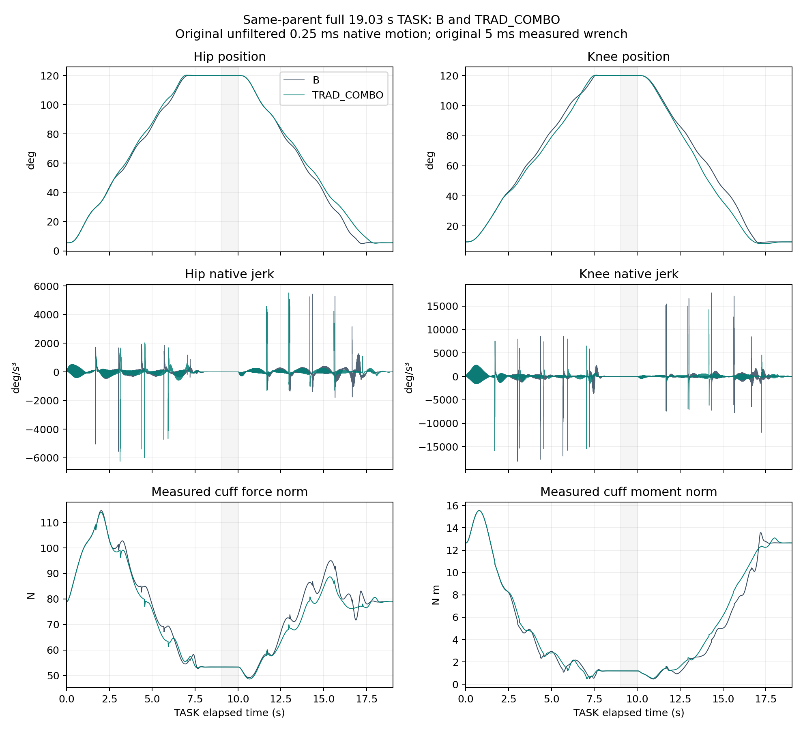

# iHEAR Lab — Research Closure & Reproducible Archive

这是 2026-10-28 的研究收束分支，用于重新搭建科研系统、复现传统控制、理解 Learning 的接入位置，并与教授讨论下一代架构。本轮没有新算法搜索或训练。所有主要物理证据均为 MuJoCo 科学仿真，不能作为真机、临床或硬实时资格。

当前可用的研究结论是：**受保护的传统控制底座能够运行完整任务；平顺性、JF 与 JM 存在条件相关的权衡；Learning 尚未建立稳定超过强传统与简单等效对照的独立收益。** 本归档保留正负结果及未解决矛盾，不宣称全局理论最优。

## 从这里阅读

|需要回答的问题|入口|
|---|---|
|系统实际如何运行、各层时钟和安全边界|[SYSTEM_ARCHITECTURE.md](SYSTEM_ARCHITECTURE.md)|
|B、H150、18D、固定阶段、HANDOFF/PATTERN/COMPOSE|[TRADITIONAL_CONTROL.md](TRADITIONAL_CONTROL.md)|
|Learning 在哪里产生什么动作，如何训练和进入执行|[LEARNING_ARCHITECTURE.md](LEARNING_ARCHITECTURE.md)|
|更早及 v1–v8 各方法的已做/未做范围|[LEARNING_METHODS_HISTORY.md](LEARNING_METHODS_HISTORY.md)|
|数值、曲线、完整轨迹与来源合同|[EXPERIMENTAL_EVIDENCE.md](EXPERIMENTAL_EVIDENCE.md)|
|失败机制、证据矛盾、评价权限限制|[FAILURE_ANALYSIS.md](FAILURE_ANALYSIS.md)|
|重新搭建并执行|[REPRODUCTION_GUIDE.md](REPRODUCTION_GUIDE.md)|
|下一代研究假设与教授讨论问题|[NEXT_GENERATION_ARCHITECTURE.md](NEXT_GENERATION_ARCHITECTURE.md)、[PROFESSOR_TECHNICAL_BRIEF.md](PROFESSOR_TECHNICAL_BRIEF.md)|
|保留范围、文件身份与遗漏|[ARCHIVE_MANIFEST.md](ARCHIVE_MANIFEST.md)|
|本轮实际核验、删除影响与交接|[ARCHIVE_VERIFICATION.md](ARCHIVE_VERIFICATION.md)、[DELETION_IMPACT.md](DELETION_IMPACT.md)、[FINAL_HANDOFF.md](FINAL_HANDOFF.md)|

## 主要复现目标

主要现代对照为 v7 `DEVPC02` 同父的 **B / V6PHASE / TRAD_COMBO**：B 的 JF/JM 为 1437.971420/100.829734，组合为 1405.935078/105.464006，均为完整 19.03s 原合格轨迹。组合对 phase 只有约 0.055 N·s 的局部降力，并伴随小幅 jerk 增加；JM 仍高于 B。它不是对所有条件、指标占优的总冠军。重型更早 H150 是另一个重要复现条件，保持其早启/晚启与 Human 的适用范围。历史 D01R B/H150 全 raw 与原 scorer 继续保留。



Linux x86_64 / CPython 3.12，CPU 即可。先安装系统 venv/EGL/GL 依赖，再在干净 clone 中执行：

```bash
bash deployment/install_rl_b.sh /tmp/ihear-archive-env
/tmp/ihear-archive-env/bin/python deployment/archive_checks.py --output /tmp/ihear-static.json
/tmp/ihear-archive-env/bin/python deployment/check_models.py --output /tmp/ihear-models.json
/tmp/ihear-archive-env/bin/python deployment/score_b_h150.py --work-dir /tmp/ihear-offline
/tmp/ihear-archive-env/bin/python deployment/reproduce_original_b.py --repo . --output /tmp/ihear-original-b
/tmp/ihear-archive-env/bin/python deployment/reproduce_trad_combo.py --repo . --output /tmp/ihear-combo
/tmp/ihear-archive-env/bin/python deployment/reproduce_traditional.py --repo . --output /tmp/ihear-d01r
/tmp/ihear-archive-env/bin/python deployment/check_learning_interface.py --repo . --output /tmp/ihear-learning
```

输出目录必须为新目录；实际可执行及通过范围见核验报告。动态入口使用原控制、plant、任务、motion 与安全门，仅在新 scratch 中重绑定路径、建立新的机械执行时限和真实源码 hash。Linux fork 的活状态不等于持久化 checkpoint。不要直接恢复已到期的历史 campaign worker 或运行训练脚本。

## 仓库布局与版本

- `stages/`、`research/side_studies/`、`research/rl_b_cpu_handoff_v1/`、`deployment/`：复用既有公开 Git 源码、模型、历史证据与部署工具。
- `research_archive/packages/<原包名>/`：选定的 v1–v8 与更早代码/模型依赖、小配置、研究报告、紧凑结果和少量 raw/checkpoint；保持原始文件字节。
- `research_archive/manifests/`：逐文件 SHA256、证据清单、删前资产盘点和公开审查结果。
- `figures/`：从真实保存数组提取的易读图、CSV、重建脚本与独立数值回执。
- `research_archive/historical/README_before_closure.md`：归档前的 README，保留当时入口与主张。

远端为 [Block-O2/adaptive-traction-mpc](https://github.com/Block-O2/adaptive-traction-mpc)，独立分支 `archive/research-closure-20261028`，基点 `1adb1de177d6f5f32de6d01c4e629cbfae9ce121`。本次不覆盖已有研究分支、不合并、不改仓库可见性。最终 payload 和核验 commit 见交接文件；源提交身份与文档自身 SHA 避免循环引用。

选定证据不覆盖全部历史 raw 和权重。复制了源码不代表所有历史实验均可逐状态恢复；旧报告中的绝对路径和未归档材料仅是历史来源，不能自动视作可用运行依赖。精确边界见复现指南与删除影响。
