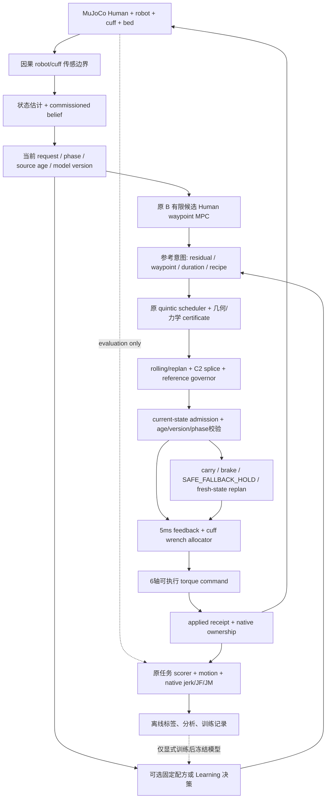

# iHEAR Lab 系统架构

本文按实际源码重建执行关系。`research_archive/packages/<包名>/` 保存各阶段独立研究包；仓库原 `stages/` 与 `research/side_studies/` 保存早期主代码和历史研究。不同快照不得按同名模块任意混装。当前便携复现优先使用 v7 的完整闭包，D01R B/H150 使用 v8 中已继承的闭包。当前机器复现是否通过，以 [ARCHIVE_VERIFICATION.md](ARCHIVE_VERIFICATION.md) 的新回执为准；下述历史数值不是本轮重新运行的结果。

## 系统边界与基本任务

研究对象是 MuJoCo 中的被动 Human 双关节腿、cuff 接触、六轴 robot 和床面。原控制器以 robot/cuff 因果测量和 commissioned belief 估计 Human 状态，最后产生六轴 actuator torque。Human qpos/qvel 真值可以进入独立评价，不能作为 actor、在线规划或 deployable 估计器的输入。此处的“物理验证”指原 native MuJoCo 动力学闭环，不代表真实机器人或人体试验。

名义 high-ROM 任务从髋/膝 `[5,10]°` 到 `[120,120]°`，完成连续 HOLD 后 RETURN。冻结任务文件为 `stages/stage5_personalized_motion_learning/configs/high_rom_v1/stage5_goal_task_120_v1.json`：ROM `[0,125]°`，原终点容差每关节 1°、速度 2°/s，HOLD 0.5 s，phase timeout 10 s，速度上限 `[45,75]°/s`、加速度 `[300,600]°/s²`。这些是工程研究假设，文件没有硬件或临床资格。MATCHED harness 另外要求 OUTBOUND/RETURN 至少各 9 s、HOLD phase至少 1 s（`SACExpertEnv.transition_allowed`）；原0.5 s有效连续dwell仍必须满足。完成后的独立积分含实际 HOLD/settling；历史完整 TASK 为 19.03 s，不能把 commissioning 计入该 19.03 s，也不能通过更短 rollout 得到低力。

## 实际执行链



Learning 的动作是规划意图或候选排序，不等于 actuator torque。`PROPOSED`、`ACCEPTED`、计划被选择、通过 activation、真正有正数 native steps 的 applied receipt 是不同事实。比较学习与传统方案时必须追踪完整链，不能以“网络输出发生变化”代替物理动作发生变化。

主要调用关系（以所选包的 `runtime/` 为根）为：

```text
便携归档 launcher
  -> 原 control/campaign_v6.Campaign 或 source/v7_worker_v5.Study
  -> code/study_common.run(name, interface, execution_mode='SCIENTIFIC_SIMULATION')
  -> sac_env.SACExpertEnv + runtime_coordination_residual_v2.run_executed_case
  -> 原 cold commissioning / belief handoff / task state machine
  -> interface.decision_boundary(boundary)
  -> NativeResidualPlannerV2 / RichFreePlanner / TerminalTimingPlanner / RetimedModalPlanner.decide
  -> 原 _evaluate / scheduler / activation_validation / receipt_reference_governor
  -> 原 feedback / cuff allocator / executable command / scientific native scheduler
  -> final_qualification.metric_record / qualify.physical_audit
  -> high_rom_v1/evaluate_execution_mode.evaluate
  -> code/analyze_matched.measure + compare
```

主物理循环在 `runtime/source/stages/stage5_personalized_motion_learning/src/traction_mpc_stage5/full3d_adaptive_integration_v1/runtime_coordination_residual_v2.py`。同目录的 `online_planning.py` 管理 request/snapshot，`online_reference.py`、`rolling_suffix_splice.py`、`multisegment_reference.py` 实现参考对象和接续，`activation_validation.py` 实施当前模型与状态校验，`receipt_reference_governor.py` 以已执行参考历史选择进度，`scientific_scheduler.py` / `wall_physics.py` 管理步进与实际命令归属，`safe_fallback.py` 保留拒绝后的合法后备。不能只抽取高层 planner 而遗漏这些依赖。

## 多时间尺度与因果性

|时间尺度|职责|不可混淆的限制|
|---|---|---|
|0.25 ms，4 kHz|native MuJoCo 动力学与完整 native 状态记录|运动诊断应使用原时间网格|
|5 ms，200 Hz|反馈、参考服务、measured wrench 的 TASK 积分|JF/JM 与 4 kHz wrench-rate 不是同一个采样指标|
|20 ms|原因果加速度/参考历史窗口等|不能用未来状态更新当前历史|
|40 ms bridge|proposal 到接续/执行的桥接时间合同|不是全部可分配给 Learning 推理的预算|
|100 ms lifecycle|原测量起算的 age/version/phase 生命周期|重试不能刷新 source age|
|历史 strict55|特定 host 资格轴|科学时钟仿真通过不等于 host strict55 或硬实时通过|

`SCIENTIFIC_SIMULATION` 使物理时间和确定性执行可比较；host profiling 仍可记录，但该路线的 `HOST_EXECUTION_CAUSAL_VALID` 为 `NOT_EVALUABLE`。原 B 工程提速包还保留 R2/strict55 失败和 NOT_FROZEN 阶段，不能合并成不存在的统一实时合格 B。

## 状态、意图和回执

|对象|真实来源与用途|代表字段|
|---|---|---|
|因果 observation|原估计器、参考、cuff 测量、公开任务历史|`estimated q/dq`、reference q/dq/ddq、measured force/moment、phase/clock|
|commissioned belief|原 commissioning 测量拟合，TASK 中按该合同冻结|`beta` 11 维、`state_residual_weights_nm` 2×5、estimated geometry、sequence|
|规划 boundary 字典|原 request 与当前可部署状态|`observation`、`reference`、`belief`、`request`、`arguments`、`planner`、`task_state`、`physical_now`|
|55D 学习上下文|`sac_env.feature_spec` 的固定物理尺度归一化；ResidualInterface 替换特定动作历史字段|10 个状态/参考量、11 beta、10 residual、6 wrench、4 geometry、phase 与任务/动作历史|
|参考意图|固定表、18D、modal8 或冻结学习策略|`family`、`x`、`legacy`、`residual_spec`、`slot_overrides`|
|决策评价|可行性与目标值相分离|`FeedbackCandidateEvaluationV1`: target、schedule、cost_terms、execution_screen|
|quintic schedule|同一个被认证、实际 sample 的参考对象|coefficients 2×6、duration、候选通过速度、速度/加速度/clearance certificate|
|request/command receipt|从源测量到真正应用的不可替代证据|source sample time、sensor age、model/reference version、plan request ID、torque、native steps、receipt index|
|评价真值|只读 native qpos/qvel/contact、原 scorer|不得反向进入动作选择|

55D 的具体字段意义会随 v1 原 absolute-target 接口与后续 residual 接口发生替换；模型/配置必须与相应 `feature_spec`、action contract 一起保留，不能只按维数加载。

## 控制关键量的来源身份

|量|本研究中的身份|不能扩大的解释|
|---|---|---|
|任务起终点、phase规则、ROM/速度/加速度工程界|STRUCTURAL_PRIOR / 冻结研究合同|不等于临床处方或实测患者界限|
|robot/cuff传感量与capture时间戳|MEASURED，仿真因果传感边界|不能以evaluation truth替换或把重试时刻当新测量|
|Human估计q/dq|ONLINE_ESTIMATED|不等于真实Human state|
|几何、beta和residual belief|commissioning产生的CALIBRATED/ESTIMATED；该TASK合同中冻结|不等于识别出全部解剖参数或持续Learning|
|默认名义模型/未学习常量|FIXED_NOMINAL / 结构先验，需按具体版本追溯|不能默认为永久已知的患者真值|
|物理case的身高、质量、刚度、真实几何和native qpos/qvel/contact|SIMULATION_TRUTH / 评价或隐含条件生成|不进入deployable actor/controller；oracle对照须独立标记|
|训练后固定Value/策略参数|离线拟合后FROZEN_MODEL|不是新的传感器或已校准安全不确定性|

同名字段可能在不同历史阶段使用了不同来源。归档保留各快照和原contract，不将历史调试中固定的参数自动升级为下一代系统的永久可知假设。

## 传统 MPC 与参考数学

原 `HumanWaypointFeedbackMPCConfigV1` 搜索有限 direct Δq 候选：步长系数 0.5/1.0、最大任务 span 的 0.20，基础方向包括 `(1,.5)`、`(1,.75)`、`(1,1)`、`(.75,1)`、`(.5,1)`。实际 candidate_mode 的方向与所有配置以所选快照为准。其单次候选目标为：

\[
J=1\left\|\frac{q_{target}-q_{goal}}{q_{goal}-q_{start}}\right\|^2
 +0.02\left\|\frac{\Delta q-\Delta q_{previous}}{q_{goal}-q_{start}}\right\|^2
 +0.25\,\mathbf 1_{\text{phase target incomplete}}+V(b,c).
\]

正式 B 使用 `V=0`。有限候选选优与后续传统优化都没有全局理论最优保证。scheduler 从当前位置/速度/加速度和候选终点/通过速度建立五次多项式 `q(u)=Σ a_i u^i`，保留原加速度、力学和几何检查。C2 接续只说明参考位置/速度/加速度连续，不能证明 jerk 连续或真实 Human/cuff 运动处处平滑。

Residual 接口令当前 B 的归一化候选进度为 `p`，`m=(p_hip+p_knee)/2`，在原 B 当前 target 上插值 PWL 图 `δ(m)`：

\[
p'=(p_{hip}+\delta(m),\ p_{knee}-\delta(m)),\qquad
q'=q_{origin}+(q_{goal}-q_{origin})\odot p'.
\]

图在当前 chunk 起点和任务终点为零；正 δ 表示按当前运动方向髋领先。它不直接生成整段时间轨迹；原 scheduler 决定 q/dq/ddq 和时长。`NativeResidualPlannerV2` 拒绝越界/不可行意图后保留原候选，不能把被拒绝动作的预测收益算作执行收益。

## admission、certificate、governor、guard 的不同作用

certificate 检查给定参考/模型/几何下的可行性；current-state admission 在真正执行时再次核对当前状态、模型、阶段、时间戳和参考接续；governor 根据已应用 receipt 的历史限制参考进度；guard 处理原观测/执行安全逻辑；fallback 为拒绝/过期保留安全后备。它们不是同义模块，也不是学习模型自动拥有的安全证明。

例如 `activation_validation.causal_return_projection` 明确将未来加速度视为**观测代理**，`future_acceleration_bound_proven=False`；其三角包络只有在未来加速度被代理界定时才成立。v4 的解析 clearance 导数和采样间条件证明了局部几何事实，但 observer/actuator 误差界与可行 backup 没有闭包，未实际替换原 guard。不得把这些模块写成已证明全系统前向不变性。

## rollout、评分、训练反馈

```text
冻结 config / action / seed / physical case / source manifest
fresh cold commissioning -> 合法真实 prefix
完整 live address-space fork -> 串行 B / 候选执行
每个子分支保留原 native physics + summary + trace + applied receipts
原 scorer 检查任务/硬门 -> matched/motion资格 -> JF/JM与native运动指标
失败/partial单独计账，不用局部低力进入完整成功排名
需要学习时：按其研究合同生成标签或reward，训练并冻结模型
独立未见条件/状态验证（本轮归档不训练，也不新增研究探索）
```

同父 fork 复制完整 plant、observer、planner、队列、RNG 和 opaque handles；仅 q/dq 重建或状态 hash 相同不等于完整运行状态一致。子分支结束后父 hash 必须不变。raw receipt 需把每个 native substep 唯一归属到真正应用的命令，且 torque/时间范围/步数完全一致。

## 架构限制与事实边界

已验证的是有限仿真条件下的完整任务与测量回执，不是广泛患者泛化。不同参数域、终点锁、timing 编译、介入时点与 prefix 会改变算法实际权限；对照必须同父、同权限、同评分。学习改善仍受动作库、原 scheduler 的非光滑 ceil/guard 分支、终点约束、过去已发生负担和数据覆盖影响。更高层的 learning world model、真正多决策 Bellman/DAgger/SAC、安全探索或临床目标均是下一代研究议题，不能由本归档中的有限结果自动推出。
