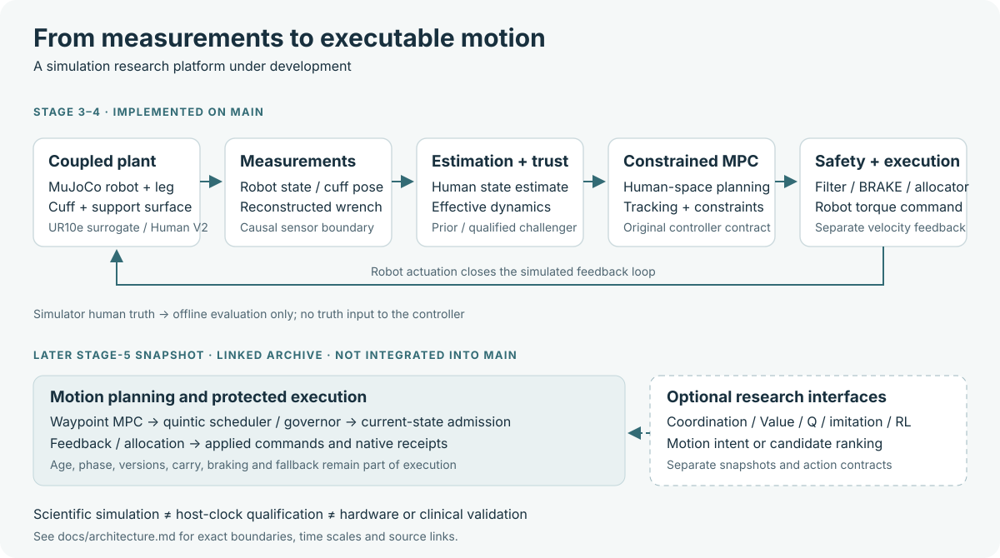
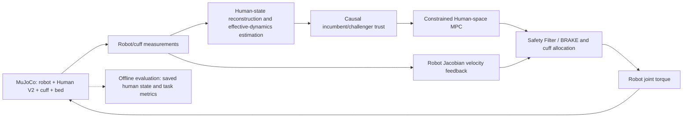
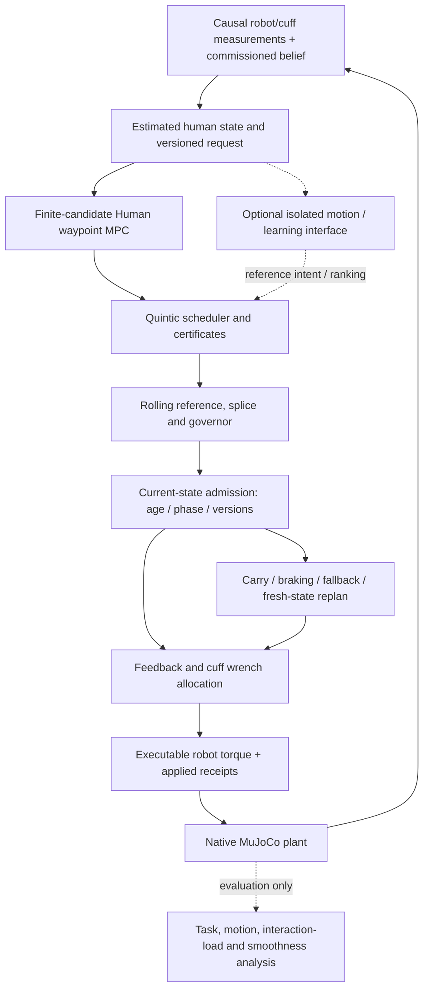

# Control Architecture

[Home](../README.md) · [Overview](overview.md) · [Roadmap](development-roadmap.md)

The figure summarizes the shared control direction and later research
extensions. It is a documentation diagram, not a claim that every block is
integrated on this branch.

## Stage 3–4 on This Branch

The [Stage-3 package](../stages/stage3_full3d/README.md) owns the coupled plant.
The [Stage-4 package](../stages/stage4_adaptive_control/README.md) owns estimation,
trust, MPC and its validation tools. Robot-facing state, cuff pose/twist and
reconstructed wrench feed the controller. Simulator human state and true
parameters are reserved for evaluation.

The Stage-4 model is control-effective; it does not establish recovery of
patient anatomy. A population prior remains active until a challenger passes
the causal validation contract. Estimation uses smoothed pose history, while
robot translational damping feedback uses the separate cuff-center Jacobian
velocity path. The original
[current-state record](../stages/stage4_adaptive_control/docs/research/CURRENT_STATE.md)
defines the exact frozen controller and measurement semantics.

## Later Stage-5 Research Snapshot

The [archived system architecture](https://github.com/Block-O2/adaptive-traction-mpc/blob/11af82a7ee35ae3c8e41e4b84d235a494b117d8d/SYSTEM_ARCHITECTURE.md)
and its source closure describe this later chain:

Learning interfaces propose motion intent or candidate rankings in these
studies. They do not automatically replace actuator torque control or bypass
the scheduler, admission checks and fallback. A selected proposal, an accepted
plan and a command applied for actual native physics steps are distinct events.
The source, model, feature/action contract and receipt format must come from
the same snapshot.

## Time and Execution Boundaries

The later architecture records several different time scales:

| Contract | Purpose | Interpretation |
| --- | --- | --- |
| 0.25 ms native MuJoCo step | Dynamics and native trace grid | A simulation step, not host compute latency |
| 5 ms feedback service | Reference/feedback/command service | A target service interval, not proof every host run meets it |
| 40 ms bridge | Proposal-to-reference transition contract | Not a free learning-inference budget |
| 100 ms lifecycle | Age/version/phase validity from the source measurement | Retrying does not refresh measurement age |

`SCIENTIFIC_SIMULATION` supports comparable physical-time execution while host
computation can take longer. `REALTIME_CHARACTERIZATION` investigates host-clock
effects such as planning delay and stale-command handling. Passing one does
not qualify the other. Historical timing improvements, deadline misses,
R2/strict55 failures and unfinished runtime packages retain their individual
scope; there is no unified hard-realtime baseline established by this guide.

## Open Architecture Questions

- How should waypoint posture, timing and segment transitions be optimized
  jointly without changing task completion or the execution/safety contract?
- Which variations in measured force come from reference transitions, feedback,
  contact or required human torque?
- Which learning inputs and actions offer useful state-dependent decisions
  beyond a strong fixed recipe or equal-budget traditional optimizer?
- What portable source and dependency closure should become the next reviewed
  Stage-5 integration baseline?

The [next-generation discussion](https://github.com/Block-O2/adaptive-traction-mpc/blob/11af82a7ee35ae3c8e41e4b84d235a494b117d8d/NEXT_GENERATION_ARCHITECTURE.md)
contains proposals, not implemented capabilities or new validation.
