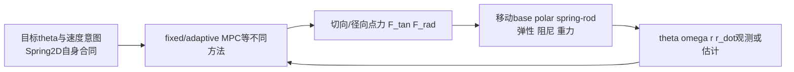
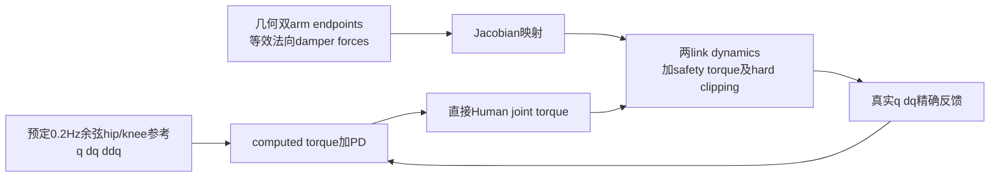
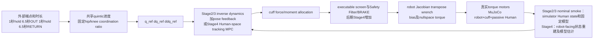
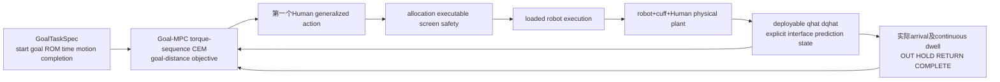
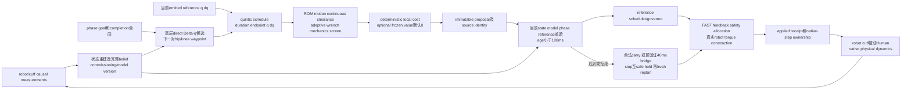
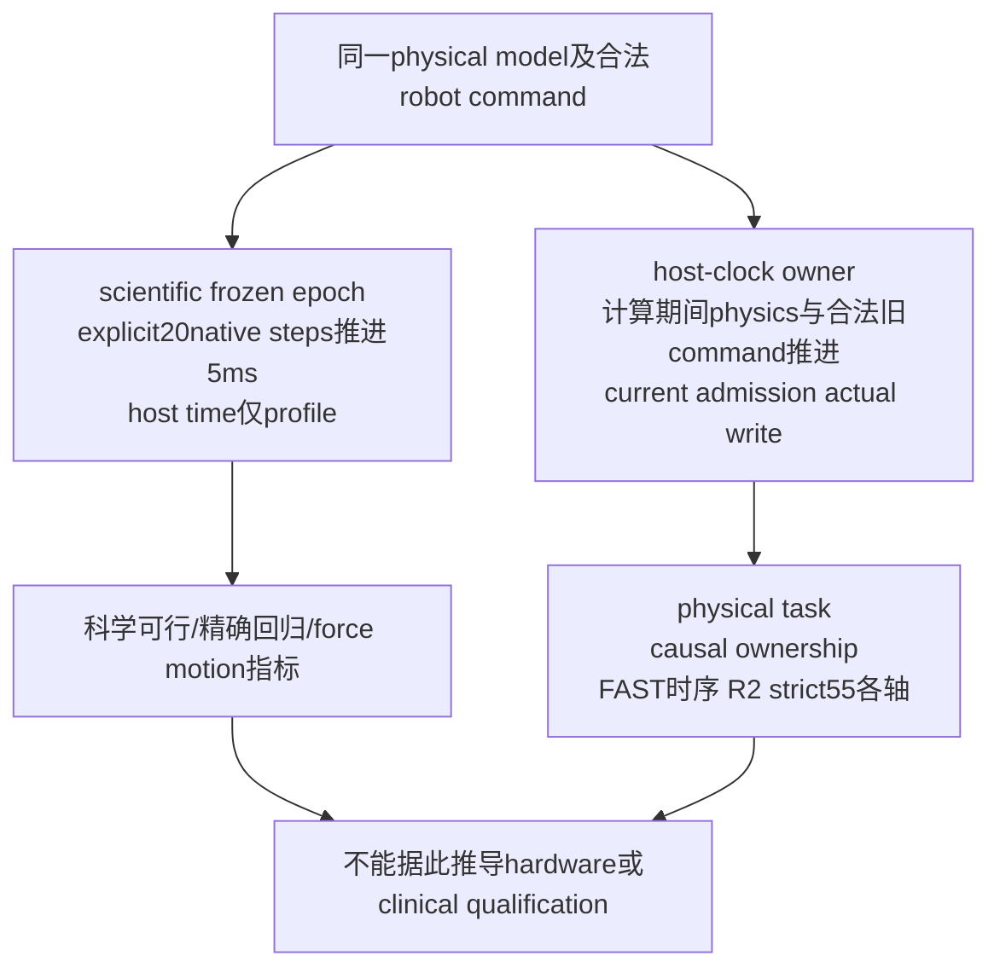
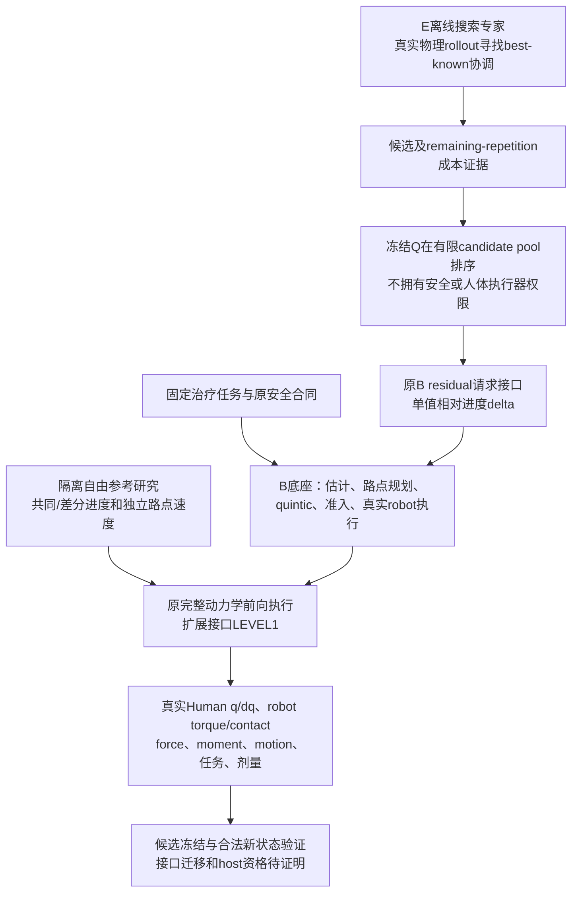

# 前后架构与不能省略的中间阶段

以下图来自源码与历史版本审查；它们分别描述不同历史系统，不是所有模块在同一天同时存在。

## 早期Spring2D

这不是hip/knee人体，也没有six-axis robot。证据：`stages/stage1/src/traction_mpc/models/spring2d_dynamics.py:81–174`。

## 教授MATLAB参考

MATLAB有示意机器人端点，缺真实机器人关节/执行器；其低force不可与后来的cuff force横排。证据：`git:c3957e8:linkage/docs/MATLAB_CODE_AUDIT.md:53–212`。

## 给定全轨迹：Human V2 Stage2/3与Stage4 tracking

Stage2/3 nominal smoke直接使用simulator Human q/dq与固定nominal model（stage3c_validation.py:26–27,88–91）；不能追认Stage4才建立的robot-facing重建/估计。Stage2/3本身没有后期Stage4 safety/identification全链；图中明确以“或”“后期增加”标识。轨迹源：`stages/stage3_full3d/src/traction_mpc_stage3/reference.py:18–63`。执行源：`stages/stage3_full3d/README.md:33–48,89–100`。

## 中间阶段：Goal-directed torque MPC

这是“取消episode-long固定参考”的第一转变；高层输出仍是generalized torque action，不可写成当时已直接输出hip/knee waypoint。历史失败与完整episode见`GOAL_MPC_V1_ENGINEERING_SMOKE.md`、`GOAL_MPC_COMPLETE_V1_ENGINEERING_REPORT.md`。

## 在线下一关节目标：Phase3接口与后来B full3D

Phase3 V3当时只验证planner/schedule/screen/value/causal records接口，观测、更新、真实robot执行是caller责任。完整B full3D后期才把右半链与online lifecycle联接。证据：`FINAL_ARCHITECTURE_TECHNICAL_DEEP_DIVE.md:12–47`、`human_waypoint_feedback_mpc.py:214–453`、`online_planning.py:1–40,71–74,179–227`、`safe_fallback.py:35–58`。

## Scientific clock与host clock是两种执行评价

40ms bridge、100ms lifecycle、strict55 qualification、5ms FAST、0.25ms physics各有不同定义。它们不是一个阈值，也不能互相替代。

## B、E、Q与自由参考的不同权限

E是有限预算物理搜索的专家，不等于训练成熟的RL；Q是计划排序器，不是直接关节控制；自由参考是更丰富的离线意图，不是修改人体动力学或正式B。三者都需要真实执行证据才能谈收益。

## 今晚18维参考的变化及零调整兼容性

旧10维：两个方向各自的common进度、differential常数/倾斜、hip/knee通过速度组合。今晚另加两个方向各自的common tilt、common curvature、differential curvature和velocity tilt。令u=2m−1、e=sin²(πm)：进度修正由e乘低阶多项式，速度比例随u变化；实际连续运动仍由原quintic决定。HOLD和terminal目标保持原B所有权，不新增人体主动关节力矩。

这里“曲率”是对空间进度函数的表达，不能直接称实际人体加速度下降；“速度意图”不保证人体真实速度相等。新增参数只增加数学候选空间，实际收益、motion、几何拒绝和控制合法性全部以前向执行为准。零调整必须与原B完整trace/native/torque/contact/receipt复现；旧10维嵌入还须重现原最佳运动。完成状态见ZERO_EXTENSION_REPRODUCTION_GATE.json和PRIOR_REPRODUCTION_GATE.json。

<!-- OVERNIGHT_CONCLUSION_START -->
## 本轮冻结后的结论

原完整动力学中18D开发最好下降2.635613%，新合法prefix条件合格0/4；事先冻结secondary开发下降2.310981%，新条件合格1/4。未用测试改选primary；这是同一Human剩余策略的LEVEL1证据，未迁移原B接口或完成host/临床资格。

下一步仍应先确认治疗允许的中间姿态和motion依据；新状态的速度/加速度/阶段端点失败说明名义开发优化不能直接当可靠teacher。完整逐条件结果见REPORT与VALIDATION_RESULTS，接口变化与负担修复诊断见MECHANISM_ANALYSIS。本轮已停止，不继续训练或自动开启下一包。

<!-- OVERNIGHT_CONCLUSION_END -->
