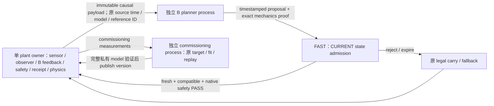

# B Multi-Rate Real-Time Architecture v1

**STATUS: NOT_QUALIFIED — 三版科学等价 PASS，真实 host-clock 资格失败，M2 NOT RUN。**

冻结工作包起点：2026-10-07T12:24:19.813712+08:00；报告生成：2026-10-07T13:30:39.577508+08:00；已用 wall 1.105 h，8 h hard cap 未触及。三版后停止物理派发，剩余工作只做归因、验证、保全和交付；未为填满建议 4–6 h 追加实验。

正式 WSL 研究目录：`/home/hank/coding/adaptive-traction-mpc-side-studies/b_multirate_realtime_v1`。Windows `delivery` 是含原始证据和源码的镜像；replay 仍以 WSL 源路径和固定 Python 环境为准。

## 1. 结论与分母

34 次登记均有 START/END：12 次启动环境/合同文件错误（零物理步）保留；22 次实际物理 episode，包括 8 次基线/版本科学回归、13 次 host 和 1 次辅助科学 profiling。科学 VALID 不计入真实 host VALID。

全部 host complete VALID = **0/13**。R3 主 ladder：4 cold + 4 same-interpreter，完成 OUT/HOLD/RETURN 7/8，原 R2 与 realtime 均不合格，qualification 0/8。全部 host 证明 116 个非平凡 OUTBOUND/RETURN B plan 有原 receipt 和 native steps；其中 9 个满足 <55 ms。这些局部及时执行不能替代完整任务资格。

M2 未运行，nonzero learning execution = 0，完整 M2 task 未测试。Q/G inference 与 training/adaptation 均为 0。冻结 Q 文件仅做 SHA 保全检查，没有被 B 加载。B 原 commissioning estimator 更新属于原 B 语义；任务仍 commissioning_only，没有启用新的 task learning。

## 2. 冻结时间和 ownership 合同

[CONTRACT.md](CONTRACT.md)、[源码阈值摘录](reports/SOURCE_TIMING_BOUNDARIES.json)、[原运行计划](RUN_PLAN.json) 是权威记录。

| 规则 | 原边界与本轮解释 |
|---|---|
| physics / feedback | native 0.25 ms；sensor/service 5 ms；不将缺失 period 补成虚构 callback |
| physical bridge | `safe_fallback.prepare_decision`: 8 × 5 ms = 40 ms，原止动/commit ownership 不变 |
| strict qualification | 原历史 host/learning qualification 与本轮合同：激活年龄严格 <55 ms；源时间到 conservative actual activation |
| generic lifecycle expiry | `PlanLifecycle.maximum_age_ns=100_000_000`，>=100 ms 过期 |
| command write | 原 wall write 前后 >100 ms 检查，边界保留；不是 strict55 PASS |
| native mode evaluator | 原 `strict_age_limit_ms=100` 单独保留，另外检查 stale/deadline/control miss/command gap；不能把它的泛型 activation 当成 <55 ms |
| R2 | 原 MATCHED 每 phase 为 9/1/9 s 至对应 +.020 s +1e-9；HOLD 上界 1.020000001 s；无改阈值 |

合同中“strict evaluator”的初始措辞在收尾明确为“strict qualification”，区别原 mode evaluator 的 100 ms；这里只纠正阈值来源描述，所有运行和审计数字边界均未改变。

FAST 独占 plant，SLOW 无 plant timing authority。只有完成的 future 才进入 result/解码；planner 等待期间 FAST 继续原 command/reference/receipt。commissioning target 和 fit/replay 也使用单独 prewarmed spawn owner；waiting loop 在原 due 下执行真实 service，不暂停物理 epoch。scientific mode 为确定性回归单独允许等待，绝不用于 host qualification。

模型在 worker 中完整构建，通过原 fit.accepted 与有限参数检查后一次交还完整 fit/updater/belief；单 plant 线程执行原模型接入，未暴露半更新模型。model sequence 与完整参数 SHA 同时记录。

输入为 frozen dataclass + 不可变 pickle bytes，含 request/source_capture/model sequence/reference hash/phase；proposal 保留原 schedule/version/ownership。planner 预计算仅限原 mechanics 的完整输入结果。FAST 再哈希当前 screen、belief、candidate、schedule 全部字段；任一不匹配执行原 native evaluate。当前观测下的 age/phase/goal/ROM/motion/clearance/reference compatibility/final command/receipt 检查全部保持原实现。

## 3. 三版与科学 gate

| 版本 | 实际变化 | scientific nominal + legal deviation | host ladder 结果 |
|---|---|---|---|
| R1 | 复用已有 native process planner；immutable snapshot/version/causal service 审计。旧配置已启用 process，未宣称“首次 offload”或新速度收益 | PASS / bit-identical | smoke 未通过 fast/strict55；原 rolling suffix revalidation abort |
| R2 | commissioning target 转独立预热 process；等待期间 legal carry service；返回后 current-state refresh，原请求源时间不重写 | PASS / bit-identical | smoke 失败；fit/replay 仍在同步路径，不能发布资格 |
| R3 | fit/replay 私有 worker + 完整 model 交接；planner exact mechanics proofs；原 evaluation-only 聚合离开关键路径 | PASS / bit-identical | smoke + 4 cold + 4 同进程 + 2 legal deviation；仍失败 |

R1/R2 smoke 已否决 fast cadence 和年龄 gate，因此没有对失败版本追加四冷四连续完整实验；R3 完成全部复现实验用于确认系统性问题。最多三版已经用完，没有第四版、controller 数学修改、Human physics 修改、K3/force/moment/clearance/safety/goal/R2 修改。

每版按冻结 seed 2026100621 nominal、2026100623 legal prefix 比较。合法前缀 OUTBOUND `[[.2,.1,-.1],[.05,.15,.25]]` 后回原 B，无 Q。绝对容差 1e-10 在结果前预注册，没有事后放宽；实际所有 0.25 ms native qpos/qvel/command/contact signatures bit-identical，5 ms 全 trace/reference q/dq/ddq/commands、selected activated labels/plan identity、phase transition、fallback/safety、J_F、force/moment/tracking/clearance 全匹配（numeric max error 0）。真正 host timestamps 排除，但 physical phase/source times 保留。

[R1 gate](versions/R1_SCIENTIFIC_GATE.json) · [R2 gate](versions/R2_SCIENTIFIC_GATE.json) · [R3 gate](versions/R3_SCIENTIFIC_GATE.json) · [snapshot/certificate negative tests](output/SNAPSHOT_AND_CERTIFICATE_TESTS.json)

离线测试在既有 causal snapshot 上关闭 residual/Q 路径，0 新物理步；证明 live input mutation 不影响 payload，原 mechanics dictionary 精确相同；model version、同 version 不同参数、schedule coefficients、screen limits 合成改变均导致 proof key miss。科学 R3 有 60 exact hits / 74 current-input checks，14 次 native recomputation。这些是有限冻结回归和 safety/dataflow 证据，不能称 Human matrix 泛化或 host 闭环等价证据。

## 4. 每次 host 原判定

COMPLETE 是 Python worker 正常结束，不等于物理 task COMPLETE/VALID。物理安全通过也不等于 R2/实时通过。

| ID | 组 | OUT/HOLD/RETURN 完成 | 原物理安全 | R2 / VALID | HOLD s | miss | age p50/p95/max ms | 非平凡执行 / fresh | abort |
|---|---|---|---|---|---:|---:|---|---:|---|
| 016_R1_host_smoke | development_smoke | False | FAIL | False / False | 0.000 | 68.79% | 79.440 / 93.515 / 95.734 | 5 / 0 | ROLLING_SUFFIX_SPLICE_REVALIDATION |
| 019_R2_host_smoke | development_smoke | False | FAIL | False / False | 0.000 | 70.43% | 84.239 / 91.948 / 92.805 | 2 / 0 | LOW_LEVEL_EXECUTION:ROLLING_SUFFIX_STALE_AT_APPLY |
| 022_R3_host_smoke | development_smoke | True | PASS | False / False | 1.185 | 66.39% | 73.062 / 83.976 / 86.654 | 10 / 2 | — |
| 023_R3_cold1 | cold | True | PASS | False / False | 1.075 | 57.89% | 69.580 / 77.913 / 80.259 | 10 / 2 | — |
| 024_R3_cold2 | cold | True | PASS | False / False | 1.085 | 60.18% | 68.829 / 78.788 / 81.132 | 10 / 1 | — |
| 025_R3_cold3 | cold | True | PASS | False / False | 1.075 | 60.76% | 71.341 / 77.283 / 78.383 | 10 / 1 | — |
| 026_R3_cold4 | cold | True | PASS | False / False | 1.090 | 59.66% | 68.928 / 77.262 / 77.849 | 10 / 0 | — |
| 027_R3_session1 | same_interpreter | True | PASS | False / False | 1.085 | 58.23% | 69.526 / 75.330 / 78.071 | 10 / 1 | — |
| 028_R3_session2 | same_interpreter | True | PASS | False / False | 1.075 | 60.07% | 68.823 / 79.963 / 80.238 | 10 / 0 | — |
| 029_R3_session3 | same_interpreter | False | FAIL | False / False | 1.110 | 67.52% | 79.557 / 88.897 / 91.827 | 9 / 0 | LOW_LEVEL_EXECUTION:BRAKE_INFEASIBLE |
| 030_R3_session4 | same_interpreter | True | PASS | False / False | 1.095 | 62.94% | 71.419 / 78.837 / 79.143 | 10 / 1 | — |
| 032_R3_host_deviation1 | legal_deviation | True | PASS | False / False | 1.100 | 62.16% | 74.070 / 82.470 / 82.682 | 10 / 0 | — |
| 033_R3_host_deviation2 | legal_deviation | True | PASS | False / False | 1.070 | 62.72% | 77.260 / 84.022 / 86.217 | 10 / 1 | — |

[完整 qualification](reports/HOST_QUALIFICATION.json) 保存每个有效原 receipt owner 的 join 依据。原 receipt 无 request ID 时，使用 exact original activation stamp 或唯一原 native half-open active segment + decision request ID；必须 applied=True 且 native_steps>0，不以 attempted/action counter 或 HOLD/no-op 代替执行。same-interpreter 为同一个 Python PID 四次独立原 episode；每次新建原 plant/commissioned model 并回收 workers，不是同 plant 连续运行或 adaptation。第三次原 BRAKE_INFEASIBLE 后，第四次重新初始化正常完成，证明 episode-level 回收/恢复，不能声称同 plant 自动恢复。

## 5. R3 正式 ladder pooled 时序

下表只聚合四 cold + 四同进程的原事件值（不是把各 run 的 p95 再平均）。所有字段都有 n；取消/过期未形成某个检查点时保持缺失，不补 0。单位 ms，commissioning/model 稍后单独报告。

| 项目（ms） | n | p50 | p90 | p95 | p99 | max |
|---|---:|---:|---:|---:|---:|---:|
| service_gap_ms | 18354 | 12.021 | 16.498 | 17.624 | 21.739 | 295.194 |
| service_compute_ms | 18362 | 5.990 | 7.274 | 7.914 | 10.225 | 71.558 |
| lateness_ms | 18362 | 10.092 | 13.526 | 14.324 | 19.449 | 293.758 |
| snapshot_ms | 150 | 0.310 | 0.385 | 0.414 | 0.545 | 0.660 |
| queue_ms | 150 | 2.669 | 3.885 | 26.701 | 52.124 | 56.200 |
| compute_ms | 150 | 45.935 | 51.802 | 53.285 | 55.011 | 55.636 |
| worker_to_main_scheduling_ms | 150 | 8.903 | 14.351 | 15.453 | 17.301 | 21.152 |
| current_state_revalidation_ms | 111 | 1.333 | 2.426 | 2.567 | 2.689 | 2.916 |
| validation_and_command_construction_ms | 95 | 7.759 | 11.356 | 12.412 | 13.814 | 13.980 |
| activation_age_ms | 95 | 71.257 | 79.391 | 81.739 | 86.319 | 91.827 |
| disposition_age_ms | 150 | 60.613 | 80.242 | 96.335 | 108.224 | 113.288 |

FAST 目标 5 ms；真实 services=18362，skipped periods=28555，miss=60.86%。miss 定义 skipped/(observed services+skipped)，extra actual services 单独记录，不构造未来 due。service compute >5 ms=98.37%；真实 start-to-start >5 ms=100.00%。activation >=55 ms=73/95（76.84%）。TASK outcomes={'EXPIRED': 8, 'ACTIVATED': 95, 'CANCELLED': 46, 'FAILED': 1}。

service_compute 包含 capture 至原 next_control_tick 入口的原 fast/controller/admission/pre-apply work；service_gap 还包含真实等待/physics catch-up。原 native 0.25 ms step host bracket 在 FORENSICS 中单独记录，不能将 integration 免费移除或把 service_compute 当成整 cycle。FAST diagnostics 会有测量开销，没有对它作无证据的时间扣除。

IPC 没有独立 wire-only instrumentation：queue 是 enqueue 到实际 worker_start（含 transfer/queue），worker_to_main 是 proposal-ready 到主 owner collection（含 result transport/deserialize/scheduling/fast service 等待）。微秒级 PlanLifecycle.result 已完成结果收集时间不能冒充完整 IPC。原 snapshot compute、native B compute、R3 extra proof preparation、receive/current validation/final command 均在原时间戳中有因果顺序。

### planner active / idle 与冷/连续

planner active 以实际 TASK worker_start→proposal-ready 窗口判定，其他为 B planner idle（可含 commissioning work）；同 run next-start gap 按前一个 service 开始时的窗口分组。

| 组 | services | gap p50/p95/max ms | compute p50/p95/max ms | miss |
|---|---:|---|---|---:|
| B_planner_idle | 17941 | 11.998 / 17.610 / 295.194 | 5.981 / 7.904 / 71.558 | 60.81% |
| B_planner_active | 421 | 13.480 / 17.690 / 22.561 | 6.345 / 8.206 / 10.443 | 63.01% |
| R3_cold | 9527 | 11.566 / 16.990 / 64.869 | 5.915 / 7.334 / 24.403 | 59.62% |
| R3_same_interpreter | 8835 | 12.684 / 18.454 / 295.194 | 6.117 / 8.410 / 71.558 | 62.12% |

不同 seeds/epochs 与同进程 cache/OS 状态混合，cold/连续差异仅作重复性描述，不宣称单一速度因果效果。active/idle 都存在持续 miss，不能把等待中的 service 数量非零当成维持 5 ms。

## 6. Commissioning / model owner

R3 ladder worker 禁止构造 plant；预热发生在 physical epoch 之前。目标选择、fit/replay 数学函数保持原样；fit 完整接受和有限参数 validation 后 publish sequence/hash。原物理 epoch 在 worker 计算期间推进，FAST 执行原 legal command，而不是 physics freeze。

### commissioning_target

| 项目（ms） | n | p50 | p90 | p95 | p99 | max |
|---|---:|---:|---:|---:|---:|---:|
| snapshot_ms | 32 | 0.053 | 0.100 | 0.128 | 0.162 | 0.173 |
| queue_ms | 32 | 0.409 | 0.941 | 1.234 | 1.717 | 1.864 |
| worker_compute_ms | 32 | 0.913 | 5.773 | 6.046 | 6.259 | 6.321 |
| ready_to_receive_ms | 32 | 14.345 | 20.977 | 22.586 | 23.526 | 23.685 |
| end_to_end_ms | 32 | 17.310 | 25.136 | 25.635 | 26.081 | 26.175 |

真实 pending FAST services 合计 25；payload p50/max 1387.000/1387.000 bytes，response p50/max 2125.000/2336.000 bytes。

### commissioning_fit

| 项目（ms） | n | p50 | p90 | p95 | p99 | max |
|---|---:|---:|---:|---:|---:|---:|
| snapshot_ms | 8 | 3.799 | 4.863 | 5.784 | 6.521 | 6.706 |
| queue_ms | 8 | 1.109 | 1.740 | 2.271 | 2.695 | 2.801 |
| worker_compute_ms | 8 | 62.437 | 76.182 | 77.530 | 78.608 | 78.878 |
| ready_to_receive_ms | 8 | 22.849 | 38.497 | 44.911 | 50.042 | 51.325 |
| end_to_end_ms | 8 | 88.936 | 121.004 | 130.357 | 137.839 | 139.710 |

真实 pending FAST services 合计 31；payload p50/max 137630.000/138012.000 bytes，response p50/max 473361.000/475024.000 bytes。

[R3 owner 原始记录](output/020_R3_nominal_COMMISSIONING_OWNER.json) 与各 host `*_COMMISSIONING_OWNER.json` 保存 data available/enqueue/worker start/estimate ready/receive/validation/publish。worker 不阻塞 future 等待，但 serialization、result decode/model handoff 仍在主 owner，slow-offload 不等于保证快循环。原 task-heavy phase/recovery/reference preparation 的同步部分仍存在。

## 7. Exact bottleneck attribution 与限制

**Primary：原 fast-side feedback + sensor/observer + native physics 的串行执行成本已经超过 5 ms，伴随 catch-up 正反馈。** 原 B planner 已独立 process，但 active/idle 两侧均失败。真实 native step mean 与 p95 见每 run FORENSICS；physics 需每 5 ms 至少 20 步，仍叠加 observer/capture/control/safety/receipt。主线程没有等待未完成 planner future，但必须做原 fast work 和当前 admission；仍无法交付固定 5 ms service。

**Secondary：proposal ready 后主 owner 可用窗口、当前 admission/command construction、phase/model/preparation 和 IPC 的尾部。** R3 exact mechanics proof 缩短当前 validate_activation，但总体 activation 仍加上 planner queue/compute/transport/collection/command 成本。原取消/过期不会强杀正在计算的 worker，后续请求有约 45–57 ms queue tail；完整结果/取消/过期分别记账。Legal prefix 两例 snapshot max≈43 ms，继承原 legal intervention preparation，不能归因成 14–21 KB payload 的纯 pickle wire 成本。

R3 ladder exact mechanics input checks=293，hits=244，native recomputes=49。没有因 proof 跳过 current-state mandatory validation；失配保持原 native path。

### 辅助科学 profiling

031 主进程 cProfile 是一次单独科学 run，不参与 host qualification；[完整 profiles/callers](reports/031_R3_science_profile_PROFILE.json)、[物理等价验证](reports/PROFILE_SCIENTIFIC_EQUIVALENCE.json) 与 `.pstats` 均保留。物理 signature 再次 bit-identical。该 profiler 有明显开销，scientific scheduler 的 source_ns 路径也不同，下面只用于函数归因，不把其数值当成真实 host 预算，也不把 nested cumulative 时间相加。

| 函数 | calls | self s | cumulative s |
|---|---:|---:|---:|
| operational_memory_v3.py:41 stream_payload | 2 | 9.237 | 72.690 |
| runtime_coordination_residual_v2.py:492 _execute_interval | 5816 | 0.336 | 60.245 |
| scientific_scheduler.py:36 next_control_tick | 5816 | 0.059 | 33.768 |
| wall_physics.py:139 _step | 116320 | 0.687 | 33.709 |
| fast_plant.py:54 step_native | 116320 | 0.417 | 19.484 |
| human_waypoint_shadow.py:389 command | 5817 | 0.147 | 17.474 |
| fast_plant.py:43 _apply_interface | 238459 | 0.989 | 13.819 |
| fast_plant.py:23 _evaluate_current_interface_value | 250097 | 0.692 | 12.530 |
| wall_physics.py:90 capture | 5817 | 0.096 | 12.512 |
| runtime_coordination_residual_v2.py:552 transform_action | 5816 | 0.204 | 9.737 |
| loaded_execution.py:303 build_stage5_loaded_execution_context | 11633 | 0.202 | 7.262 |
| controller_interface.py:162 update | 11643 | 0.043 | 3.273 |
| split_acceleration_monitor.py:266 update | 10229 | 0.104 | 0.880 |
| multirate.py:30 capture | 5822 | 0.020 | 0.494 |
| measurement.py:181 update | 5816 | 0.026 | 0.255 |
| track_brake.py:322 command | 5816 | 0.061 | 0.162 |
| executable_command.py:89 command | 11634 | 0.054 | 0.117 |
| activation_validation.py:144 validate_activation | 26 | 0.002 | 0.103 |

[预算敏感性](reports/TIMING_SENSITIVITY.json) 是只读代数界限，不是反事实物理 PASS：ladder 非平凡 79 个执行中，proposal-ready 源年龄 p50=55.357 ms，44 个在 ready 时已经耗尽 55 ms；即使乐观移除整个 result collection/transport/scheduling 区间，仍有 64 个不能满足 <55 ms。不能靠给 IPC 一个平均低值解决 admission 窗口和 fast cadence。

主进程 profile 显示 command、native interface/physics、capture、transform/safety 的累计调用成本；original evaluation/artifact JSON serialization 主要发生在收尾，虽然 wall episode 占比大，却不应被当成 5 ms feedback 瓶颈。worker 的 B 数学成本用真实 worker timestamps 衡量，没有假装主进程 profile 包含 worker CPU。额外 mechanics proof 的模型 API 调用没有完整接入旧 worker inverse-dynamics counter，旧总数不能当成全面 computation accounting；本轮 qualification 依据真实时间/native steps。

### 原 wall-grid 延迟证据

所有 13 个 host 的 native_states 与原 receipts 逐步核对：actual computation 在 apply_ns 之前的新命令步骤=0，torque 与 receipt 无不匹配，step_count 与所有 receipt native_steps 完全一致。没有 source time 重写，原返回 proposal source identity 保持。**同时，原 nominal fixed-grid 的部分新命令 step-start 在 actual host write 之前，仍是真实负面证据。** 这表示保留的原固定网格带有延迟离散 realization，不能称及时的连续物理执行或 realtime PASS。

| ID | native states（含收尾） | scored trace 最后步数 | nominal starts before write | 最坏滞后 ms | command-gap receipts |
|---|---:|---:|---:|---:|---:|
| 016_R1_host_smoke | 73134 | 73120 | 13806 | 14.646 | 1140 |
| 019_R2_host_smoke | 57296 | 57280 | 10476 | 9.716 | 845 |
| 022_R3_host_smoke | 118536 | 118520 | 23721 | 14.846 | 1992 |
| 023_R3_cold1 | 117937 | 117920 | 24542 | 8.250 | 2483 |
| 024_R3_cold2 | 118131 | 118120 | 24272 | 8.530 | 2352 |
| 025_R3_cold3 | 118090 | 118060 | 24194 | 8.511 | 2316 |
| 026_R3_cold4 | 117949 | 117940 | 24222 | 8.126 | 2379 |
| 027_R3_session1 | 117973 | 117960 | 24921 | 18.635 | 2464 |
| 028_R3_session2 | 117976 | 117960 | 24419 | 9.520 | 2355 |
| 029_R3_session3 | 111399 | 111380 | 21994 | 13.036 | 1807 |
| 030_R3_session4 | 119375 | 119360 | 24534 | 10.021 | 2212 |
| 032_R3_host_deviation1 | 118814 | 118800 | 24389 | 32.538 | 2247 |
| 033_R3_host_deviation2 | 118929 | 118900 | 24343 | 33.836 | 2217 |

scored trace 最后样本和 raw final flush 可有额外物理步骤；保全/compute 分母使用完整 native artifact，不删除收尾步骤。receipt steps>20 是原 command gap 的原始证据，不是另设宽松阈值。长 service gaps 与 catch-up scopes 可见 [CAUSAL_DIAGNOSTICS](reports/CAUSAL_DIAGNOSTICS.json) 和每 run FORENSICS；gap 的两个端点定义与 scope 覆盖不同，不能按名称直接等同。

## 8. Resource 与 lifecycle closeout

[资源收尾](reports/RESOURCE_CLOSEOUT.json)、[全部资源样本](output/RESOURCE_LOG.jsonl)、[CPU watcher](output/CPU_WATCH.jsonl)、[attempt/worker 收尾](reports/WORKER_AND_ATTEMPT_CLOSEOUT.json)、[attempt journal](ATTEMPTS.jsonl) 全部保留。

| 项目 | 实测范围/事件 |
|---|---|
| WSL MemAvailable GiB | 4.903–6.950 |
| WSL swap used MiB | 69.453–80.203 |
| owned PSS GiB | 0.010–2.069 |
| Windows commit headroom GiB | 1.136–4.387 |
| samples / processes / owned processes | 74 / {'min': 29, 'max': 39} / {'min': 1, 'max': 5} |
| swap-in/out pages Δ / OOM Δ | 3473 / 457 / 0 |
| CPU load1 / machine aggregate busy % | {'min': 0.0078125, 'max': 1.08837890625} / {'min': 0.00347096881681615, 'max': 3.8369687460949975} |
| pause / Windows query errors | False / 0 |

CPU coverage 从 CPU_WATCH 和同进程 CPU_LOG 开始；之前 campaign 把 load 写到采样后内存 row，未入 JSON。早期 CPU load 无法恢复，明确缺失，不推测填充。后期 aggregate CPU/load 无全机饱和证据，但 45 s 采样不能排除局部核/短期 OS 调度、频率或 measurement effects；没有 controlled CPU-contention 实验。stable swap 不作为 stop 原因，没有 restart WSL、修改 RAM/swap、drop cache 或 kill 未知进程。

当前自有 planner/commissioning/physical/session/CPU watcher 全部 join，live_owned_processes=[]，34 START=34 END，单 plant policy 保持。进程峰值包括 main、native planner、commissioning owner、resource tracker 等，并非多个 physics plant。worker/model warm-up 均在各新 physical epoch 前。

## 9. Preservation / reproducibility

[最终保全](preservation/FINAL_PRESERVATION.json)：22,033 历史文件逐 SHA 全相同、无缺失/新增；1,021 frozen control source/config 文件全相同。旧 Matrix、Q Integration/noon extension、native residual/旧失败/报告/trace/weights 保留。新目录的源码路径 relocation 单独记录，不改旧源码。主 WSL branch、HEAD、dirty status、index SHA、staged diff 全相同；未 reset/stash/clean/merge/commit/push。Windows evidence workspace 的 Git 查询最初不可用，不伪称它是审计对象。

原 WSL branch `codex/expert-strength-value-adequacy-v1`；HEAD `41cdddef117caa4b191a52129c4ff83e481fd5a8`。冻结 Q SHA `3be0536a8cd9007e8926fc1f49d97468facd2d09233bd89618d04e683b6d3db9`，仅 hash read，无 inference/training。

12 次 startup failure 原日志与输入保留：前 4 system Python 缺 numpy，再 4 错误 env 缺 gymnasium，再 4 缺冻结 shared action contract；之后修复执行环境/独立副本文件，旧 IDs 不覆盖重跑。成功环境 `/home/hank/envs/adaptive-online-rl-v1/bin/python`；BLAS/OMP/MKL threads=1。每次 imported source SHA 和 START source hashes 保留，修正前 wrapper 字节保存在 preservation/<sha>/，R2/R3 installed runtime source 在 versions。

源码 frozen copy 与 adapters 分开：`source/` 控制数学不变；`code/multirate.py`、`commissioning_owner.py`、`slow_owner.py`、`admission_certificates.py` 是本包执行 adapters。报告/收尾工具没有改变已经结束的物理配置。FULL_PACKAGE_MANIFEST 与交付验证记录覆盖最终包的原始 evidence/源码；所有 artifacts 是本轮本地 simulation，没有真实硬件部署。

## 10. Negative results 和唯一 NEXT

- 独立 process planning 与异步 commissioning 能持续执行合法旧命令，但原 fast work 的预算不足；active/idle 都持续 miss。
- R3 能完成大部分物理任务并降低当前 mechanics validation 开销，仍没有任何 full VALID / host qualification；HOLD 与其他 phase 超出原 R2。
- 多数非平凡计划执行时年龄 ≥55 ms；native100 的 activation 不能包装为严格及时，029 原 brake failure 和 fixed-grid 滞后均保留。
- 两次合法偏移增加 snapshot/preparation 尾部，M2 无入场资格；本轮没有学习执行证据。

**NEXT（仅一项）：开独立后续包，在保持原 B/Human/安全数学的前提下建立可预算的 native FAST execution owner，将原 sensor/observer/feedback/receipt/physics 路径整体隔离并编译等价实现，移出 phase/model preparation，同时以实际 write-time 约束 plant command ownership；先逐位科学回归，再以同一 4 cold + 4 连续 strict55/R2 ladder 验证，合格前保持 M2 关闭。**

本包状态 CLOSED / NOT_QUALIFIED，M2 NOT_RUN。STOP。
