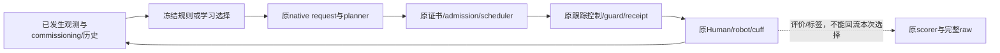

# Learning 与真实控制接口

**CONFIRMED：本项目的学习输出必须通过已登记的参考/协调接口进入原控制链。** 预测值、候选名字和低训练误差都不能代替真实动作、完整任务或安全资格。本指南定义输入、动作、执行证据与评价合同；各组最终数值和资格以本包 [REPORT.md](/home/hank/ihear-lab/autonomous_learning_smoothness_v7/REPORT.md) 及其冻结raw审计为准。静态接口通过不赋予任何实验组资格。

## 1. 决策边界与完整配对

原 OUTBOUND slot1（OUT1）实验在实际commissioning和登记合法prefix之后、当前native request规划之前，从同一个活父进程作完整Linux地址空间fork。它保留当时的commissioned belief、observer、scheduler、task、reference owner、lifecycle、guard和原MuJoCo对象；child完成后仍须核对父状态before/after、恢复身份、退出码和join，最后验证parent与B raw。相同seed、q/dq或首个观测向量不足以证明配对状态相同。JSON和hash是证据，不能在父进程退出后恢复这些活对象。[原fork与prefix接口](/home/hank/ihear-lab/autonomous_learning_smoothness_v7/runtime/code/matched_harness.py)、[控制链审查](/home/hank/ihear-lab/autonomous_learning_smoothness_v7/agent_reviews/early_activation/REVIEW.md)。

OUT0是在同一原任务开始、首个OUTBOUND request处更早fork。它提供更早的决策机会，会改变此后的参考与物理prefix，不能称为在旧OUT1状态上修复，也不能仅因fork时间/hash不同就称独立Human。晚期控制必须从同OUT0父按原B走完登记首slot，再激活原候选；已发生的jerk、wrench或成本不能被后续动作抹除。同一父状态下多个候选是配对反事实，不是多个独立状态或患者。

## 2. 动作权限必须按完整策略区分

|接口|实际可控量|身份与比较边界|
|---|---|---|
|原native residual / K3类接口|在原B目标上施加反对称normalized-progress残差，髋/膝为 `[delta,-delta]`，common progress保持|绑定实际PWL knots、values、support、request-slot与continuation；不能只记一个残差幅值或借旧合同的维数代替当前版本|
|18D、T、H150派生方案|既有18D参数、保留的RETURN residual、T端点修复及已登记posture/early-duration/terminal-timing配方|完整wrapper链、recipe和激活时点共同决定策略；同名seed或18D向量单独不足以确定动作|
|modal8 / modal8_retimed|共同/相对路径、局部duration和pass velocity，按phase及slot应用|是比原反对称residual更丰富的参考权限；原证书、端点、HOLD和admission仍在|
|历史native-event PPO|两个关节独立的progress fractions|41D是观测维数，不是动作维数；可改变common progress，不能当作same-K3或与modal同权限|

18D完整身份见 [PARAMETER_MAP.json](/home/hank/ihear-lab/autonomous_learning_smoothness_v7/runtime/PARAMETER_MAP.json)。该文件同时保留两项RETURN plateau；只拿18个浮点数不能重建完整方案。modal8的零起点坐标依次为OUTBOUND common/relative、RETURN common/relative、OUTBOUND/RETURN local time、OUTBOUND/RETURN pass speed，因此本版本x3、x5、x7分别是RETURN相对路径、局部时间、通过速度。它们与18D的同编号坐标不是同一变量。[modal源码](/home/hank/ihear-lab/autonomous_learning_smoothness_v7/source/acl2_modal_planner.py)、[retimed源码](/home/hank/ihear-lab/autonomous_learning_smoothness_v7/source/acl2_modal_retimed.py)。

retimed版本对修改后的目标重新取得原scheduler的最小duration，再按原5ms网格向上取整并申请固定duration；端点锁、fresh原certificate、current-state admission和fallback均保留。连续参数不同不保证实际duration、接受参考或物理动作不同。固定phase、GP/quad提案和传统组合必须绑定完整action JSON、slot overrides及后续策略；GP与二次方法若给出同一动作，只是一项实际探索。固定提案跨状态执行只检验迁移，不能自动称作state-conditioned个性化学习。不同传统库中同名 `NATIVE_SCALAR_18` 也必须按来源/源码/参数/hash区分。

**CONFIRMED（原源码）：T-family的OUTBOUND端点修复仍包含duration×1.5并按原网格取整。** 它只在原选定目标到达该phase终点时申请替代计划，不可行仍用原计划。删去RETURN额外recipe的“EARLY_18D”仍可能保留这个T底层行为，不能叫裸18D消融，更不能把整包结果归给单一RETURN组件。[TerminalRepairPlanner](/home/hank/ihear-lab/autonomous_learning_smoothness_v7/runtime/code/terminal_repair.py)、[已封存recipe身份与限制](/home/hank/ihear-lab/autonomous_learning_smoothness_v7/agent_reviews/early_simplification_runtime/RECIPE_IDENTITY_AND_LIMITS.json)。

## 3. B延迟、可选timing与真实激活

`original_B_through_outbound_slots=1` 的合法范围是：从实际原生B planner的OUT0父开始、固定菜单的 `policy=None` 路径、事前冻结的连续首slot延迟。worker临时令current=B，调用原父控制及原prefix，finally恢复candidate并return；该slot不再注入后面的T/modal参数。下一slot才激活候选。flag须为明确整数，不能依赖浮点转int截断。相同prefix系数不意味着early和late运动相同：early可先切换planner，prefix context因此使用不同planner。[v8控制顺序](/home/hank/ihear-lab/autonomous_learning_smoothness_v7/source/v7_worker_v8.py:53)。

这不是通用planner reset：若T/modal已经激活，临时current=B不会自动把class和所有状态回滚。恢复后的EXECUTION_BINDING/action描述完整复合策略，不证明每个slot都实际使用过T。晚期复现、B资格与必要强对照应在early之前通过冻结raw身份门；意外partial、错误ID或资格失败须阻止后续arm，不能跳过失败继续取一个好结果。生成器的required controls和顺序依赖正式配置，不能把generic代码称为任意配置都fail-closed。[有限序列](/home/hank/ihear-lab/autonomous_learning_smoothness_v7/source/v7_early_sequence_v1.py)。

RETURN5的可选timing applicability检查只读取现有reference和公开return goal，不满足部分位置/静止前提时清除optional intent。它是部分保守筛选：公开目标可能不同于planner internal目标，仍可能误拒绝或放行后触发原断言。原constant-knee/velocity断言、fresh certificate、guard及scorer完整保留；这个predicate不是完整适用性或安全证明。[接口审查](/home/hank/ihear-lab/autonomous_learning_smoothness_v7/agent_reviews/terminal_rule/REVIEW.md)。

## 4. OUT1完整输入与OUT0目的限定子集

已发生的observer q/dq、request reference、最近emitted reference、measured wrench、公开task时钟、commissioned有效模型及过去历史可作为因果输入。request起点可能是当时已经知道的prefetch/handoff命令对象，必须与最近实际发出的reference区分；它不是未来身体测量。

这里的可得性是在本轮仿真measurement/observer接口下审查的，不提供真实硬件传感标定或噪声/延迟鲁棒性资格。

|捕获用途|可用范围|必须保留的限制|
|---|---|---|
|OUT1的77D helper|20维当前观测/reference/wrench、25维commissioned模型、13维task/过去控制、19维已发生历史；另有33项质量诊断|只有该次字段完整、时间/父身份/真值隔离检查通过，才可称该payload有效；77D不证明完整Markov性或长期预测充分性|
|OUT0的目的限定commissioning子集|beta11＋有效geometry4＋residual10，共25数及33质量；最新子集顺序为beta→geometry→residual|原77D整体继续INVALID；缺少emitted reference/TASK history及原OUT1边界错误不能删除、补零或用未来填齐|

旧fork JSON有些字段只保存hash/shared object，History/GUARD也未完整归档；完整内存fork不等于已有可训练数值。缺失必须保留null/NOT_AVAILABLE，不能由未来0.5/1s tail或完整trajectory回填。capture只读现有对象，不额外observe、refresh、predict、step或更新History来“补齐”当前边界。[OUT1因果接口与逐字段来源](/home/hank/ihear-lab/autonomous_learning_smoothness_v7/agent_reviews/causal_human_interface/CAUSAL_HUMAN_INTERFACE_GUIDE_DRAFT.md)、[正式capture源码](/home/hank/ihear-lab/autonomous_learning_smoothness_v7/source/v7_causal_context.py)。

**CONFIRMED（三个已审commissioning context）：** nominal、light、heavy的OUT0已有上述25数，且各自与对应OUT1参数及33项质量逐值相同。原 `commissioning_only` 在TASK中冻结beta/residual/几何，observer和measured状态仍更新；比较相等没有使用OUT1填OUT0。子集validator只输出用途限定的可得性、复制字段和警告，不输出策略，不把77D改为VALID，也不授予原安全资格。[OUT0完整审查](/home/hank/ihear-lab/autonomous_learning_smoothness_v7/agent_reviews/out0_context_scope/REPORT.md)、[固定字段/单位](/home/hank/ihear-lab/autonomous_learning_smoothness_v7/agent_reviews/out0_context_scope/FEATURE_SCHEMA.csv)、[pure validator](/home/hank/ihear-lab/autonomous_learning_smoothness_v7/agent_reviews/out0_context_scope/payload_validator_v2.py)。

beta是受先验、ridge、边界、平滑和限幅影响的有效参数；fit accepted/rank11不是无偏恢复真实K/D或个体解剖的证明。geometry只识别hip平面位置、thigh长度和knee-to-cuff有效距离，不能拆分真实shank长度与cuff比例。light/heavy的bound/rho1条件冻结、heavy样本排除等警告必须保留。参数fit绝对时间戳未捕获时仍为UNKNOWN；observation age=0不表示beta刚更新。三个Human各一个context仍只有三个独立commissioning样本，多个候选或OUT0/OUT1重复快照不能扩大样本数。输入可分、拟合接受、可预测动作排序和个体化有用是不同命题。

## 5. 真值、防泄漏与执行证据

case ID/path/hash/group、hidden physical dict、真实Human/geometry、native qpos/qvel/contact/true clearance、全manifest或integration hash用于身份/评价，不能进入actor或代替可部署患者信息。全manifest可能包含generation-side对象，不能整包当feature。GUARD计数是过去软件调用，可能包含commissioning及重复评估，不是事故数或唯一物理尝试。完整trial的反馈只能在该trial真实结束之后用于下一任务；同一fork候选的未来成本、PASS/FAIL、最优arm或未来receipt都不能用于选择本次动作、列选择或资格mask。

模型给出proposal不等于它已执行。依次核验完整action/recipe身份、selected-plan接受与activation、实际reference q/dq/ddq、positive-step command receipts、native步归属/torque/时序，以及最终物理轨迹。拒绝、fallback、guard和5ms量化可能令不同proposal落成同一动作；反之，只比较累计JF相近也不能宣称动作等价。

**CONFIRMED（已封存recipe证据的限制）：部分receipt的 `plan_request_id/request_id/reference_version` 实存null。** null不能彼此相等连接为直接ID绑定，更不能补造。可使用原learning interval、selected_plan_activated、记录q_ref/dq_ref、positive-native-step receipt与原native ownership gate，支持相应时间段的执行联系；区间也含旧参考继续和端点等待，不能把每一步算作新recipe独占步数。没有直接唯一request归属时，报告其证据层级，不把原qualification结果改写成更强的逐request因果证明。[精确限制](/home/hank/ihear-lab/autonomous_learning_smoothness_v7/agent_reviews/early_simplification_runtime/RECIPE_IDENTITY_AND_LIMITS.json)。

参考/物理轨迹在guard事件之前已分叉，只能支持完整策略改变了轨迹与guard触发；未独立干预guard时，guard介导峰值仍是HYPOTHESIS。原软件constraint-unsatisfied诊断也不能直接升级成真实物理事故或替换原任务资格。

## 6. 新Human、short_segments与factorial配置

现成case或新登记case只有在显式case bytes/path/SHA、task/options/方向和原模型合同全部绑定后，才能进入cold commissioned执行。原loader仍有nominal默认值；worker仅在case_path存在时安装adapter，replay也保留旧nominal默认路径。因此新增case的launch preflight必须硬核对 **group→冻结case_key/path/SHA**，不能只改case_key或组名。B必须是首项，required_qualified_controls含B，必要强传统control也在候选之前门控；缺B或B失败不得换case/状态、补一个容易的B或降低门继续。[独立科学范围审查](/home/hank/ihear-lab/autonomous_learning_smoothness_v7/agent_reviews/factorial_case_scope/REPORT.md)。

adapter只允许case_path与execution_mode两处评价metadata RHS派生，原qualify/final_qualification/mode_metadata归属、env/options、summary及persisted hidden case、launch和返回scorer身份须一致。actualplant audit读取已有plant/模型数组作评价绑定，actor_input=false；新case或新guard不会继承原资格。新增文件须在受保护旧作业闭包全部结束后物化，原case保持只读，再冻结新的source/config/模型/评价合同。六case白名单的pure测试只证明工程检查，不代替实际plant绑定与完整资格。[接口候选审查](/home/hank/ihear-lab/autonomous_learning_smoothness_v7/agent_reviews/factorial_case_interface/REPORT.md)。

short_segments是原登记几何变体，task/commissioning字典与nominal一致，并非缩短任务。冻结迁移保留传统强对照和完整动作；嵌套的nominal模型预测不能被解释为新case的在线预测。原stock case可能历史暴露，只有结合历史inventory、真实plant/commissioned/native/prefork身份才能说明独立性；seed、标签或host hash不同不足以证明新患者。[迁移合同静态审查](/home/hank/ihear-lab/autonomous_learning_smoothness_v7/agent_reviews/short_segments_protocol/REPORT.md)。

factorial两交叉case比较的是anthropometry/placement整包与两关节被动K/D整包：height、mass、hip placement及其长度/惯量关系并未单独分离，K和D也一起变化。case label只用于评价分组，不能给selector充当隐藏患者输入。无论各格资格如何，原状态和全部失败均保留；它不自动形成单独mass/K/D、guard、临床或患者级因果证据，也不授权新selector fit。

## 7. 完整评价、强基线与效率

JF与JM分别按原完整TASK、含HOLD的5ms measured cuff wrench norm左端点积分，单位N·s与N·m·s。native velocity、acceleration、jerk使用原未滤波native信号与原求导定义；force/moment的norm-rate、vector-rate及tracking/excursion、安全项分别报告。不能缩窗、滤原raw、删端点/峰、改积分或构造一个加权分数来替代原scorer。[原辅助复算与额外quality合同](/home/hank/ihear-lab/autonomous_learning_smoothness_v7/source/v7_metrics_v3.py)。

正式比较须同时满足原完整任务、HOLD/端点/ROM/torque/clearance、admission/receipt及相对同合法状态B的原motion门。失败和partial保留原积分与原因，不能参加低成本成功排名。额外quality的hip/knee jerk≤1.001、force norm-rate≤1.004是另一个事前冻结条件：完整但原不合格的V6PHASE仍可作连续比值分母；正式paired success还要求双方原合格、JF严格降低、JM不增加。基准partial/缺失则NOT_AVAILABLE，不能默认PASS；预测资格也不能替代真实原门。

强对照按同动作/激活权限准备，并另列跨权限传统参照。只赢弱固定、短期方法或V6PHASE辅助表，不能等于超过最强合格传统；GP/quad同动作、固定phase或简单规则能达到同样效果时，学习的独立增量须单独核验。新early权限不能只给Learning，传统B/H150及相同策略的late/early控制均需保留。

实际尝试账包括cold parent、commissioning/recovery、每个child真实新增native步、失败/partial和开发搜索；共享fork前缀不重复计为每个child新物理，也不能漏掉其真实parent成本。训练forward/backward/Adam、模型构造/API、原scorer复算和wall资源单列，unknown不填0。累计parent host_start可能包含此前child等待，不能当每个child独立耗时；main/worker API也不能随意相加为唯一调用总数。全菜单都真实执行后，“模型本可少试”是反事实，不是已实现物理尝试节省。

## 8. PPO与合法学习流程

历史native-event PPO的41D观测与两个独立progress fractions接口须完整冻结，包括当前request/reference时点、固定标准化、sampling density、原动作映射、HOLD及失败语义。它既不是torque策略，也不是任意频率reference写入。父policy、Adam、RNG、软件byte contract和pending rollout必须共同记录；旧buffer重复更新不能叫fresh on-policy。

原动作每维在 `[-1,1]`，以 `(a+1)/2` 乘该关节本次允许的最大normalized progress，再由距当前internal phase goal的remaining截断；HOLD沿用原remaining，不能靠actor跳过有效dwell。41D含因果估计/robot与reference状态、公开任务信息、measured wrench及既往intent/拒绝/age，不含case真参数或未来receipt。仅“都在native request决策”不足以证明它与反对称residual拥有相同权限。

本轮私有副本单步Adam诊断实际执行8步，确认优化更新会改变步长/方向；它没有产生完成资格评价的可部署新PPO续训。更大梯度或actor步长不能替代动作、完整任务、motion或强传统增量。若登记fresh continuation，应使用各臂自己的新on-policy数据，joint/separate从同一父身份开始；预先固定early与endpoint checkpoint及独立deterministic完整评价，保留失败，不能挑best-sampled rollout、最好seed或事后checkpoint。

同PPO权限的对照至少保留未续训父policy、原joint-clip续训，以及同两fraction接口在开发集优化后冻结的固定phase/slot规则；`[+1,+1]`可作固定参考，不能未经优化就称最强传统。原K3、18D/H150与modal方案另列跨权限参照，不能混排后把权限差异归因算法。

**CONFIRMED（有限离线桥接）：** 两条预选历史R1 deterministic raw在447项原byte contract一致、summary/case/动作/receipt保持原身份时，可通过原physical/scientific scorer与metric_record(NATIVE)，JF/JM准确复算。它们的phase约9.005/1.020/9.005；这不满足该metric_record的MATCHED模式9/1/9逐phase±.010000001，不能把NATIVE PASS改名MATCHED，也不能混用另一版本的LEGACY_R2门。

**CONFIRMED（工程阻断）：** 原fullmotion analyzer只产出第一条partial motion_series，随后因缺legacy `_EXECUTED_RESIDUAL_RECEIPTS.json`停止，compare未执行。空online_reference_records触发的外层证书标记不等于覆盖RL动作；不得补造ACCEPTED行或将RL伪装residual。完整公平评价、通用RL request→activation→receipt证据及同父/同prefix强传统对照仍未闭合，所以当前fresh PPO实现NOT_RUN；这不是PPO整体无效、时间或额度耗尽的结论。通用RL桥接须另登记，并保留全部原门。[实际桥接门](/home/hank/ihear-lab/autonomous_learning_smoothness_v7/agent_reviews/ppo_scorer_bridge_gate/REPORT.md)、[接口/续训闭包审查](/home/hank/ihear-lab/autonomous_learning_smoothness_v7/agent_reviews/ppo_clip_feasibility/REPORT.md)。

任一Learning分支均按目标身份、信息、真实决策、完整任务、最强传统、独立合法状态及总成本逐层报告。先登记假设/预算/停止条件并冻结输入、标签、候选和评价，再打开结果；History更新只使用已完成trial的过去反馈，独立验证不用反复暴露的同一结果。无信息、无排序差异或简单规则已等效时，保留负结果/适用范围，不用标签补信息缺口。方法有效、具有独立增量、具有实际计算效率、完成独立泛化验证四个结论分别给证据，不能互相替代。

## 9. 身份、恢复与停止

所有source/config/模型/数据/动作与评价版本独立hash；单物理owner、有限队列、PID/start_ticks、原子结果与checkpoint、每次START/END及全部失败/partial保留。恢复不重置研究时钟；工程失败若另建execution ID，须保留失败记录并证明原case/condition/actions/source/合同未变，不能把换ID当新科学状态或删去失败尝试。PPO活线程环境不能直接套用固定菜单的os.fork方案，须独立审查owner、队列和同步语义。

全局唯一T0为2026-10-26 15:56:51.846771 UTC，硬截止为2026-10-27 03:56:51.846771 UTC；到时停止新科学计算、保留partial并封包STOP，不自动下一轮。以上均是仿真与工程证据，不升级为真实硬件、临床舒适度或患者安全结论。

## 10. 本轮stump与未执行的条件选择候选

**CONFIRMED：** 两stump只用OUT0 purpose-specific三个scalar和未改QA；完整77D仍INVALID，模型不读取true case或未来结果。原训练标签包含完整原资格、JF和两关节jerk/力变化率，JM单列。CFH有效前瞻只有一例；CFL metadata严格拒绝保持NOT_TESTED；两CF retrospective开发benefit均0，gate NOT_MET。

**NOT_RUN：** CVNHS01/CVHNM01与CONTEXT_RULE实际部署。两case仅有未安装payload，adapter4/worker10/driver v2只有静态候选。driver在OUT0首次yield前一次缓存选择，B先资格，七强控制不变，无效QA跳过selector而不伪造fallback；if阈值与stump数学等效。主prelaunch full开发证书验收及显式case_path/route强绑定是额外必要步骤，runtime preflight并不替代；本轮未执行，不能称已通过真实执行验证。原case准备manifest仍保留V1门，独立审查指出其与V2开发门不同，失败后未借旧准备包派发。[独立scope](agent_reviews/conditional_rule_independent_scope_v2/REPORT.md)。

原物理/scorer/native检查与元数据限制分开：前台部分static/metadata只有tool退出回执，没有完整持久化PID；HOLDSS01零START导入失败没有worker SOURCE_MANIFEST，解释器binary/path和实际loaded-module身份未独立存证。最终最多COMPLETE_WITH_DOCUMENTED_METADATA_LIMITATIONS，不以静态预检补造运行时身份。
