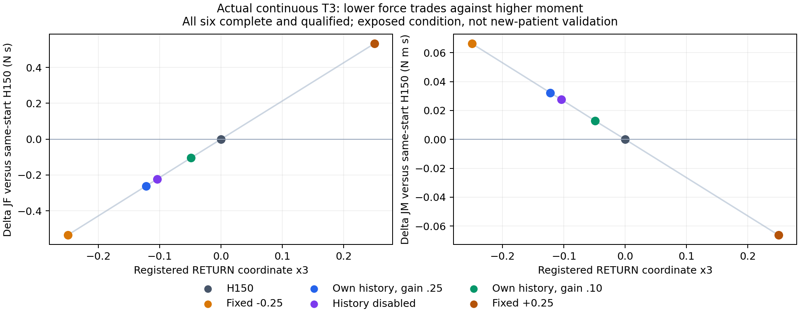

# History-conditioned / ILC / BO：最终结果

截至 2026-10-27 13:38 UTC，真实连续Trial工程与原两新参数条件程序验证均已闭合。heavy065因H/zero partial未进入T3；light035历史确实改变动作，gain.25有小幅JF改善但增JM，未超过同父disabled/固定−.25的降力。BO真实拟合后弃权。总体仍 **NOT_FULLY_EXPLORED**，不构成广泛个体化或家族整体否证。

## 真实连续 Trial

`V8CONTILC01` 保持同一进程内模拟器、控制对象及重复运动状态，从 T1/B 经 20 native 步边界进入 T2；T2 自身 H150 完整结束后，再经 20 步边界进入 T3。T3 子候选从该实际状态分叉。该证据支持对象与时间连续，边界没有记录全部隐藏 native 状态，因而不声称逐位证明所有隐藏状态。它不是从旧 B 轨迹重建的冷启动重复。

14 个完整任务全部通过原任务、安全和 motion 合同。实际新增 **1,106,000 native steps**，包含 2 个边界；子归档的继承前缀不重复计作新增物理。两个阶段各自的 parent/B、zero/H150 四对完整 raw 一致。独立审计重新运行原 scorer、5ms 左积分及未滤波 native motion，并核对自身历史、实际 reference 激活和闭合进程。

T3 同起点 H150：JF=1619.786324018 N·s，JM=122.304416177 N·m·s。

| 方法 | 实际 x3 | 相对 H150 的 ΔJF | ΔJM | 完整资格 |
|---|---:|---:|---:|---|
| 历史误差投影，gain=.25 | -.122386278 | -.261417264 | +.032363016 | PASS |
| 同一投影，gain=.10 | -.048954511 | -.104125317 | +.012833761 | PASS |
| history-disabled，异质旧历史先验 | -.104280307 | -.222977747 | +.027649160 | PASS |
| 固定小扰动 −.25 | -.25 | -.535212660 | +.066306076 | PASS |
| 固定小扰动 +.25 | +.25 | +.533033930 | −.066244428 | PASS |

**CONFIRMED：**真实自身历史改变了动作；enabled 相对 disabled 进一步降低 JF .038439517、增加 JM .004713857。**CONFIRMED：**本例 gain=.25 未超过固定 −.25 的降力，所有降力方案均增加 JM。固定 −.25 并非未知测试答案，而是本次付费比较中的预登记对照。以上不构成严格双成本改善、独立个体化或净试验效率收益。

disabled 使用旧 nominal/轻载等异质历史、明确各自后续策略；不把这些成本当作同一无条件策略 value。当前局部 reference 更新限于已冻结的一维 RETURN 参数，未覆盖高维历史窗口、其他误差方向或自适应增益。

## 分量 BO

从同一当前 T3 起点的 6 个唯一 x3 观测，独立拟合 JF、JM 和原 45 项归一化 margin。线性、二次、RBF、Matérn-3/2 两个长度尺度合计 6 个模型，包含非零动作留一诊断：42 次多 RHS 求解、1,974 个标量头，0 额外 BO 物理候选。含原数据提取的 wall=28.563265s；最终数值拟合与选择约 .012105s，累计 receipt 不重复相加。

预登记保守分量规则给出 **ABSTAIN**。局部 JF 斜率约 +2.136493 /x3，JM 约 −.265101 /x3；候选 −.125 的 JM 上界增加约 .034485，且不能超过已观察的强固定 −.25。线性非零留一误差约 .001876 JF / .000141 JM，已足以描述此局部趋势；更复杂核模型没有获得控制增量。所谓 2σ 为未校准启发式，不能视为安全证书。

**SUPPORTED：**该一维局部范围存在力和力矩交换；弃权是实际决策，不是算法失败的泛化结论。本段为原known-heavy工程记录；原两新参数结果见下节。其他采集函数及更广动作方向仍未充分测试。

## 原两新参数条件的闭合程序验证（2026-10-27 13:38 UTC）

冻结的同一C4自适应程序已在原heavy065和light035两条件闭合。它检验冻结更新程序在新虚拟参数上的表现，包含当次合法局部拟合；并非冻结权重的纯推理、临床个体化或参数字节盲测。只有这两条件，TASK/fork/重复parent不能增作独立患者数。

- `V8CONVAL01`（heavy065，seed2026102753）：6对START/END，3完整B原合格、2个ZERO/H150 partial、1原boundary。两partial均KNEE_REFERENCE_MUST_BE_CONSTANT中止，hard11全true但不可完整排名；T3/ILC/disabled/固定扰动/BO全部NOT_RUN。既有新增native407220，不是本次审查新增。
- `V8CONVAL02`（light035，seed2026102754）：16对START/END，14完整TASK均原合格、2原boundary各20native，既有新增native1106000。T1→T2以及本臂T2_H150→T3的真实session/时钟、11个parent不变检查与四对parent/B、zero/H150 raw等效均通过。14个TASK不是14名患者。

light的T3决定由本臂已完成T2_H150的6个RETURN因果slot产生，estimated-reference误差与正receipt/原内部目标对齐；决定在第二boundary前冻结。gain.25 x3=−.04291765064389352、gain.10=−.01716706025755741，disabled=−.10428030739734558。五个非零臂都有实际激活、positive native及reference差异，支持历史→动作→执行，未重跑数学或scorer。

| 同父T3臂 | x3 | JF N·s | JM N·m·s | ΔJF/H150 | ΔJM/H150 |
|---|---:|---:|---:|---:|---:|
| B | N/A | 1360.929558448038 | 96.016341149227 | +36.946393353 | -5.765194634 |
| H150 | 0.000000000000 | 1323.983165095152 | 101.781535782827 | +0.000000000 | +0.000000000 |
| ZERO_MODAL | 0.000000000000 | 1323.983165095152 | 101.781535782827 | +0.000000000 | +0.000000000 |
| ILC_ENABLED_G025 | -0.042917650644 | 1323.902035051143 | 101.791027066076 | -0.081130044 | +0.009491283 |
| ILC_ENABLED_G010 | -0.017167060258 | 1323.950724079688 | 101.785330300444 | -0.032441015 | +0.003794518 |
| ILC_HISTORY_DISABLED | -0.104280307397 | 1323.786406773582 | 101.804329552796 | -0.196758322 | +0.022793770 |
| FIXED_X3_MINUS025 | -0.250000000000 | 1323.510983590399 | 101.836060465175 | -0.472181505 | +0.054524682 |
| FIXED_X3_PLUS025 | 0.250000000000 | 1324.451769315780 | 101.727712398868 | +0.468604221 | -0.053823384 |

全部表中臂原完整资格PASS。gain.25相对H150仅降JF .081130044 N·s，增JM .009491283 N·m·s。它的JF比disabled高.115628278、比固定−.25高.391051461；后两者的JM代价也较大，不能称严格双成本支配。支持本条件的小幅力/力矩交换，不支持当前history超过强固定或广泛个体化。disabled仍为事前异质nominal earlyH/light lateH先验，非同完整recipe标签。

light BO使用同一真实T3父状态的6个唯一x3，独立JF/JM/45margin头，原42个多RHS solve×47头，实际ABSTAIN、0新增候选；不能称未拟合，也不能把弃权当整体BO失败。未试grid±.125被预登记力增量、JM及原motion风险门拒绝；不确定性未校准。已有原提取+fit CPU28.238230s，其中最终fit/选择CPU.012099s；receipt为累计计数，不重复相加。

CONVAL02原closed raw审计core104.818161CPU/105.281270wall/RSS611768KiB；外层105.40wall、99.30user/5.63sys，二者重叠。原physics外层1415.75wall、1396.53user/36.04sys、RSS1557016KiB也已在主账本；本次metadata审查0raw/scorer/投影/模型/physics。

证据：原审计RESULT `60797de3083752adece20846b5051a1d27c36a3da0d357cfb3764f1eadb7b9a2`；metadata复核 `b443ceec5b6425b125342075f5ea18ec2929888545357f2b6810d1a6e18d06c9`。总体仍`NOT_FULLY_EXPLORED`：LEVEL3真实history影响及本light条件LEVEL4小JF改善成立，LEVEL5未超过强固定；LEVEL6只有原两条件程序验证，其中heavy门失败、light未显示强固定外JF优势；LEVEL7省试未证明。未充分探索更广动作/多轮history/校准BO与跨条件重复，不能整体否证家族。

新APP连续机制保留原合同草案。主线程报告已closed POSTAPP01新H complete=True、qualified=False，因此预设完整/motion/科学资格进入门未满足，明确`NOT_RUN_THIS_ROUND`，不实现/prepare/run。具体motion失败项待主线程原审计；本次未打开POSTAPP工件。该门失败不是family失败，也不修写原C4结果。

## 冷启动 History-conditioned Value

原 28 个 ridge history 模型和 history-enabled/disabled、action-only、commissioned25 变体使用三动作权限 B/LATE_H150/EARLY_H150。四个 frozen stock-case 中，enabled 与 commissioned25 均选 B/H/B/B，4/4 合格；相对 B 合计 ΔJF=−42.412107、ΔJM=+6.122961，简单三动作 RF/PPO/BC 也作同样选择。该结果没有建立历史信息的独有收益。

后来 `V8COMPENG03` 的实际 history reader/c3b/trial_interface 加载路径和 SHA、after-B 时间顺序均留证。它属于已曝光条件上的接口验证，不是额外独立患者样本。它与五动作 A/B/D 不混合排名。

图仅表示原V8CONTILC01开发工程，不含新参数验证。线段只连接实际观测，不是新增拟合；PDF/SVG同名文件可导出。

## 证据与后续

- [连续独立审计](families/history_conditioned/audit/V8CONTILC01_INDEPENDENT_CONTINUOUS_V1/RESULT.json)
- [独立关闭检查](families/history_conditioned/audit/V8CONTILC01_INDEPENDENT_CLOSURE_V1.json)
- [四条件 frozen 比较](analysis/FROZEN_TRANSFER_COMPARISON_V1.json)
- [动作权限纠正](audit/ACTION_PERMISSION_CORRECTION_V1.json)

LEVEL1 已通过；历史能改变决策属于 LEVEL3；本例完整合格降 JF 但增 JM，LEVEL4 仅限预登记 JF 目标；LEVEL5 尚未超过强固定扰动；LEVEL6原两新参数程序验证已闭合（heavy门partial，light小JF收益未胜强固定；非临床独立患者）；LEVEL7 净物理省试未证明。后续更广范围仍需新合同与主审批，保留同起点fixed/disabled及全部探索负担；不得把本两条件结果推广为整体家族结论。

## 最终目标权限澄清：实际冻结V2 BO

CONFIRMED：实际V2新候选门额外要求所有模型相对H150的ΔJM mean+2spread≤0，比原资格相对同父B的JM比值≤1.25更严格。未尝试的±.125各同时失败保守JF超过已测最佳固定−.25至少.01、JM上界与motion余量三项，因而ABSTAIN、0新物理候选。并非仅JM门导致，也不是未执行点实际运动失败。不能以此与允许JM取舍的ILC/固定臂作同目标排名或否定BO模型家族；没有松绑重算。精确合同、selector、存储decision的路径/SHA/指针见 [独立澄清](families/history_conditioned/audit/CONVAL02_BO_ABSTAIN_OBJECTIVE_CLARIFICATION_V1.json)。旧V1目标叙述不代替实际执行的V2。
