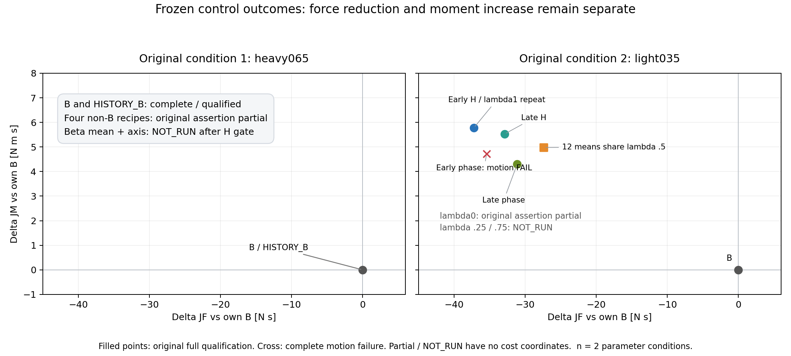
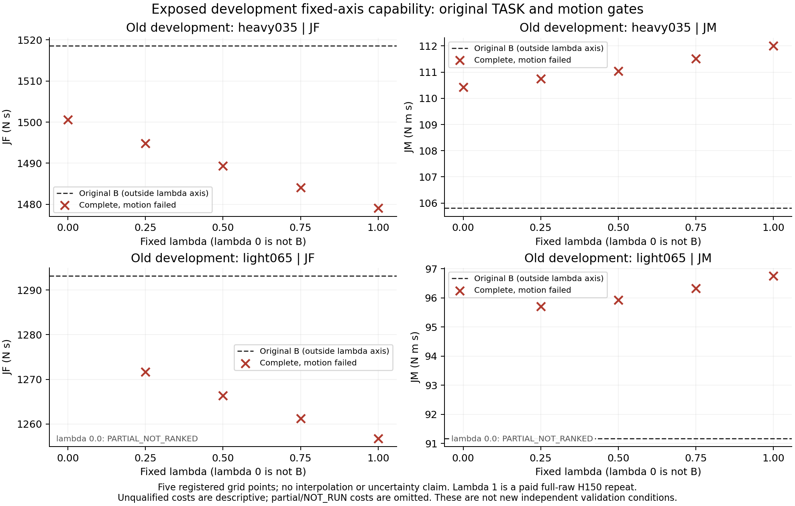
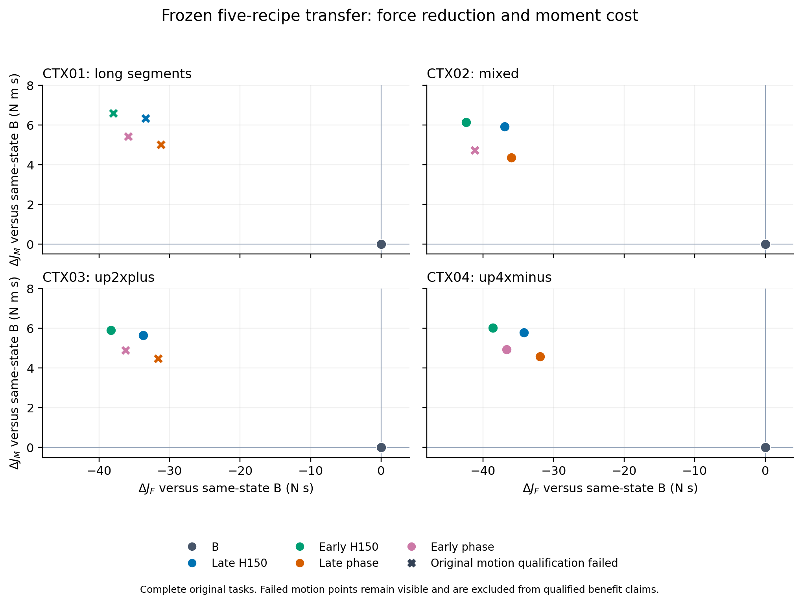

# 力、力矩与运动资格：最终结果

CONFIRMED：必须同时保留完整TASK、原motion与JF/JM分量。原两新参数的heavy非B旧配方为partial，不用其积分排名；light固定H合格且比B降JF/增JM，六个余量mean虽合格，JF仍弱于固定H而JM较低，均无双成本支配。原EARLY_PHASE完整但加速度p95失败。JM原比值≤1.25门保持，不等于JM不增加；BO V2另有更严相对H的JM不增门，目标单列。

此图仅含原冻结菜单，不把postvalidation新recipe当成旧模型输出。导出[PDF](figures/TWO_ORIGINAL_PARAMETER_FORCE_MOMENT_V1.pdf)、[SVG](figures/TWO_ORIGINAL_PARAMETER_FORCE_MOMENT_V1.svg)。

开发图红叉均为完整但motion不合格，L的λ0partial无完整坐标，B在λ轴之外。它支持已测点无合格非B，不能证明全连续域不可行。新POSTAPP两个条件的四个非B也全完整但motion失败，且light原合格H/late phase启用新flag后退化；接口完整不等于运动合格，不能替换原标签。来源及独立导出见[开发图manifest](figures/DEVELOPMENT_FIXED_AXIS_CAPACITY_V2.json)与[后验汇总](analysis/OPTIONAL_EXPOSED_DEVELOPMENT_FINAL_V2.json)。

以下为保留的早期四stock-case及各阶段细表；当前结论以本页首、总报告和原始SHA回执为准。所有结果限SCIENTIFIC_SIMULATION，host realtime/硬件/临床资格未建立。

# 力、力矩与运动资格（研究进行中）

当前已完成冻结四条件证据支持一个明确取舍：合格非B动作的JF降低均伴随JM增加。原JM积分比≤1.25门仍保持，但通过该门不等于JM不增加。原始native速度、加速度、jerk、行程、端点、phase边界及duration等运动门均保留；完整却不合格的低JF不列入合格收益。

图中圆点通过原完整资格，叉号为原motion门失败；所有点均为完整原任务，同条件B为原点。独立导出[PDF](figures/FROZEN_TRANSFER_FORCE_MOMENT_V1.pdf)、[SVG](figures/FROZEN_TRANSFER_FORCE_MOMENT_V1.svg)及[来源与SHA](figures/FROZEN_TRANSFER_FORCE_MOMENT_V1_MANIFEST.json)。

|冻结条件|同父完整合格的最低JF动作，仅作事后菜单描述|ΔJF / N·s|ΔJM / N·m·s|原门的关键限制|
|---|---|---:|---:|---|
|CTX01 long_segments|B|0|0|四个非B动作均excursion失败|
|CTX02 mixed|EARLY_H150|−42.412107|+6.122961|EARLY_PHASE速度峰值失败|
|CTX03 up2xplus|EARLY_H150|−38.308938|+5.905092|两个phase动作jerk RMS失败|
|CTX04 up4xminus|EARLY_H150|−38.626794|+5.953777|五动作均合格|

该表逐条件选取的菜单最优不是可部署未知测试教师。所有冻结控制器在B执行前保存选择，之后按实际选择连接同父物理结果，未按结果重选。事后比较全部菜单本身付出了全部真实试验成本。

冻结RF/PPO/BC与history-enabled恰好同选B/H150/B/B，4/4合格，合计ΔJF −42.412107、ΔJM +6.122961。A1主模型同选B/H150/phase/phase，仅3/4合格；其合格子集收益不能与4/4策略直接排名。A2完整48行开发资料中，21个合格非B记录的ΔJM全部为正，最小约+4.244746；这限于当前菜单与数据，不能推论其他合法动作不存在双成本收益。

STRICT_JM目标要求预测JM不增，独立列出；冻结A1各严格目标均选B，A2 DELTA严格目标也均选B。ABS严格目标仍曾误选实际JM增加的动作，因此预测约束不构成实际资格证明。

真实PG开发采样heavy035新增的LATE_PHASE完整原合格，ΔJF −32.683033、ΔJM +4.798604；该点是训练样本，不升级为冻结策略表现或独立泛化。连续轴、持续ILC及后续冻结新参数验证尚在执行或准备中，其结果另增，不能由此图代替。

证据：[冻结菜单与选择汇总](analysis/FROZEN_TRANSFER_COMPARISON_V1.json)、[完整原scorer重算](audit/scorer_replay/)、[A2覆盖风险数据](families/critic_value/coverage_risk_v2/data/ACTUAL_COVERAGE_DATASET_V1.json)。当前所有整体家族结论仍为NOT_FULLY_EXPLORED。

## 两个原新参数条件的冻结结果（已完成原回放）

第一组四个原nonB均partial，图中不给成本坐标；B/HISTORY_B完整合格。第二组EARLY_H150相对B为ΔJF −37.203525、ΔJM +5.781172；Beta均值λ=.5为−27.360936/+4.978963，二者均原资格通过，但均值的降JF较弱。固定lambda1为新付费raw repeat，不作额外独立患者；12个逻辑均值共享一个半轴recipe也不计12份物理成功。EARLY_PHASE完整但加速度p95门失败，λ0原断言partial，λ.25/.75按原门NOT_RUN。

这是两个参数条件的有限结果。不能由合格点图忽略第一组失败，也不能把partial或NOT_RUN标为零成本点。数据及文件SHA见[原结果汇总](analysis/TWO_ORIGINAL_NEW_PARAMETER_COLD_RESULTS_V1.json)、[图manifest](figures/TWO_ORIGINAL_PARAMETER_FORCE_MOMENT_V1_MANIFEST.json)，另有PDF/SVG。绘图0模型/fit/scorer/raw/physics，core CPU .5271s、wall .5474s、RSS87464KiB；外部启动成本另记。
