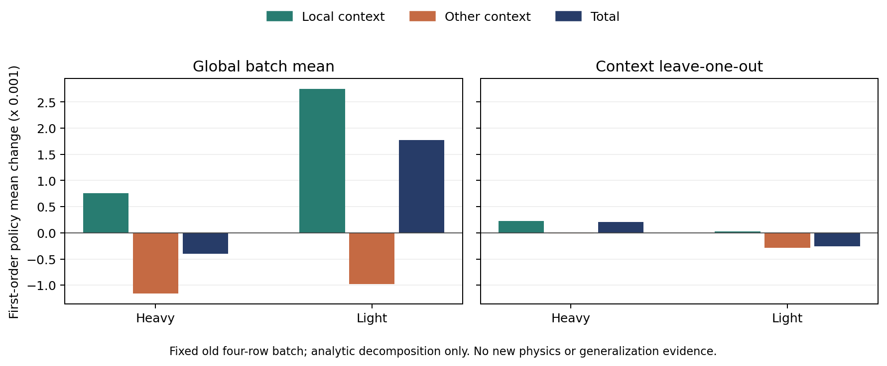

# PPO、Reward与策略梯度

CONFIRMED：本轮已从旧表优化推进到新的真实rollout，并完成两个四分支梯度批次；独立六mean冻结端点在两原新参数中一组被H150 partial挡住、另一组全部原合格，但原JF主目标未超过强固定H。旧数据信用分配/共享核干扰及其向新context的函数传递已有分开诊断，不能升级为控制、广泛个体化或净效率收益。整体家族为NOT_FULLY_EXPLORED。

历史研究并非“PPO从未学会任务”：两fraction和modal8策略已有有限完整任务能力。旧modal8有64次真实完整任务决策，正确强锚为JF 1400.089728，不能错用约1436的B；已有mean约1399.918合格，但未证明超过最强传统方法。旧41D native-event与当前完整motion/receipt桥接仍未闭合，不能把本轮离散接口称为修复旧41D。

本轮先完成168个离线小fit，含112 RF/PPO和56 BC，区分raw/gain20、JF/JM/严格JM目标及constant/25D表示。这些读取历史完整表，明确不是fresh on-policy。原旧三动作策略在四个冻结新执行条件均4/4合格，同选B/H150/B/B，合计ΔJF −42.412107、ΔJM +6.122961；与BC完全相同，未发现PG独有增量。它们只覆盖B/LATE_H150/EARLY_H150，不能与五动作A1跨权限排名；[权限审计](audit/ACTION_PERMISSION_CORRECTION_V1.json)保留了实际actor contracts。

真正新分支使用五个完整冻结recipe，在OUT0按合法commissioned25选择一次并完整执行。共同BC三→五lift保留原三logit，新phase行取两个H150行均值；softmax分母和概率发生改变。四臂为RF_RAW、PPO_RAW、RF_SCALED、PPO_SCALED，gain为1/20；RF每批1 epoch，PPO3 epochs，lr=.15、gradient norm≤1、clip=.2，无Adam或另一个value loss。更新强度不同，不能把差异全归于clip。

反馈仅在原完整工程/ownership合法时计算：合格为`clip(gain*(JF_B−JF)/max(abs(JF_B),1), −.9, .9)`，完整motion失败为−1；JM和motion独立报告，partial不排名。gain20改变成功量级相对固定失败floor，不能称纯全局尺度实验。

首个完整批次的两新开发条件为heavy035与light065，各臂每条件2个独立真实样本，共16个policy child、2个B control及2个真实parent。相同动作仍各自真实执行，未共享outcome假作多条on-policy数据。heavy8个policy样本均原合格（7B、1LATE_PHASE）；light8个样本均完整但motion不合格，低JF均保留为失败并给−1。首批8个SGD、32次manual score gradient、48个训练forward，四臂全成功后原子发布GENERATION_0002，第一完成即early，未按reward选最好。

|首更新|实际参数步|关键机制|
|---|---:|---|
|RF_RAW|1|小量heavy正反馈与两个light失败；梯度norm约1.2106，被裁至1|
|PPO_RAW|3|采样reward只有0/−1，逐epoch梯度norm约.6562/.5161/.2214|
|RF_SCALED|1|本臂合格样本只有B=0，gain20无成功差异可放大|
|PPO_SCALED|3|与raw完全相同的0/−1数据，更新后权重也相同|

48次冻结纯推理诊断中，四CTX及heavy的argmax未变；light上RF_RAW从失败EARLY_H150改选原数据中合格的B，两PPO改选尚未测的LATE_PHASE。PPO已知失败概率质量约.5298→.3537，未知动作质量约.2794→.4493。因此决策改变已确认，实际资格改善仍未知；不能把概率移到未知区域算成功。[诊断](families/ppo_reward/first_batch_diagnostic_v1/inference_once_v2/RESULTS.json)只读已关闭开发结果，非独立test。

RF_RAW曾消耗一个后来取消的工程采样draw；RNG没有倒回，故与其余分支的曝光不同，算法/尺度比较需保留该混杂。首次tuple/list JSON身份错误消耗192440新native且0更新，已回到原artifact严格复核后全组取消；继承generator的child GC共享写问题另建owner-only版本修正，未覆盖旧源。后续配置self-hash预检失败为0物理；诊断首次系统Python缺NumPy为0forward，另用正确venv的显式修正版48forward成功。工程错误不计为算法否证。

原分支窗口04:47:55Z→06:47:55Z不重置、不延长。第二批两组均已关闭、所有child joined、parent不变且无survivor；独立原始scorer重算共20个START均PASS。该批16个策略样本全原合格，15个B、一个light LATE_PHASE（JF1262.3775577477618、JM95.28246550990768；相对B ΔJF−30.7404635047205、ΔJM+4.11424506455151）。原子GENERATION_0003完成后另冻末次指针，首次完成的GENERATION_0002不变；没有best checkpoint选择。累计32个fresh policy trials、24合格/8完整motion失败、16真实SGD、64次manual score、96训练forward；不包含另外计账的取消draw和纯推理诊断。

末次指针为[GENUINE_ENDPOINT_POINTER_V1](freeze/GENUINE_ENDPOINT_POINTER_V1.json)，SHA `2f5d424e1e51fbe8033b4028385939264e15b86896142262b0e96de0662852b7`；[主审](audit/GENUINE_BATCH2_MAIN_REVIEW_ENDPOINT_V1.json)逐臂保留梯度、实际计数、原始结果和模型身份。新批启动余量不足冻结的3400秒，故不再启动此局部窗口的下一配对批次，继续其他已授权机制研究。该余量曾仅根据实测job约1231秒登记4000→3400秒例外，每job仍需至少1800秒余量并保留1800秒cap，未改变模型、reward、RNG或原停止时刻。

连续 Beta 的 Gate1 已完成并经原 scorer 独立重算：λ1 与原 H150 完整 raw 一致，λ=.5 完整合格，λ0 完整但 motion 不合格。保留原 λ∈[0,1]，没有按结果缩窄动作域；λ0 不等于 B，同轴固定 λ/H150 对照必需。

真实 Beta 四臂于原窗口 07:57:15–09:57:15 UTC 内初始化一次。每臂独立随机状态、标量 Beta 密度和实际付费轨迹，初始 α=β=2，均值 .5；不把该一维密度误作 18D 联合密度，不 clip/resample。首批两个开发 case 的 16 个 policy child 均完整执行，但全部 excursion 不合格；另有 2 个真实 B 和 2 个 parent，20 个 START 的原 scorer 重算均精确通过。

首批四臂共调用 8 次参数更新、32 次 manual score、48 次训练 forward，原子发布 G1。**全部 16 个奖励均为 −1，批均值 advantage 均为零，梯度与实际权重变化也均为零。** 因而这是有效的零梯度更新调用记录，不是学到新信息或策略改善。gain20 对失败 floor 没有作用。第二个平衡批次已从 G1 实际采样，仍遵守同一原停止时刻；冻结 mean 部署尚未执行。

首批准备器漏填 group_transaction_id 的失败发生在 18 次回执 adapter 重建后、任何 actor 更新前；修正版控制器路径预检又发生一次零模型调用失败。两次均保留原证据，随后用独立版本完整复核并成功提交，未覆盖失败，也未重复拟合 actor。当前正在准备独立的资格 margin 反事实诊断，未修改正在运行的四臂 reward。原始失败 floor 与新目标会分别报告；离线反事实更新不能冒称 fresh on-policy 或真实任务收益。

第二批重载的 8 个 policy child 均完整 motion 失败；配对轻载的首个 λ=.192973503 动作在原 `KNEE_REFERENCE_MUST_BE_CONSTANT` 断言处停止，新增 69120 native，部分成本不排名。轻载冷 parent 在 OUT0 中止，原 partial-compute 与 receipt 闭合其 40200 个新 native；此前的 commissioning 前缀不能冒称完整 TASK。所有 owner 已停止、原 pending/RNG 保留、该批 0 更新；四臂取消需单独完成 commissioning 前缀安全范围审计，未知项不补值。截至此时真实 Beta 共 25 个 policy START，其中 24 完整运动失败、1 protected partial；不能拿这些失败的低 JF 作控制增量。

独立反事实分支只重用首批 4 个 unique context/action，保留四臂全部 16 条真实付费身份；没有新采样或物理。原 45 项资格余量的符号与失败组精确 parity，最差 margin 奖励分别 −.0468191/−.0360940/−.1039754/−.1083142。只优化可行性、JF/JM 不进入奖励。global-batchmean 的 RF1/PPO3 共 24 forward/16 score/4 step，首梯度 norm=.0227902，所有 clip 未激活；H 均值变为 .499600/.498787，L 为 .501773/.505350。简单 OLS 在全部数据和两个 context 留出中均预测 λ1 最优，但未观测端点不能据此授予资格。

同数据、同优化器的条件 leave-one-out baseline 使用另一独立 draw 奖励，另计 24 forward/16 score/4 step，无新 OLS；首梯度 norm=.00363699，与 global 梯度 cosine=−.355654，H 均值 .500211/.500634、L .499743/.499229。global 同批优势在 H 全正、L 全负，LOO 则各条件正负成对；这证明有限批次的信用分配差异，不证明哪一种能恢复任务，亦不构成普遍方差或期望方向结论。四个最终模型全部保留，不选最好，实际冻结 mean 任务评价尚未运行。

不据上述限定结果整体否定 PPO 或连续策略家族。

10:05 UTC 主审补充：Beta 第二批父前缀实际 40,200 native 步已闭合；原数据在 commissioning 人加速度、commissioning session clearance、active recovery sleeve gap 三个 scope 缺观测，最终保留 UNKNOWN。未执行 all-arm cancel、未发布第二批更新；原 CURRENT 仍为 G1，第二批九个实际 draw/receipt/RNG 留在 external pending。此未完成分支不能标为安全通过或成功训练。第一批已提交 G0→G1 与此隔离，后续只读端点清单必须明确披露这一范围。

phase applicability 新探针的五个原 scorer 重算全部通过一致性检查；B 与 H150 对 V8COMPENG03 相同 case/seed/prefix 的全部 trace、116,320 native 记录和 5,817 command receipts 分别完全一致。两个新 phase recipe 都在 RETURN slot5 根据当前 reference 与公开目标拒绝了不适用的 optional timing 请求，原阈值 1e-10、原断言均未改变；两者完整结束但 excursion 不合格。确认接口适用性修正能避开这次中止，尚未确认完整运动资格或相对强基线增量。核验见 audit/PHASE_APPLICABILITY_CLOSED_REVIEW_V1.json；额外物理/模型调用均0。

10:59 UTC 主审补充：真实 E2 权重 schema canary 实际通过，candidate 7 API/35 query、原参考 18 API/50 query，共25 API/85 query；320个标量比较误差为0，九个选择一致，0 A3、0 fit、0新物理。该结果确认最小外层 schema 修正与原数学路径相容，不替代实际冷 OUT0 来源证明。新 ENG02 已以同一已曝光 heavy case、seed2690启动，逐次保存已成功返回的推理回执；ENG01原失败不覆盖。

GateK 对同一旧四行行为数据的实际数值分解确认共享特征的跨条件干扰：Gram(H,H)=12.7249783、Gram(H,L)=−16.3313512、Gram(L,L)=38.6695169。LOO Light 自身对 mean 的一阶贡献为+0.0000314110，Heavy 跨项为−0.0002882602，合计−0.0002568492，与已存 RF1 mean 位移一致。故按条件 baseline 本身尚未修复共享参数的更新方向；正在准备同尺度的上下文核去耦合变体，训练数据、奖励、原物理和评价门不变。这个旧批次代数结论不证明总体方差、真实任务收益或泛化。诊断19次26D dot、16次2D dot、4次2×2分解、16个方向导数，0 learner forward/score/fit/physics。

图中只绘制 GateK 已保存的一阶分解，不重跑模型；[矢量 PDF](figures/CREDIT_KERNEL_CONTRIBUTIONS_V1.pdf)。

11:04 UTC GateG 实际一次完成：保留同一G0、四个已闭合行为draw、余量奖励、LOO优势、lr .15、RF1/PPO3和原clip，仅以冻结训练context核去耦合更新，并共同缩放回当前原梯度范数。首梯度与旧LOO逐值一致，K_eff、span重建、范数和实际step上界全部通过。24 forward/16 score/4私有步；0采样/真实actor更新/新物理；核心wall .04605s、CPU .045185s、RSS 27772KiB。RF Heavy/Light mean=.500136641/.500019109，PPO=.500410048/.500057325，旧Light的负方向由几何修正转正；这只支持旧批次的干扰解释，不证明可行性、JF/JM增量或泛化。两个固定最终端点全部保留，正在与原四个端点共同冻结独立六mean程序，之后才打开新参数物理结果。

## 原两参数的全部冻结端点（13:11 UTC闭合汇总）

CONFIRMED：原Beta parent/first/last共12逻辑mean在VAL03被H150 partial门挡住；VAL04全部为同一λ=.5 recipe，连接一份付费合格结果，不是12次独立训练成功。JF/JM=1333.056546/100.645502；固定H=1323.213957/101.447711，B=1360.417482/95.666539。均值相对B降JF增JM，原JF主目标未胜H。λ0 KNEE断言partial，λ.25/.75按原门NOT_RUN，原全域未缩窄。

六个可行性反事实最终端点在首次新参数START前全部冻结且不挑best。FMEAN03为6次真实mean返回、但6TASK均NOT_RUN；FMEAN04六者真实执行且全部原完整合格，原9child+1parent的10份原回放均重现。几何相对LOO使RF的JF变化−.00237990、JM+.00004589；PPO为−.00714162/+.00013771，只是该单条件实际副观测。旧训练优化的是四个失败draw的feasibility margin，fixedλ.5本来已经合格，故这里没有相对初始策略的资格率增益。全六成本并列于[家族端点报告](families/ppo_reward/FROZEN_FEASIBILITY_DEPLOYMENT_RESULTS.md)，无强H的JF增量、无双成本支配、无统计总体或净效率结论。

SUPPORTED：reward floor、有限批baseline与跨context共享梯度干扰均得到分开诊断/修正；不能把这一机制进展升级为真实策略普遍改善。原Beta训练窗口已关闭且G1权重零变化，外部第二批pending/三安全UNKNOWN隔离，不取消、不提交、不重置时钟。原开发条件固定轴能力诊断仍待原六任务闭合后执行。

## 冻结新context的span传递解释（原单次算术，非新模型评估）

新03/04的确切causal25在原normalizer下，旧二训练context span之外的平方能量比分别为.5845464351/.7169288579；旧span投影系数分别(.75010013,−.00271717)/(.40970296,.46531448)。六个固定最终端点的双head参数位移都仍在旧span浮点残差范围内，故本轮更新对这部分新输入方向几乎无响应。该残差比不是失败风险或不确定度概率，非正交H/L分项不是因果重要度。

Geometry相对LOO的原已存mean差在03为RF−.000056778966/PPO−.000170433270，在04为RF+.000097803769/PPO+.000293490915。对应一阶对齐误差原记录分别约−1.2600e−9/−1.14805e−8、+6.95673e−11/+6.42353e−10。03/04不同的cross-kernel混合可解释符号差，不能预设旧核去耦合使所有新context同向“改善”。全部六端点、原Δlogit与一阶/已存Δmean表见[函数迁移诊断](families/ppo_reward/NEW_CONTEXT_SPAN_RESULTS.md)。

这次原算术只读pre-B25、G0/normalizer、旧C/L/G闭合梯度与最终weights、旧GateK Jacobian及12条已存预测，不读取新TASK成本/资格或raw；没有重建39或重算observer/非线性mean。100 scalar normalization、111dot26、48dot2、14solve和12次显式双head线性projection等价均已付费独立计账，0learner API/score/fit/RNG/physics；不能把算术说成0forward等价，也不把读取12个旧trace当12次新训练。原core wall.03198266s/CPU.03198s/RSS25728KiB，outer childwall.11450338s/inclusiveCPU.082672s；root prepare CPU未隔离，保留UNKNOWN，不填0。

RESULT SHA `20875d2d295030fc9ec4bc6f167cd96b22fe67fbcd06747841cadcc71d6b2cac`，DONE SHA `634514022a72aa9c9bcad3d402422d1b4da59a19aa52dedeae31a801484b5c24`。本次仅metadata复核，0新数学/模型/物理；所有原source、weights、阈值、validation和clock均保持。既有FMEAN03 TASK未运行、04原合格是另一层物理证据，本分解不声称造成其资格；固定半轴已合格、全部六mean未胜强H的JF结论不变。

## 原已曝光重型条件的固定轴能力（V8DEVCAP01H 已闭合）

原 heavy035/seed2026102751/prefix 保持，before-B 固定 B→H150→独立付费λ1→.5/.25/.75/0，实际5纯映射、7提案、0模型。7child全部complete、原11硬条件全true且原安全violation=false；只有B完整合格。H/λ1/.5/.25/.75均excursion失败，λ0还失败acceleration p95。B的JF/JM=1518.6079264083894/105.80146265999815；失败动作的低JF不能算收益，全部原成本见[家族固定轴结果](families/ppo_reward/DEVELOPMENT_AXIS_CAPACITY_RESULTS.md)。λ0仍非B，原拒绝/fallback保留。

原8START/8END、7joined、12个PID/startticks退出和1408源pin逐项通过；原parent+7child的8份full scorer replay exact PASS。付费λ1与H的原完整raw门PASS，保留两次实际成本，不静态alias。每child原receipt新native步76120、parent116320分列，END未填步数保留null。物理外层wall16:36.13、CPU user985.27/system22.88s、RSS1507876KiB；原回放wall1:05.22、CPU56.44/8.77s、RSS902420KiB、0新物理，资源范围不混算。

五个固定λ与旧heavy两个unique draw（约.49542/.70273）在这些已观测点均无合格非B support。它说明本条件有限网格及已付费随机点没有发现可行支持，不证明全连续区间不可行、整个家族失败或独立泛化。独立metadata复核3050checks PASS，REVIEW SHA `918950785a526f9f52913e35fa9e28da0122d276fb728a4541ade2e6b619f2f5`；本次0新模型/映射/数学/helper/scorer/rawcompare/physics，未读轻型DEVCAP01L或POSTAPP02，原冻结程序与clock不变。

## 原轻型固定轴能力闭合与联合范围（V8DEVCAP01L）

原light065/seed2026102752/prefix保持，5map/7proposal/0model。前6child完整且只有B原资格通过；H与独立付费λ1失败velocity max及excursion，.5/.25/.75失败excursion。λ0为原工程partial68140步，KNEE_REFERENCE_MUST_BE_CONSTANT，完整JF/JM/motion=null；NOT_RUN=[]只因它排最后，stop=ENGINEERING_PARTIAL_REST_NOT_RUN保留，partialJF不排名。L的B JF/JM=1293.1180212524823/91.16822044535617；所有分支成本见[联合固定轴结果](families/ppo_reward/DEVELOPMENT_AXIS_CAPACITY_RESULTS.md)。

7joined、8START8END、12已知PID/startticks退出、1408sourcepins与原11硬条件全true均独审通过。原H与付费λ1全raw门PASS；8原replay exact重现，其中λ0的SCORER_REPLAY_PASS重现原三轴FAIL、motion=null，不能升级完整成功。原物理外层wall16:09.33、CPU user958.90/system21.86s、RSS1511804KiB；原回放wall1:01.53、CPU53.76/7.76s、RSS903264KiB、0新物理。

两个已曝光开发条件的已测五固定λ与各旧两unique draw没有合格非B support；L的λ0缺完整结果，故不把它说成complete motion failure，也不证明整个连续域不可行或整个家族失败。新L原硬条件不能回填Beta02L旧三个UNKNOWN，旧pending/CURRENT安全scope保持。独立L复核5941checks PASS，REVIEW SHA `4dbdbd4062953676be9307fb9c0b6870c885318449ed9eb13b8305a7426e3e96`；本次0新模型/映射/数学/helper/scorer/rawcompare/physics，未读活动POSTAPP02。原frozen源码/模型/配置/阈值/clock不变；本分支完成最终账目后停止写文件，交主线程绘图与封包。
