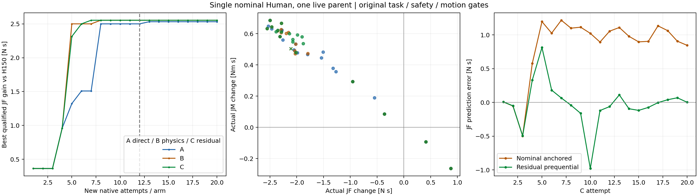

# iHEAR Lab — Learning-Guided Constrained Motion Improvement v1

**终态：STOP。** 本轮产生了完整合格的新协调运动；固定12次预算下，未建立C优于A与B的额外优化价值。

T0：2026-10-21T14:23:51+00:00 UTC；报告生成：2026-10-21T17:11:18.141990+00:00 UTC（北京时间2026-10-22T01:11:18.141990+08:00）；激活时钟未重置，实际elapsed 2.7909 h。最终封包结束见END.json。

真实物理START 77/80；优化 60/60，冻结验证 11/12，工程 6/8；实际新增native 5,474,800/8,000,000。所有完整、拒绝、partial和失败按原分母保存；import-only失败另列且无native步。

|独立状态|判定|
|---|---|
|RESEARCH_REFLECTION_RECORDED|PASS|
|FORWARD_PROXY_VALIDATED|PARTIAL_NOMINAL_LOAD_ONLY_FULL_CLOSED_LOOP_BLOCKED|
|PHYSICS_PRIOR_USABLE|CONDITIONAL_LOCAL_NOMINAL_RANKING|
|LEARNED_RESIDUAL_VALIDATED|LIMITED_LOCAL_PREQUENTIAL_FORCE|
|THREE_ARM_COMPARISON_COMPLETE|PASS_FIXED12_COMPLETE|
|STRONG_BASELINE_IMPROVED|OBSERVED_QUALIFIED_LOCAL|
|LEARNING_ADDED_VALUE|NOT_ESTABLISHED|
|TASK_SAFETY_MOTION_QUALIFIED|PASS_SELECTED_LOCAL_AND_ONE_NEW_PREFIX|
|CROSS_CYCLE_READY|NOT_READY|
|HOST_REALTIME_READY|NOT_READY|
|FINAL_CAMPAIGN_READY|NOT_READY|

FORWARD/RESIDUAL的局部状态不等于完整closed-loop、跨患者或安全预测资格。Learning贡献与是否能找到低force新动作分别判断。

## 三臂主结果

同链B JF=1436.456498145051 N·s；合格H150强父JF=1402.643211 N·s、JM=107.072272 Nm·s。当前H150相对B下降约2.353937%，这是本轮同链复现的父对比，不算新Learning收益。所有候选motion按原同链B门，不按H150重新放宽。

|臂|真实优化attempt|完整/原门合格|前12最佳JF|全分配最佳JF|相对H150降低 N·s（%）|JM变化 Nm·s|
|---|---:|---:|---:|---:|---:|---:|
|A|20|20/20|1400.143110|1400.111575|2.531636（0.180490%）|0.648777|
|B|20|20/19|1400.089728|1400.089728|2.553483（0.182048%）|0.632416|
|C|20|20/19|1400.089728|1400.089728|2.553483（0.182048%）|0.632416|

A=DIRECT_NATIVE_OPTIMIZATION（有界pattern search）；B=PHYSICS_GUIDED_OPTIMIZATION（固定名义模型排序）；C=LEARNING_RESIDUAL_GUIDED_OPTIMIZATION（同名义prior+局部GP残差）。共同初始4点在各臂分别真实执行，不能把它们的相同收益归功Learning。前12是固定主分母；按预注册信号扩展的结果单列，没有为了C获胜重排历史门槛。

全部已分配预算下C是否严格超过A/B：False。到达同等收益的真实尝试数见OPTIMIZATION_ANALYSIS.json；相同新增物理预算不等于相同模型拟合、代理查询或历史计算成本。

## 最终十六问

1. **方向反思是否长期归档？** 是。先于新physics追加到`/home/hank/ihear-lab/RESEARCH_DECISION_JOURNAL.md`；原条目不回写。新包保留初始/最终快照和SHA，结果以新UTC注释追加。见RESEARCH_MILESTONE_REFLECTION.md及audit/JOURNAL_RECORDING.json、JOURNAL_FINAL_RECORDING.json。

2. **过去最重要的教训？** 学会任务、产生低force动作、通过完整原门、超过强baseline和少次个体自适应是不同证据层。过去算法经常同时改变动作权限、目标和评价合同，百分比不能直接比较。大Learning潜力不证明当前可行集合必有大收益，小收益也不证明天然上限；18D机制提示姿态重力/弹性需求比单一smoothness代理更值得关注。

3. **现有物理模型事前能预测什么？** 原同型Human逆动力学与allocator能给拟议reference的名义phase/full JF和JM，并计算reference v/a/jerk、excursion/terminal值。正确历史重建预测H150相对B ΔJF=-7.935726，实际-33.813287 N·s；JM分别0.092151/5.818577 Nm·s。方向可对、幅度不充分。一组历史不能证明泛化。

4. **哪些量需要闭环残差？** robot/contact、tracking、governor pacing、离散准入及后续状态响应没有由该名义模型闭合。本轮学习完整JF/JM结果残差和经验最差motion比；真实q/dq轨迹、tracking及task/contact可靠预测仍UNKNOWN。某量“需要学习”仍是研究假设，不能由缺口直接证明GP足够。

5. **实际生成什么运动？** 在冻结H150上把18D differential系数[1,6]分别改为原值+0.002*x_O、原值+0.002*x_R；只改变中间髋膝协调意图，原HOLD/端点/时序修复不变。原quintic、certificate、admission、governor和torque链执行，拒绝与fallback均保留。各臂最佳参数如下：
   - A：`OPTIMIZATION_A_013`，x=[0.875, -1.0]，Δ系数=[0.00175, -0.002]。
   - B：`OPTIMIZATION_B_008`，x=[0.8245887463260377, -0.9835625245511301]，Δ系数=[0.0016491774926520755, -0.00196712504910226]。
   - C：`OPTIMIZATION_C_007`，x=[0.8245887463260377, -0.9835625245511301]，Δ系数=[0.0016491774926520755, -0.00196712504910226]。

6. **A/B/C各多少真实attempt？** A=20, B=20, C=20；每个失败、partial和未改善点均消耗对应分母。公共工程与验证成本另记，共77次，未借其它臂尚未公开的反馈更新模型。

7. **哪个找到最好完整合格运动？** 前12的最小数值ID为`OPTIMIZATION_B_008`，全分配最小ID为`OPTIMIZATION_B_008`；若相同JF须视为并列，不能按字母次序宣布唯一算法赢家。见完整表和CSV。

8. **C真正优于A/B？** 固定12次：False；全部已分配：False。这些是本轮同一父的确定性开发观察；患者总体优势、统计可靠性和硬件适用性未建立。

9. **相对强baseline降低多少完整JF？** 本轮最佳新合格候选下降2.553483 N·s（0.182048%）；分母是同链H150的1402.643211，不能套用旧18D/B或其它患者分母。

10. **JM及motion代价？** JM变化见主表；tracking、raw native v/a/jerk、excursion、endpoint/overshoot、contact、clearance与torque见MOTION_AND_WRENCH_TRADEOFF.md和独立raw审计。原门通过仅表示这份工程合同合格，力下降而JM增加仍是取舍，不称全面Pareto优势或临床舒适度改进。

11. **代理是否误导？** 历史全参考重建低估force/moment改善幅度；局部误差以每次START之前锁定的预测对比完整真实轨迹。C预序JF RMSE=0.324837，同点锚定名义RMSE=0.941323 N·s。预测motion可过却原门失败列表为['OPTIMIZATION_C_015']，分母19；没有失败覆盖也不能授可靠motion预测资格。无效默认ROM诊断保留并单列，不充当科学反例。

12. **是否支持扩大Learning？** 本轮最多支持针对闭环残差、失败域和独立合法状态的受控开发。只有真实固定预算收益才是优化额外价值；预测拟合改善本身不能授权更大训练、Stage2或最终Campaign。

13. **若C无额外改善，可能原因？** 名义prior已可能给出局部正确方向，二维有界邻域容易被传统搜索覆盖；小数据残差、GP平滑/不确定性、有限参数权限和离散执行响应也可能限制收益。当前单父实验不能唯一识别主因，不能归结为Learning无用或当前物理全局上限。

14. **如何连接少数重复运动？** Trial1产生当前患者因果历史，Trial2只据已完成历史更新局部残差/参数，Trial3/4逐次冻结后验证；与固定强baseline、history-disabled、ILC/BO同权限比较，记录每次完整JF及累计探索负担。本轮几十次仿真试错不等于新患者两三次适应；原motion真值余量还需可部署测量合同。

15. **下一轮优先改什么？** 优先补充经独立合法状态与失败域验证的闭环响应/运动余量模型和因果数据合同，再判断是否需要扩大动作表示或改变优化策略。保持本轮已找到的局部合格候选为固定参考；不因有限小收益自动加网络、PPO episode或自由度。

16. **论文与真实硬件还缺什么？** 独立患者/初态覆盖、少次连续trial消融、累计探索成本、motion与治疗等效性的依据、传感器可得余量、状态迁移与不确定性校准、真实host时序与硬件安全验证。Linux地址空间fork不是可持久化跨ABI恢复，也不是真实患者可克隆的状态。

## 预测排序与不确定性

同20条完整C轨迹，名义JF Spearman=0.933835，学习预序=0.697744；跨更新模型的描述性相关不是固定模型的独立状态排序资格。95%区间经验覆盖JF=7/20、JM=8/20、motion比=14/20，未证明校准。

## 低force但原motion失败的本轮反例

`OPTIMIZATION_B_013` x=[0.8657225587571926, -0.7869727010304737]，完整JF=1400.530418，原门失败=['jerk_deg_s3/rms']；raw jerk RMS hip/knee=[558.1903238532266, 680.6090564297104] °/s³。原physical/task轴=PASS。该点只保留原始积分与负结果，不进入正式收益排名。
`OPTIMIZATION_C_015` x=[0.8657225587571926, -0.7869727010304737]，完整JF=1400.530418，原门失败=['jerk_deg_s3/rms']；raw jerk RMS hip/knee=[558.1903238532266, 680.6090564297104] °/s³。原physical/task轴=PASS。该点只保留原始积分与负结果，不进入正式收益排名。
冻结最后C模型对失败动作`OPTIMIZATION_B_013`的事后只读预测（相同action已在训练中=True）：motion UCB=1.596241，实际最差原门比=1.663338；会预测motion通过=False。最后模型的同action训练内重放不算泛化；实际C15误判以其START前冻结预测为准，跨臂相同参数按一个action/state组解释。离线查询不回流新proposal。
冻结最后C模型对失败动作`OPTIMIZATION_C_015`的事后只读预测（相同action已在训练中=True）：motion UCB=1.596241，实际最差原门比=1.663338；会预测motion通过=False。最后模型的同action训练内重放不算泛化；实际C15误判以其START前冻结预测为准，跨臂相同参数按一个action/state组解释。离线查询不回流新proposal。

这类反例说明名义负荷或局部GP余量不能替代真实原门；不删除瞬态、不用滤波门替代raw，也不以任务完成冒充motion通过。

## 冻结新合法前缀

患者仍相同；前缀与seed在优化结果之前登记，candidate/model锁定后才执行。未做任何heldout后调参。

|分支|完整|原门合格|JF N·s|JM Nm·s|对该前缀合格H150收益 N·s|
|---|---|---|---:|---:|---:|
|B|True|True|1437.930510|100.786184|-34.031554|
|H150|True|True|1403.898956|106.606114|0.000000|
|LOCKED_A|True|True|1401.358816|107.269517|2.540140|
|LOCKED_B|True|True|1401.336169|107.252105|2.562787|
|LOCKED_C|True|True|1401.336169|107.252105|2.562787|
|PRIMARY12_A|True|True|1401.387489|107.309104|2.511467|

若该状态H150原门失败，其force不得作为合格父收益分母；B仍独立列出。一个新前缀不等于跨患者或一般合法状态可靠性。
冻结C模型在新prefix上的绝对JF预测=1400.155210、实际=1401.336169，误差=-1.180959 N·s；冻结预测配对ΔJF=-2.488002，实际新H150配对ΔJF=-2.562787。没有据新B/H150重锚或更新模型；局部动作差分与跨状态绝对成本预测分开判断。

## 保护、计算与证据边界

GitHub起点`1adb1de177d6f5f32de6d01c4e629cbfae9ce121`干净checkout只读。历史保护检查97832个文件metadata、43676个内容SHA；变化0；Git HEAD/branch/status/index保持一致。物理源码、安全、原scorer、旧PPO/B/18D/H150及raw未覆盖。没有Git commit/push/merge/reset/stash/clean。

最小可用RAM 27.449 GiB，最小磁盘余量 161.261 GiB；单活动物理环境，父进程在waitpid期间不步进。native/queue-wall吞吐636.98，包括归档、评分、拟合与间隙，不能当纯mj_step速度。预算为上限；有限队列完成后不为填满5–7小时重复计算。

独立重算采用同一Agent的另一条代码路径：完整JSON解码、trace左积分、native receipt区间join、applied torque与dq导数重算；不是独立研究者或独立数据。所有完整attempt结果见audit/INDEPENDENT_RAW_AUDIT.json。历史allocator事后重算与事前预测严格分开；原36.53/37.92不能解释为96%预测准确率。

历史prior公开给全部臂：D01R B/H150两条已完成轨迹，同一Human/同一父组；相关原父/分支新native分别116320、69260、69260（audit/HISTORICAL_PRIOR_COST.json），原wall成本未重构。共同新增工程锚点和全部失败另记本轮账本；不能仅以新增次数相同声称总计算成本完全相同。

可审阅交付：[BASELINE_AND_CANDIDATE_COMPARISON.md](/home/hank/ihear-lab/learning_guided_motion_improvement_v1/BASELINE_AND_CANDIDATE_COMPARISON.md)、[MODEL_RESIDUAL_STUDY.md](/home/hank/ihear-lab/learning_guided_motion_improvement_v1/MODEL_RESIDUAL_STUDY.md)、[MOTION_AND_WRENCH_TRADEOFF.md](/home/hank/ihear-lab/learning_guided_motion_improvement_v1/MOTION_AND_WRENCH_TRADEOFF.md)、[THREE_ARM_CANDIDATES.csv](/home/hank/ihear-lab/learning_guided_motion_improvement_v1/THREE_ARM_CANDIDATES.csv)、[ATTEMPT_ACCOUNTING.json](/home/hank/ihear-lab/learning_guided_motion_improvement_v1/ATTEMPT_ACCOUNTING.json)、[SOURCE_RETURN_PLAN.md](/home/hank/ihear-lab/learning_guided_motion_improvement_v1/SOURCE_RETURN_PLAN.md)、[PACKAGE_VERIFICATION.json](/home/hank/ihear-lab/learning_guided_motion_improvement_v1/PACKAGE_VERIFICATION.json)。

正式Stage2、长程PPO与最终Campaign未启动。完成后STOP，未自动开启下一研究包。
