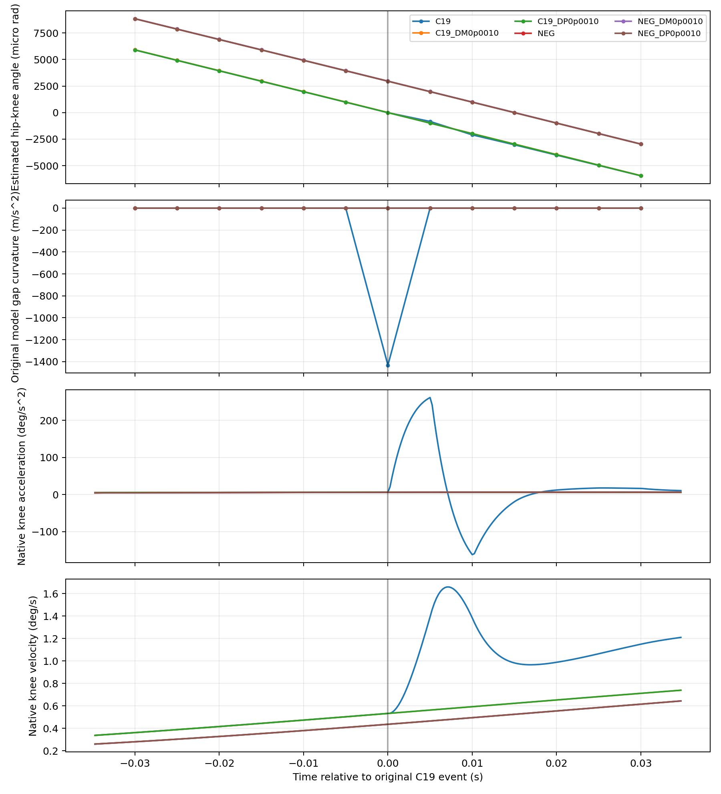

# clearance非光滑机制与有限因果验证

**CONFIRMED**：观察到的是袖套几何最低端点切换产生的连续、不可微包络，其跨分支中心二阶差分进入原反馈，触发实际扭矩修正和native运动质量问题。**SUPPORTED**：原样物理配对与负对照支持它是该局部motion失败的重要中介。尚未直接替换单独guard曲率做物理干预，不宣称已排除所有闭环中介或证明替代guard安全。

## 几何分支和活跃选择

令 φ=q_h−q_k，a=cosφ·p_x,z+sinφ·p_z,z，z_k为膝高度，z_c为cuff中心高度。原几何、半径、床高和margin均保留。

|组件|原gap/分支|
|---|---|
|proximal thigh|注册非负髋角域且平面满足条件时为固定安装下界0.0001 m；否则为min(髋高,膝高)−大腿半径−床高|
|distal shank|`min(z_k,z_k+0.46a)−小腿半径−床高−0.001`|
|sleeve|`min(z_c−La,z_c+La)−r sqrt(1−a²)−床高`|
|cuff bar|与袖套同类圆柱式，使用原bar半长与半径|
|cuff adapter|原标定变换得到两端高度及轴竖直分量，使用原0.018 m半径；退化长度使用原中心式|

总体 `CombinedRigidTableClearanceV1.evaluate` 取旧shank及五组件的最小值。连续quintic证书保留1201节点及原导数/Lipschitz界；若原配置启用单调专用证明，同一组件取两条有效下界的较大者，最后再取组件最小值。它们与反馈里的袖套gap导数不是同一层。

**本次已定位的分支是sleeve圆柱两端，而不是已证实的全局组件最小值切换。** 袖套gap可写成 `smooth(q)−L|a(q)|`。a>0时a端最低，a<0时b端最低；gap在a=0连续但不可微。测得gap-rate的原公式另含 `−L sign(a_measured)·a_dot_measured`，在精确测量轴零点有一侧导数跳变；本次没有把这个未完整记录的测量轴切换认定为事件主因。

## 差分与原控制计算

原guard的关节梯度使用q±10⁻⁵ rad，方向曲率使用q±h·dq、h=10⁻⁵ s，数值相同但单位不同。只要这个极窄方向模板跨过a=0，二阶差分就含最低端点的切换项。精确切换处约为 `−2L|a_dot|/h`。在本次非零偏置状态，h小于跨分支尺度后回到单支；不能声称该固定状态在h→0必发散。更小h另有浮点抵消。

固定h的包络差分随q连续且斜率很大，不能将大值直接称为gap的数值不连续。原反馈随后还有active-set/加速度box饱和，执行层另有5ms采样和ZOH，以及scheduler时长网格。它们必须分别检查。

|需要区分的现象|本轮判断|
|---|---|
|连续但不可微|CONFIRMED：圆柱最低端点的min/绝对值|
|gap真正数值跳变|未发现；固定h差分虽很陡，仍不能因此称gap不连续|
|离散执行/模式|5ms ZOH与投影box激活已记录；C19邻域supervisor仍是TRACK，未据此声称TRACK/BRAKE切换|
|导数计算尖峰|CONFIRMED：方向模板跨两端点分支；C19与其单个光滑端点曲率差数千万倍|
|真实Human变化|CONFIRMED：receipt实际扭矩、native速度/加速度/jerk；其唯一物理中介归因仍为SUPPORTED|

原需求为 `required=2(10⁻⁵−measured_gap−response*measured_gap_rate)/response²+adverse`。当 `required−grad·a_requested−curvature>0` 时，在原加速度box内修正，再经原filter、allocator、robot执行和真实cuff/Human动力学。本例出现巨大负“模型gap曲率”，不是巨大真实Human加速度。

|保存反例|方向曲率 m/s²|原guard修正 Nm|native jerk RMS 髋/膝 °/s³|物理/任务|原motion|
|---|---:|---|---|---|---|
|CORE_C_019|-1432.356195|[14.915400528209446, -4.408732069397653]|[885.9671407429007, 1955.250980612544]|PASS|FAIL|
|PPO_SCRATCH_TRAIN_0009|-449.597641|[8.880443536095054, -2.8059660784551106]|[559.0113099239076, 681.0538402349291]|PASS|FAIL|

对两条raw重新构造原函数所消耗的因果充分gap/gap-rate标量，独立调用未修改的 `clearance_acceleration_correction`，曲率、gradient、力矩修正误差均为0，required误差至多8.9×10⁻¹⁵。这个适配是计算重放，不是重建真实Human完整状态；没有用物理trace中略有差异的cuff点冒充控制输入。

C19当次guard使用gap=0.055423979 m、gap-rate=−0.130540779 m/s、response=0.08 s；模型曲率−1432.356195令原box到角点，guard自身记录constraint_satisfied=false。完整原physical/task和clearance审计仍PASS；其native最大加速度为[156.807740,261.247177]°/s²，不能与该gap曲率混为一谈。

原requested acceleration、guard correction、filter后的Human generalized command、接受的6轴robot torque和applied torque分别保存；Human 2维Nm和robot 6轴Nm不是相同量。guard前6轴robot请求扭矩没有单独归档，不制造此字段。两反例的对应receipt均实际applied，持续20个0.25ms native步，event/receipt/native torque逐项相同。C19在随后5ms的真实关节速度变化为[0.465152,0.860352]°/s；native jerk burst确实伴随真实速度变化，不是只由模型曲率绘图得到。

## 同父微参数物理干预

预登记只改变回程相对路径坐标x[3]：C19周围±0.0001、±0.001；未跨该差分模板的旧TIME_PLUS_010作为NEG，并做同样±0.001控制。9条分支加1条冷父，总10个物理START。全部沿用原guard、阈值、plant、任务和scorer；不是优化或新guard资格实验。

负对照的“未切换”指控制采样处没有中心模板跨分支；连续运动仍可在两个5ms控制采样之间换最低端点。不能将没有模板命中写成没有几何分支变化。

|身份|原门|JF|JM|跨模板事件数|最低曲率|native jerk RMS 髋/膝|
|---|---|---:|---:|---:|---:|---|
|P2_B|PASS|1436.456498145|101.253694591|0|-0.067183|[305.07675131461014, 714.7273635353746]|
|P2_C19|FAIL|1399.857062420|108.090020580|1|-1432.356195|[885.9671407429007, 1955.250980612544]|
|P2_C19_DM0p0010|PASS|1399.846020577|108.089362379|0|-0.068248|[319.49004383784467, 675.6802720655979]|
|P2_C19_DM0p0001|FAIL|1399.857001821|108.090027045|1|-1015.050571|[885.9677965167714, 1955.252668741987]|
|P2_C19_DP0p0001|FAIL|1399.857123018|108.090014116|1|-1313.635749|[885.9664849686444, 1955.249292477647]|
|P2_C19_DP0p0010|PASS|1399.847232894|108.089233361|0|-0.068248|[319.489837403395, 675.6808462633272]|
|P2_NEG|PASS|1399.849198648|108.032127691|0|-0.068248|[319.42276237174923, 675.5540696130813]|
|P2_NEG_DM0p0010|PASS|1399.848591092|108.032192426|0|-0.068248|[319.42286832008773, 675.5537849779846]|
|P2_NEG_DP0p0010|PASS|1399.849806202|108.032062956|0|-0.068248|[319.42265650466305, 675.5543542937285]|

|配对变体|Δx[3]|最大目标差 °|改变时长的decision|最大request偏移 s|RETURN前native完全一致|跨模板数 base→variant|
|---|---:|---:|---|---:|---|---|
|P2_C19_DM0p0010|-0.0010000|0.000302822|[]|0.000000000|True|1→0|
|P2_C19_DM0p0001|-0.0001000|0.000030282|[]|0.000000000|True|1→1|
|P2_C19_DP0p0001|0.0001000|0.000030282|[]|0.000000000|True|1→1|
|P2_C19_DP0p0010|0.0010000|0.000302822|[]|0.000000000|True|1→0|
|P2_NEG_DM0p0010|-0.0010000|0.000302800|[]|0.000000000|True|0→0|
|P2_NEG_DP0p0010|0.0010000|0.000302800|[]|0.000000000|True|0→0|

全部六对签发时长、request时刻、activation及modal接受/拒绝状态均未变化。±0.001的最大目标变化约0.000303°；C19配对在事件前最大6轴torque差<0.001 Nm，事件后约11.9 Nm，native位置差约0.015°。未跨模板的NEG配对事件后torque差仍<0.001 Nm，位置差约0.000293°。这排除了本组配对的5ms时长量化/请求迁移解释，仍不等于只替换guard的物理中介隔离。

这张表明确列出调度/请求混杂；没有靠“事件时间相近”认定因果。每对完整live父状态相同，且RETURN前native q、dq、torque逐项一致。之后的目标、通过速度、时长和activation差异全部保留；详见 `analysis/P2_PAIRED_RESULTS.json`。物理曲线使用原native数据，未滤波或删除瞬态。

## 已证实、支持和未测试

- **CONFIRMED（计算因果）**：在相同已记录gap/gap-rate、dq、requested acceleration下，只将C19髋估计q移动±3×10⁻⁶ rad，原函数修正从约[14.9154,−4.4087] Nm变为0。两个独立光滑端点曲率约2.1×10⁻⁵ m/s²，而min曲率约−1432；公式分解和原函数重放定位了修正来源。
- **CONFIRMED（总干预）**：登记的上层微参数变化在同父原链中改变分支采样、实际命令/真实运动及原motion判断。每条失败也保留完整JF/JM与原scorer，未进入合格排名。
- **SUPPORTED（物理中介）**：跨模板、原guard冲量、receipt实际执行、真实native运动及配对/负对照共同支持该反馈计算是局部motion失败的重要来源。零物理q扰动不是物理实验；微参数物理干预又会改变其他闭环量，不能声称已做“只改guard”的物理中介隔离。
- **HYPOTHESIS**：窄模板与5ms采样相位相互作用产生稀疏失败带，使平滑目标/约束模型在局部优化中失配。发生频率、全域边界及其它患者上的重要性未建立。
- **NOT_TESTED**：替代guard的物理执行、完整保护等价性、硬实时/硬件/临床资格、跨患者失败率。

数学上 `min(gap_a,gap_b)≥margin` 等价于两条端点gap都≥同一margin；本轮仅在诊断里验证此表达和各自光滑曲率。点态几何等价不证明加速度反馈、有限响应时域、估计误差、组合shank保护和饱和可行性等价。没有替换正式guard，没有晋级实验实现。

原始/新raw及函数身份见 `analysis/forensics/`；PPO第9次仅复用已保存raw，没有新训练。旧四个较大时序干预也已复核，支持时间安排能改变失败，但它们不单独识别微参数敏感性的唯一中介。
