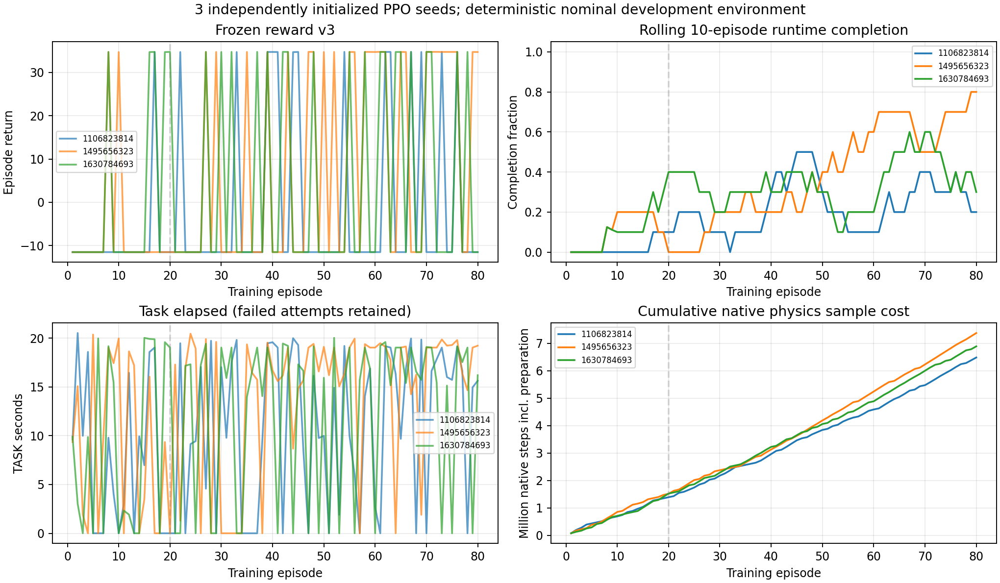

# 三seed PPO学习曲线

三个seed的全部训练采样、失败、reward分项、entropy与loss保存在ALL_TRAINING_LOG.jsonl及seeds/*/stage1/TRAINING_LOG.jsonl。下表按连续10集汇总。失败的partial JF不能同完整成功JF当收益比较。clip前Gaussian entropy不是实际扭矩熵。nominal重复不是新患者泛化。

|seed|episodes|训练成功|平均return|平均TASK s|平均entropy nats|
|---:|---|---:|---:|---:|---:|
|1106823814|1–10|0/10|-11.500000|7.259|2.8387|
|1106823814|11–20|1/10|-6.880240|7.401|2.8373|
|1106823814|21–30|1/10|-6.881042|9.645|2.8369|
|1106823814|31–40|3/10|2.361130|9.567|2.8329|
|1106823814|41–50|3/10|2.358800|11.912|2.8310|
|1106823814|51–60|1/10|-6.877200|8.563|2.8269|
|1106823814|61–70|4/10|6.986145|12.092|2.8257|
|1106823814|71–80|2/10|-2.256936|15.159|2.8195|
|1495656323|1–10|2/10|-2.261326|11.299|2.8352|
|1495656323|11–20|0/10|-11.500000|6.478|2.8335|
|1495656323|21–30|2/10|-2.257478|11.443|2.8276|
|1495656323|31–40|2/10|-2.258417|8.779|2.8177|
|1495656323|41–50|4/10|6.986140|16.410|2.8106|
|1495656323|51–60|6/10|16.225290|16.306|2.8123|
|1495656323|61–70|5/10|11.608726|14.596|2.8107|
|1495656323|71–80|8/10|25.472295|18.551|2.8103|
|1630784693|1–10|1/10|-6.878857|7.741|2.8411|
|1630784693|11–20|4/10|6.980760|10.270|2.8373|
|1630784693|21–30|2/10|-2.257881|9.022|2.8338|
|1630784693|31–40|3/10|2.365980|13.372|2.8260|
|1630784693|41–50|3/10|2.366753|10.772|2.8200|
|1630784693|51–60|2/10|-2.257562|10.616|2.8155|
|1630784693|61–70|6/10|16.227260|17.785|2.8183|
|1630784693|71–80|3/10|2.364131|12.156|2.8174|

## 冻结评价

|seed / checkpoint|runtime|TASK s|JF N·s|JM Nm·s|tracking RMS °（hip/knee）|5ms jerk RMS °/s³（hip/knee）|
|---|---|---:|---:|---:|---|---|
|1106823814 / initial_deterministic|ABORTED|16.580|1260.614 partial|73.401 partial|[0.5817, 0.5987]|[522.999, 849.193]|
|1106823814 / checkpoint020|ABORTED|16.200|1218.506 partial|72.291 partial|[0.5605, 0.6337]|[472.017, 855.885]|
|1106823814 / checkpoint050_first|ABORTED|15.535|1097.199 partial|74.375 partial|[0.4734, 0.9066]|[336.735, 977.923]|
|1106823814 / checkpoint050_repeat|ABORTED|15.535|1097.199 partial|74.375 partial|[0.4734, 0.9066]|[336.735, 977.923]|
|1106823814 / checkpoint080_first|ABORTED|15.435|1131.390 partial|70.120 partial|[0.5018, 0.7201]|[354.434, 813.535]|
|1106823814 / checkpoint080_repeat|ABORTED|15.435|1131.390 partial|70.120 partial|[0.5018, 0.7201]|[354.434, 813.535]|
|1495656323 / initial_deterministic|ABORTED|16.575|1260.631 partial|73.334 partial|[0.5821, 0.6025]|[523.107, 853.266]|
|1495656323 / checkpoint020|ABORTED|16.755|1269.049 partial|75.492 partial|[0.538, 0.5917]|[416.005, 784.111]|
|1495656323 / checkpoint050_first|COMPLETE|19.030|1446.793|101.533|[0.4889, 0.555]|[336.701, 645.336]|
|1495656323 / checkpoint050_repeat|COMPLETE|19.030|1446.793|101.533|[0.4889, 0.555]|[336.701, 645.336]|
|1495656323 / checkpoint080_first|ABORTED|16.265|1222.538 partial|70.588 partial|[0.5007, 0.5242]|[324.088, 626.43]|
|1495656323 / checkpoint080_repeat|ABORTED|16.265|1222.538 partial|70.588 partial|[0.5007, 0.5242]|[324.088, 626.43]|
|1630784693 / initial_deterministic|ABORTED|16.625|1265.041 partial|73.857 partial|[0.5821, 0.6047]|[520.281, 851.432]|
|1630784693 / checkpoint020|ABORTED|15.885|1187.704 partial|69.888 partial|[0.5501, 0.6654]|[422.905, 868.394]|
|1630784693 / checkpoint050_first|COMPLETE|19.030|1437.054|102.749|[0.5057, 0.5804]|[328.023, 531.109]|
|1630784693 / checkpoint050_repeat|COMPLETE|19.030|1437.054|102.749|[0.5057, 0.5804]|[328.023, 531.109]|
|1630784693 / checkpoint080_first|ABORTED|15.580|1171.454 partial|60.870 partial|[0.4949, 0.4905]|[270.964, 570.289]|
|1630784693 / checkpoint080_repeat|ABORTED|15.580|1171.454 partial|60.870 partial|[0.4949, 0.4905]|[270.964, 570.289]|

失败成本下限保持v3；训练reward提高不单独构成force/motion优化。冻结评价没有用于改reward或挑训练seed。
