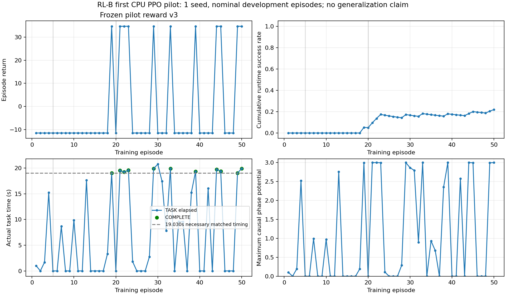

# PPO学习曲线

单seed nominal开发训练；失败总回报成本下限固定，不以少积JF换取回报。partial JF不作完整收益；采样训练成功不替代冻结checkpoint。每episode一次完整PPO rollout。阶段5/20/50门、entropy/losses/所有失败见原JSONL。entropy为Box clipping前二维Gaussian分布的总微分熵（nats），并非实际已执行扭矩的熵。

|Episode|Runtime|TASK s|Max progress|Return|JF (partial unless COMPLETE)|Decisions|Adam steps|
|---:|---|---:|---:|---:|---:|---:|---:|
|1|ABORTED|1.030|0.1042|-11.500000|101.317|3|4|
|2|ABORTED|0.005|0.0000|-11.500000|0.394|1|4|
|3|ABORTED|1.695|0.1967|-11.500000|165.639|4|4|
|4|ABORTED|15.220|2.5253|-11.500000|1217.412|21|8|
|5|ABORTED|0.005|0.0000|-11.500000|0.394|1|4|
|6|ABORTED|0.005|0.0000|-11.500000|0.394|1|4|
|7|ABORTED|8.670|0.9914|-11.500000|762.157|11|4|
|8|ABORTED|0.005|0.0000|-11.500000|0.394|1|4|
|9|ABORTED|0.005|0.0000|-11.500000|0.394|1|4|
|10|ABORTED|9.885|0.9744|-11.500000|901.947|19|8|
|11|ABORTED|0.005|0.0000|-11.500000|0.394|1|4|
|12|ABORTED|0.005|0.0000|-11.500000|0.394|1|4|
|13|ABORTED|17.660|2.7601|-11.500000|1330.756|25|8|
|14|ABORTED|0.005|0.0000|-11.500000|0.394|1|4|
|15|ABORTED|0.005|0.0000|-11.500000|0.394|1|4|
|16|ABORTED|0.005|0.0000|-11.500000|0.394|1|4|
|17|ABORTED|0.005|0.0000|-11.500000|0.394|1|4|
|18|ABORTED|3.330|0.1930|-11.500000|306.377|5|4|
|19|COMPLETE|19.030|2.9949|34.692041|1530.100|28|8|
|20|ABORTED|0.005|0.0000|-11.500000|0.394|1|4|
|21|COMPLETE|19.510|3.0000|34.682860|1576.280|25|8|
|22|COMPLETE|19.210|3.0000|34.716895|1406.570|23|8|
|23|COMPLETE|19.580|2.9970|34.689810|1540.513|24|8|
|24|ABORTED|1.805|0.1124|-11.500000|161.233|4|4|
|25|ABORTED|0.005|0.0000|-11.500000|0.394|1|4|
|26|ABORTED|0.005|0.0000|-11.500000|0.394|1|4|
|27|ABORTED|0.005|0.0000|-11.500000|0.394|1|4|
|28|ABORTED|2.765|0.2899|-11.500000|290.401|5|4|
|29|COMPLETE|19.885|2.9996|34.669674|1642.144|26|8|
|30|ABORTED|20.750|2.8637|-11.500000|1465.206|29|8|
|31|ABORTED|17.445|2.7958|-11.500000|1369.915|26|8|
|32|ABORTED|7.820|0.8958|-11.500000|643.253|10|4|
|33|COMPLETE|19.890|3.0000|34.707698|1451.417|25|8|
|34|ABORTED|0.005|0.0000|-11.500000|0.394|1|4|
|35|ABORTED|9.605|0.9333|-11.500000|750.035|14|4|
|36|ABORTED|9.550|0.6798|-11.500000|716.525|14|4|
|37|ABORTED|0.005|0.0000|-11.500000|0.394|1|4|
|38|ABORTED|15.255|2.3554|-11.500000|1167.761|18|8|
|39|COMPLETE|19.320|3.0000|34.705886|1461.944|24|8|
|40|ABORTED|0.005|0.0000|-11.500000|0.394|1|4|
|41|ABORTED|0.005|0.0000|-11.500000|0.394|1|4|
|42|ABORTED|16.075|2.5819|-11.500000|1235.522|21|8|
|43|ABORTED|0.005|0.0000|-11.500000|0.394|1|4|
|44|COMPLETE|19.715|3.0000|34.684542|1568.256|23|8|
|45|COMPLETE|19.385|2.9971|34.715360|1413.557|25|8|
|46|ABORTED|0.005|0.0000|-11.500000|0.394|1|4|
|47|ABORTED|0.005|0.0000|-11.500000|0.394|1|4|
|48|ABORTED|0.005|0.0000|-11.500000|0.394|1|4|
|49|COMPLETE|19.030|2.9967|34.700556|1488.496|22|8|
|50|COMPLETE|19.905|3.0000|34.717085|1404.948|22|8|
