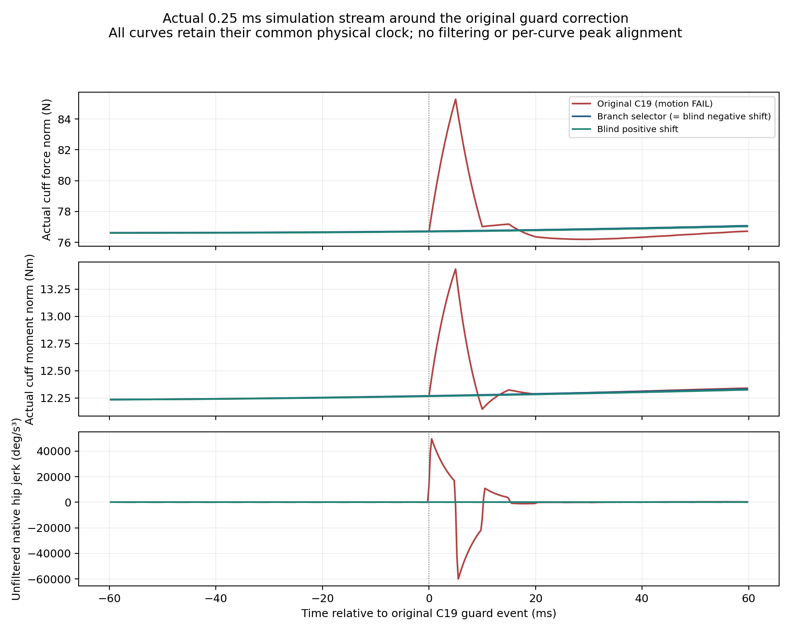

# 分支机制与信息价值

复用既有v3/v4机制，不重新证明abs尖点。本轮正式原guard及阈值完全保持。C19原反例及已知避让已复现。首版通用分支启发式在较早RETURN1改target而消除了较晚的C19冲击；这不等于已准确预报该晚期冲击。强固定原已安全时的小JF变化也不等于平顺性增益。

| 身份 | 原门 | 权限 | JF N·s | JM Nm·s | native jerk RMS 髋/膝 °/s³ | 200Hz ‖F‖ rate RMS N/s | 4kHz ‖F‖ rate RMS N/s |
| --- | --- | --- | --- | --- | --- | --- | --- |
| ANT01_ANT_C19 | PASS | original domain | 1399.930374 | 108.081086 | 319.49/675.71 | 17.8724 | — |
| ANT01_ANT_ONLY | PASS | EXPLORATORY | 1397.949114 | 107.979259 | 320.16/678.33 | 17.7435 | — |
| ANT01_ANT_REF | FAIL | EXPLORATORY | 1397.499083 | 108.271447 | 329.25/667.71 | 17.7996 | — |
| ANT01_BEST | PASS | original domain | 1398.034615 | 107.971017 | 320.15/678.37 | 17.7435 | — |
| ANT01_B | PASS | original domain | 1436.456498 | 101.253695 | 305.08/714.73 | 19.3905 | — |
| ANT01_REF_HALF | FAIL | EXPLORATORY | 1397.583704 | 108.263219 | 329.25/667.76 | 17.7999 | — |
| BRANCH02_ANT9 | PASS | original domain | 1400.161839 | 107.803159 | 320.04/677.34 | 17.8620 | 19.4422 |
| BRANCH02_ANTC19 | PASS | original domain | 1399.930374 | 108.081086 | 319.49/675.71 | 17.8724 | 19.4477 |
| BRANCH02_BEST | PASS | original domain | 1398.034615 | 107.971017 | 320.15/678.37 | 17.7435 | 19.3341 |
| BRANCH02_BLINDM9 | PASS | original domain | 1400.329015 | 107.786894 | 320.07/677.43 | 17.8659 | 19.4461 |
| BRANCH02_BLINDMC19 | PASS | original domain | 1399.930374 | 108.081086 | 319.49/675.71 | 17.8724 | 19.4477 |
| BRANCH02_BLINDP9 | PASS | original domain | 1400.161839 | 107.803159 | 320.04/677.34 | 17.8620 | 19.4422 |
| BRANCH02_BLINDPC19 | PASS | original domain | 1399.762839 | 108.097513 | 319.49/675.65 | 17.8723 | 19.4478 |
| BRANCH02_B | PASS | original domain | 1436.456498 | 101.253695 | 305.08/714.73 | 19.3905 | 20.9137 |
| BRANCH02_C19 | FAIL | original domain | 1399.857062 | 108.090021 | 885.97/1955.25 | 26.2841 | 43.2456 |
| BRANCH02_FAIL9 | FAIL | original domain | 1400.243102 | 107.796737 | 559.01/681.05 | 20.9639 | 28.2218 |
| STRICT01_ANTREF | FAIL | original domain | 1397.930115 | 108.149856 | 321.88/682.92 | 17.8026 | 19.4086 |
| STRICT01_ANT | PASS | original domain | 1398.007158 | 107.973664 | 320.15/678.36 | 17.7435 | 19.3341 |
| STRICT01_BEST | PASS | original domain | 1398.034615 | 107.971017 | 320.15/678.37 | 17.7435 | 19.3341 |
| STRICT01_B | PASS | original domain | 1436.456498 | 101.253695 | 305.08/714.73 | 19.3905 | 20.9137 |
| STRICT01_REF025 | PASS | original domain | 1397.949604 | 108.076996 | 320.80/680.17 | 17.7690 | 19.3659 |
| STRICT01_REF050 | FAIL | original domain | 1397.957504 | 108.147215 | 321.88/682.93 | 17.8027 | 19.4086 |
| STRICT01_REF100 | FAIL | original domain | 1398.084987 | 108.241982 | 323.28/686.75 | 17.8689 | 19.4872 |

BRANCH02以另一已知训练反例与不读分支信息的±0.02度盲移位区分“预测信息有用”和“任意扰动绕开窄失败带”。训练09只作失败压力点，绝不冒称PPO部署策略。执行前菜单、参数、实际激活与曲率/饱和日志见analysis/execution及analysis/extended。数学点态等价、采样间安全、最终torque响应与替代guard晋级仍是独立问题，本轮替代guard NOT_RUN。

CONFIRMED：两处已知失败均被模型和两个预登记盲扰动恢复，模型与相应盲移位的实际reference、torque、wrench和native Human逐字段完全一致。分支信息改变了候选，但其独立恢复价值尚未建立。两处base-risk预报时间与原实际stencil事件相差约0.085秒和5.16秒；C19的恢复不能解释为准确预报晚期冲击。原失败点guard各有一次active与constraint-unsatisfied记录，实际原物理安全门与原motion门分别判定，不能因此声称形式闭环安全已建立。详见analysis/BRANCH_BLIND_COUNTERFACTUAL_AUDIT.json。

CONFIRMED：新暴露TAILOT失败的未改模型重放中，模型选择并激活+0.02°移位，风险分数只从约0.672降到0.529；实际仍出现原guard模板跨支、inequality-unsatisfied与原motion失败。两种固定±0.02°也均失败，模型与+0.02°盲移位的物理结果一致；其JF略低仍不进入成功排名。该负例表明此前两处局部恢复不构成一般微移位避让能力。完整receipt和实际guard记录保留；原安全/task有限仿真门与motion门分开判定，未改变正式guard。

最终冻结验证、失败分母与补充反事实见[冻结验证汇总](FROZEN_VALIDATION_SUMMARY.md)、[补充执行反事实](SUPPLEMENTARY_EXECUTION_COUNTERFACTUALS.md)和[力／力矩波动分解](WRENCH_COMPONENT_TRADEOFF.md)。主结果不使用未来资格mask，不改变原积分、原阈值或开发固定预算。
