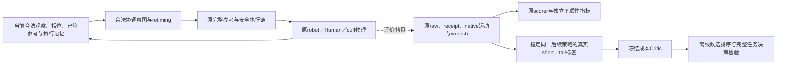

# v5 学习与控制接口

本轮改变的是合法髋膝协调意图和参考通过速度；原MPC、scheduler/governor、current-state admission、FAST反馈、allocator、robot/cuff/Human物理及原guard继续执行。上层不直接写motor torque，不改保护阈值。

## 输入与输出

可用输入包括当前因果Human估计q/dq、已测cuff力/矩、当前参考和active suffix、phase/slot/剩余时间、commissioned模型、observer接口记忆、receipt-governor进度及已完成历史。未来Human、当前未执行候选真实未来torque/receipt不进入候选生成。native真值和新增4kHz实际wrench只用于评价。

合法基础空间为已验证modal8_retimed：去/回共同路径、相对路径、局部时间、通过速度共8维，参数[-1,1]。局部幅度原为0.30度路径、±8%段时长、±12%通过速度，逐关节终点锁保留；实际可执行仍由原证书与admission决定。历史强固定的legacy两坐标冻结。STRICT01参考最小jerk分支只在原共同通过速度坐标c∈[-1,1]内优化，保留原slot包络；不能逐关节独立扩大速度权限。分支感知的相对target移位也先映射到原相对模式坐标并裁剪[-1,1]，实际角度变化可能小于0.02度，保留原通过速度与段时长、终点锁和证书。首版逐关节调速及越出相对参数box的探索已封存并排除正式同权限比较，原物理和motion结果原样保留。所有新提议可被原门拒绝并回退。

## 三个不同问题

参考局部积分jerk下降，不保证完整实际issued参考下降，更不能保证Human jerk或wrench波动下降。Human改善与完整JF下降也分开。原5ms左积分JF/JM与原未滤波0.25ms motion门不变；更高频率wrench不会回写历史积分。

已发现的交接现象是多个相邻参考q样本保持而dq非零；本轮用原速度模式在进入交接前调整，未修改executor来消除该现象。分支风险是显式预测模型的候选排序启发式，其不确定带不是安全证明。

## 真正的rolling剩余价值

C1在原合法cold-parent途中完整地址空间fork，每个分支只修改指定一个决策；随后恢复相同原B rolling/replan策略。恢复包括原planner类，避免残留18D/modal意图污染后续。H=0.25/0.5/1秒处保存合法因果状态；原active composite和suffix分别记录。标签由实际原左积分切成short与tail并验证闭合。

Critic若获真实短视证据才训练，gamma=1，V_cost(z_H)是指定B后续策略的分量剩余成本，不是全局最优值。 固定modal后续策略的tail必须另行标明，不能与B-policy标签混用；若未来推广到多种后续策略，输入与标签必须显式绑定策略身份及执行记忆。补充反例在0.5秒short下曾选中最终motion失败轨迹，说明实际资格不能在候选选择时用未来真值mask补救。主Critic的少量合格标签不建立失败风险识别能力。 当前状态也未显式包含完整native累计运动剂量或历史极值，不能把worst_ratio分量预测当作完整原motion合同的充分因果状态或放行证书。预备的小型kernel ensemble预测remaining JF/JM/时间和原motion最差比。先fit并冻结源码/权重/协议，再运行独立test父状态；不同horizon不算独立患者。若排序条件使用事后原资格，只能称离线条件诊断。所有菜单已完整执行时，不能声称实际节省物理尝试。 本轮C3的C_short和z_H由真实分支执行获得；Critic只预测其后的tail。尚未建立廉价的候选短期状态/成本预测器，因而该排序检验不是已经可部署的实时控制器。

## PPO与优化的预算含义

传统pattern/BO每次新候选必须真实执行；同预算检查点比较，代理查询和拟合另记。冻结PPO只使用与modal8_retimed完全兼容的历史tanh(mean)动作；不采用训练样本中最佳动作，不复用不同语义rollout。PPO加显式交接规则是混合对照，不能称actor已经学到新机制。 历史PPO的合格任务奖励为5*tanh((base JF−actual JF)/5)，没有门内平顺性或JM奖励；actor是一任务一次高层向量决策，非逐slot状态反馈策略。它与本轮新S目标不同，本轮对照不能作为新平顺性reward下PPO训练样本效率的结论。

一条完整任务通常只有一个高层计划或一次C1干预；任务内多个MPC请求、数万native步、三个H样本不能冒充多个独立RL episode。科学仿真PASS、host实时、硬件和临床资格分别报告；未建立患者舒适度或跨患者适应。

## 本轮数据与控制流

Critic这条线在本轮是离线决策实验；没有将评价真值或未来receipt回写到控制输入。新增4kHzwrench仅复制原native步的post-refresh缓存，原5msJF/JM口径保留。具体源码及实际执行身份以对应job SOURCE_MANIFEST、实际activated参考与原receipt/native审计为准。

## 本轮冻结PPO奖励基准与显式投影

CONFIRMED：历史奖励真实anchor为PPO_SCRATCH_STRONG legacy2、JF1400.089728，原B不是reward anchor。全部64条on-policy reward按源码重放误差约4.44e−16；61条合格reward不饱和。它没有门内jerk/JM项，不用错误参照的tanh饱和解释当前结果。

本轮TIME0/RULE是对冻结全局均值的显式坐标置换；原高斯log probability不能直接当成此投影hybrid的动作密度。没有复用旧rollout训练该hybrid，新PPO更新为0。若以后训练，必须重新定义其动作分布、密度和on-policy数据合同，保持原物理接口与安全链；不能用本轮挑选后的最佳动作冒充actor部署性能。
