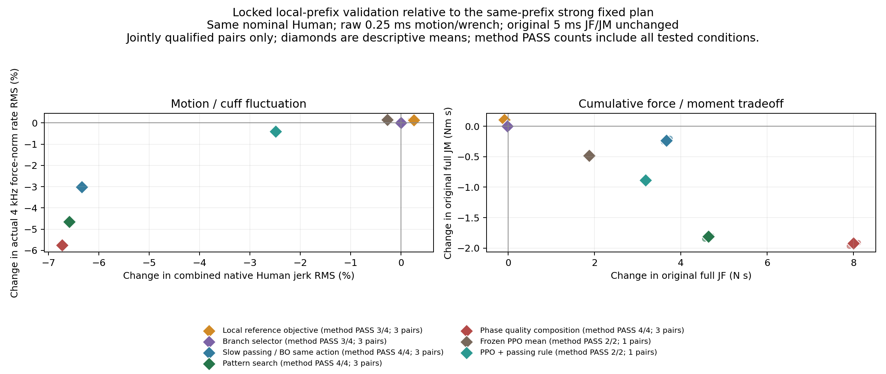

# iHEAR Lab — Smoothness-Aware Control & Long-Horizon Critic v5

最终研究已完成；精确终态与总耗时见[END.json](END.json)。最强证据是**执行感知的提前交接协调改善真实运动及局部施力波动，同时存在JF／JM和其他运动分量的取舍**。Critic在回程复现更好的完整任务选择，但固定训练动作与1秒窗口同样有效，出程失败仍保留。

## 1. 运行与真实预算

**CONFIRMED — 运行与真实预算。** 本轮ACTIVATION为 `smoothness_critic_research_v5_20261022T162113Z`，T0=2026-10-22T16:21:13.763847+00:00，硬截止=2026-10-23T02:21:13.763847+00:00，重启和恢复均未重置。封包前实际经过约 **7.212小时**，最后一次物理END在T0+6.910小时；精确总耗时见END.json。真实START/END **189/189**：22个冷启动父episode、167个完整任务候选评价（167完整、0 partial，原门合格146、正式同权限合格145）。每个父和live-state fork均付费计数；新增native **12,889,360**，相当于3222.340秒新物理积分，不把归档prefix重复计入。新PPO训练episode/update均为0。6个早期超出原共同速度／相对坐标子族的探索身份保留原结果，但全部排除正式同权限排名，不能由原motion PASS冒充权限合格；见audit/ACTION_PERMISSION_REVIEW.json。零START工程启动失败另存，不冒充物理尝试。

## 2. 实际人体平顺性的有效方法

**SUPPORTED — 实际人体平顺性的有效方法。** 最可靠的改进来自在合法协调接口内提前降低rolling交接的通过速度；传统pattern继续调整通过速度／时序，池化历史的相位组合增加一个质量前沿候选。名义组合候选髋／膝原始jerk RMS约降低7.53%／6.55%，pattern约降低6.97%／6.50%，交接规则约降低6.44%／6.31%。冻结新prefix结果如下；相对同条件强固定BEST，只有双方原合格时计入正式配对均值。原门通过数独立列出。

| 冻结方法 | 原合格／条件 | 与BEST均合格对数 | 髋jerk Δ% | 膝jerk Δ% | 4kHz力模长变化率 Δ% | ΔJF N·s | ΔJM Nm·s |
| --- | --- | --- | --- | --- | --- | --- | --- |
| BEST | 3/4 | 3 | 0.00000 | 0.00000 | 0.00000 | 0.00000 | 0.00000 |
| REFERENCE | 3/4 | 3 | 0.17643 | 0.27103 | 0.14121 | -0.08704 | 0.10476 |
| ANTICIPATORY | 3/4 | 3 | -0.00022 | -0.00058 | 0.00087 | -0.01833 | 0.00143 |
| HANDOFF | 4/4 | 3 | -6.45742 | -6.30694 | -3.01349 | 3.66177 | -0.23078 |
| PATTERN | 4/4 | 3 | -6.98335 | -6.49395 | -4.64571 | 4.63511 | -1.81088 |
| COMPOSE | 4/4 | 3 | -7.54325 | -6.54726 | -5.75428 | 7.99749 | -1.92423 |
| BO | 4/4 | 3 | -6.45742 | -6.30694 | -3.01349 | 3.66177 | -0.23078 |
| PPO_MEAN | 2/2 | 1 | -0.29416 | -0.26511 | 0.14367 | 1.87442 | -0.48229 |
| PPO_RULE | 2/2 | 1 | -2.17468 | -2.55545 | -0.40258 | 3.18183 | -0.88321 |

这些是同一Human的四个局部prefix，不是四名患者、统计显著性或临床舒适度验证。BO动作与HANDOFF完全相同，复用实际结果，不增加独立样本。PPO预登记只测两组。

## 3. cuff施力波动部分同步改善

**CONFIRMED — cuff施力波动部分同步改善。** 名义组合候选的4kHz力模长变化率RMS下降约5.75%，力向量变化率下降3.85%，100ms局部向量线性残差RMS下降20.26%；力矩模长变化率下降3.54%。但是力RMS增加约0.53%，力峰值仅下降约0.19%，不能将波动降低写成平均负荷也降低。交接规则虽然降低力变化率，却增加力TV；各分量、分位数和冻结条件逐项见[波动分解](WRENCH_COMPONENT_TRADEOFF.md)。4kHz流复制原step已有的实际wrench缓存，不增加observe、refresh或积分，且与原5ms重合点完全一致。早期只有5ms的组仍保留其测量限制；不推断连续时间或真实传感器亚毫秒能力。

## 4. JF/JM存在明确取舍

**CONFIRMED — JF/JM存在明确取舍。** 原JF/JM一直使用原5ms TASK左积分，原motion门和阈值不改。名义结果：

| 名义开发身份 | 原门 | JF N·s | JM Nm·s | 原始jerk RMS 髋／膝 °/s³ | 4kHz力模长变化率RMS N/s |
| --- | --- | --- | --- | --- | --- |
| HANDOFF01_B | PASS | 1436.4565 | 101.2537 | 305.08/714.73 | 20.9137 |
| HANDOFF01_BEST | PASS | 1398.0346 | 107.9710 | 320.15/678.37 | 19.3341 |
| HANDOFF01_BOTHLOW | PASS | 1401.7564 | 107.7794 | 299.53/635.53 | 18.7538 |
| OPT01_PATTERN011 | PASS | 1402.7257 | 106.1796 | 297.82/634.25 | 18.4351 |
| COMPOSE01_PAIR01 | PASS | 1406.0932 | 106.0661 | 296.04/633.96 | 18.2222 |
| STRICT01_REF025 | PASS | 1397.9496 | 108.0770 | 320.80/680.17 | 19.3659 |
| STRICT01_ANT | PASS | 1398.0072 | 107.9737 | 320.15/678.36 | 19.3341 |

组合候选相对强固定ΔJF=+8.058633 N·s（约+0.576%）、ΔJM=−1.904880 Nm·s；pattern为+4.691113／−1.791424，简单交接规则为+3.721764／−0.191663。组合相对原B的JF仍低约2.11%，JM却仍高约4.75%；不能称全面优于B，也不能称胜过强固定的JF。全部完整TASK仍为约19.03秒，含原1.02秒HOLD。部分髋加速度RMS、膝速度峰值或力RMS会增加，详表保留。验证失败：VAL03_BEST：excursion；VAL03_REFERENCE：excursion；VAL03_ANTICIPATORY：excursion。失败完整积分不进入正式低成本成功排名。

## 5. 改善来自执行前协调

**SUPPORTED — 改善来自执行前协调。** 原issued/accepted/activated参考、receipt、requested/applied torque及native真值均保留；本轮没有滤波后替换原运动评价。原rolling交接出现约10ms的q保持而dq非零，十个事先固定邻近窗口覆盖强固定约83%的jerk平方和；这是描述性时间重合，不是独占中介比例。降低原共同通过速度坐标会在交接前改变合法参考并降低交接邻近的实际人体／cuff波动，原guard仍完整生效。原5ms六轴applied torque全局变化率RMS仅变化约+0.028%（规则）、−0.076%（pattern）、−0.130%（组合），故不声称所有执行器瞬态均明显下降。交接数量及ESCAPE_ADMITTED语义保持，改善并非取消安全保护。严格reference-smooth虽改善局部解析目标，却没有改善实际全任务jerk/wrench；较强平滑还触发excursion门。

## 6. clearance信息改变了候选，独立收益尚未建立

**CONFIRMED — clearance信息改变了候选，独立收益尚未建立。** 小型因果几何模型在两个已知局部反例选出不同符号的合法微移位并实际恢复原motion门；两种盲移位也都能恢复，且所选模型轨迹与匹配盲移位逐字段相同。预测事件时刻误差约0.085秒／5.16秒，不能说准确预见了晚期C19冲击。强固定上的严格分支增量几乎为零。对新暴露TAILOT失败的补充重放保持旧分支模型冻结，不训练新模型；其实际结果为：B 原门=PASS、guard active=0；SPEEDP 原门=FAIL、guard active=1；ANT 原门=FAIL、guard active=1；BLINDM 原门=FAIL、guard active=1；BLINDP 原门=FAIL、guard active=1。模型改变当前决策数=1；这组是已暴露失败的探索性反事实，不是新的盲泛化验证。原SPEEDP及B重放身份审计为PASS_EVIDENCE_IDENTITY。具体信息增益以[补充反事实](SUPPLEMENTARY_EXECUTION_COUNTERFACTUALS.md)的盲对照为准，不能自动归功于分支信息。

## 7. 存在有界的近期JF排序短视

**CONFIRMED — 存在有界的近期JF排序短视。** 在相同完整live-state、仅改变当前决策、所有以后决策恢复原B rolling/replan的真实续跑中，0.5秒short与完整合格剩余成本选择不同：出程约0.042779 N·s、回程约1.553816 N·s完整JF regret。回程改选同时增加约0.331268 Nm·s JM。差值约4.2–4.5秒后稳定，回程1秒short已选到完整菜单最优。因此证据是指定后续策略和近期JF排序下的局部问题，不是原MPC综合目标普遍短视，也不是必须记忆整个任务的证明。actual-tail只是离线参照，既非可部署预测器，也非全局最优oracle。

## 8. Critic已训练，原因来自C1真实门控

**CONFIRMED — Critic已训练，原因来自C1真实门控。** C1两个菜单均全合格，超过事前0.02 N·s研究门槛后才训练。主出／回模型各16条真实分支标签、两个父状态；8标签版本在test前另行冻结，复用历史数据，不能事后择优。模型是三lengthscale的小型RBF ensemble，预测剩余JF、JM、时间和motion最差比；gamma=1，C_total=C_short+V_cost(z_H)。100维z_H含合法估计、参考／active suffix、scheduler/governor和执行记忆，不只是q/dq，不使用未来Human、torque或receipt。没有world-model/BPTT或新PPO训练。所有源、标签、权重、冻结时序和独立公式重放已核验；不继承SuperMimic的实验有效性。

## 9. Critic只在回程改善0.5秒short，未显示独立Learning增量

**CONFIRMED — Critic只在回程改善0.5秒short，未显示独立Learning增量。** 冻结模型对真实续跑菜单进行离线选择：新状态回程short选SPEEDM，Critic选RELATIVEM，与实际tail参照相同：完整JF 1429.726061→1428.170545 N·s，JM 103.487906→103.819659 Nm·s，两者原门PASS。训练时选定的固定动作和1秒short也作相同选择，因此Critic相对它们增量为0。出程主模型和8标签版本均仍选SPEEDP并motion FAIL；禁止用未来资格mask后的好排名替代此负结果。失败峰值在H前0.18秒已发生，尾部成本不能抹去过去极值；当前特征缺少完整累计极值／guard失败历史，训练也只有正例。15ms任务时钟漂移在训练常量字段的小缩放下造成核域外距离，去菜单共同误差后的tail RMSE仍约1.301 N·s，远超约0.04 N·s关键差。16标签比8标签RMSE更小，却没有额外改变选择；已暴露查询敏感性将训练恒定时钟字段置均值，主出程tail RMSE降至约1.547、去共同误差后约0.965，但仍选同一失败动作；时钟影响存在，却不是充分修复。原权重和主test不变，完整状态修复与新盲验证NOT_RUN。回程后续策略为B，不能把其结果冒充胜过JF约1398的强协调方案。

## 10. 实际物理尝试节省为0

**CONFIRMED — 实际物理尝试节省为0。** 全部候选的short与tail都实际执行，标签、开发、训练与独立评价分别记账。尚未构建廉价候选z_H／C_short预测器，当前是离线尾部排序检验，不能称实时部署控制器。ensemble分歧未校准，失败概率模型未建立。预测查询次数与拟合毫秒数不能充当少做的物理尝试。

## 11. 更简单的方案更有证据

**SUPPORTED — 更简单的方案更有证据。** 同一四维合法空间、同一共享历史起点，每臂12次真实尝试：pattern 12/12合格且S最优约0.953545；BO 11/12合格，最佳仍为交接规则（S约0.964078）。该seed中实际证书拒绝和执行平坦区可复核；它们对两算法差异的独占贡献仍是假设，不能推为BO普遍无效。组合追加一个新候选，该组连同B与冷parent共3 START，另外已消费Handoff与OPT合计34 START历史；预测JF／JM误差约2.13e−7／4.30e−9仅证实本地HOLD后近似相位分解，不是免费历史或普适动力学定理。冻结PPO在两个预登记prefix均原门通过，其中包括强固定失败的VAL03，故不能称旧PPO无用。它只在一个任务开始输出一次全局均值向量，旧奖励侧重JF，不奖励门内jerk/JM；真实reward anchor是legacySTRONG JF1400.089728，64条奖励精确重放、61合格奖励均未接近±5，故基于错误B参照的tanh饱和解释已被否定；其四个出程modal提议因速度证书被拒绝。名义TIME0将实际modal接受数5→9，但单独恢复没有降低jerk或力变化率；结合降速后S=0.970874，优于旧规则0.992824，同时JF增加。补充TIME0／降速规则反事实结果独立记账，验证触发=True；不是actor已经学会机制。跨患者ILC／历史学习、独立新Q和PPO训练均NOT_RUN。

## 12. 证实的失败机制

**CONFIRMED — 证实的失败机制。** (a) q保持/dq非零的参考交接与修正脉冲真实存在；(b) 已知clearance分支附近出现原guard差分模板跨支、inequality-unsatisfied日志及运动峰值；原实际physical/task门仍单独判定，不能因此宣称形式安全；(c) excursion可在guard完全未激活时失败，例如VAL03强固定膝行程增量0.506278°超0.5°；(d) 名义PPO与负时序pattern候选的出程参考／物理轨迹完全相同，说明提议被证书屏蔽后参数不同不一定改变执行；(e) 仅预测未来费用不能修复H前已失败的原全任务极值。未把所有失败归于clearance。

## 13. 未闭合的解释

**HYPOTHESIS / NOT_TESTED — 未闭合的解释。** 交接是否独占所有jerk来源、tracking与力矩分配的完整中介、几何启发式的广域预测能力仍未建立。训练常量字段对算法距离和误差的影响已有查询敏感性证据；数据覆盖／缺失历史的完整模型修复贡献尚未分离。更少jerk是否对应患者舒适度、不同Human的动作排序、跨患者学习与真实硬件带宽均未测试。完整5ms积分定义下很小出程差值不自动具有临床意义；新增native辅助积分仅做采样敏感性，不改原结论口径。

## 14. 值得继续投入

**SUPPORTED — 值得继续投入。** 优先研究原接口内交接速度／时序与可执行参考的一致性，以完整原门、各native分量、最高可得wrench及JF/JM共同验证；固定pattern与相位组合先作为透明基线。若另轮需要Critic，应先建立合法累计风险状态、负例支持、常量特征/OOD处理、明确后续策略，以及相对固定动作／1秒short的状态相关选择增量，再测真实尝试节省。新guard替代、长程PPO和扩容目前均无本轮新增资格；详见NEXT_RESEARCH_DECISION.md，本轮不自动执行。

## 15. Learning定位发生了收窄

**SUPPORTED — Learning定位发生了收窄。** 本轮发现可学习的实际剩余成本与局部短视，但也发现简单执行感知规则、固定动作与更长近期窗口能解释主要收益。学习的优先角色是执行权限和状态相关响应／失败风险的可验证预测，不是默认更大策略网络。回程cost Critic有相对0.5秒short的局部决策价值；独立于固定动作的增量和真实样本节省仍未建立。不能据一个失败Critic推为所有Learning无效，也不能将更好拟合当控制收益。

## 16. 长期日志已按只追加规则完成

**CONFIRMED — 长期日志已按只追加规则完成。** 开始前读取实际根日志，发现v4已有技术开始／结束但缺流程回顾，因此只追加一次约1.43小时提前停止及未执行分支回顾。随后追加本轮唯一开始、必要转折及最终简短结束；旧文本字节前缀和重复身份由audit/JOURNAL_FINAL_AUDIT.json核验。详细参数、失败与证据留在本包。

## 17. 所有owned计算已结束，最终STOP

**CONFIRMED — 所有owned计算已结束，最终STOP。** PID+Linux start_ticks审计覆盖270个已知身份，active owned=0、未跟踪包进程=0、缺失必需队列END=0；已退出但待reap zombie=0。原安全/task各189 PASS，167候选motion为146 PASS／21 FAIL（原资格与权限排除另列）。独立原scorer重算189 START、差异0，receipt/native、source、action权限、冻结时序、历史保护、Git只读状态及封包另有审计。有限仿真原安全/task/motion资格分别保留；host实时NOT_EVALUABLE、硬件与临床NOT_TESTED。本轮提前结束的依据是核心、条件Critic、优化、盲对照和独立验证队列及审计均完成，剩余未实施分支缺少下一实验所需的独立增量或安全资格；不因单个负结果结束，也不为耗时重复计算。**STOP，无自动下一轮。**

## 证据与复核入口

[冻结验证](FROZEN_VALIDATION_SUMMARY.md) · [平顺性](SMOOTHNESS_INTERVENTION_COMPARISON.md) · [施力波动](WRENCH_FLUCTUATION_ANALYSIS.md) · [波动分量](WRENCH_COMPONENT_TRADEOFF.md) · [提前协调](ANTICIPATORY_COORDINATION.md) · [补充反事实](SUPPLEMENTARY_EXECUTION_COUNTERFACTUALS.md) · [真实续跑](SHORT_HORIZON_VS_FULL_TAIL.md) · [Critic决策价值](CRITIC_DECISION_VALUE.md) · [上层优化](OPTIMIZATION_COMPARISON.md) · [控制接口](LEARNING_CONTROL_INTERFACE_GUIDE.md) · [账本](RESOURCE_AND_ATTEMPT_ACCOUNTING.json) · [包核验](PACKAGE_VERIFICATION.json)。

