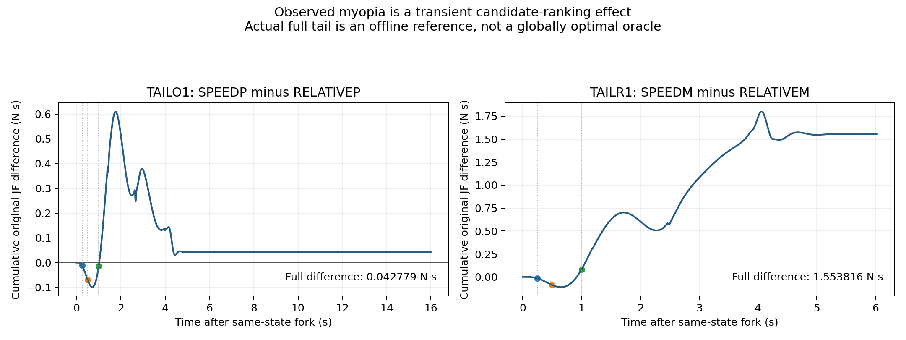

# 同状态真实rolling续跑

每个合法中间状态完整地址空间fork。候选只改变当前一个决策，随后恢复同一原B rolling/replan；原admission、拒绝、fallback和HOLD继续生效。后续planner类恢复与每个实际selected plan核验，不能把整段承诺轨迹当rolling标签。B为原B控制；ZERO为当前一个T-family决策的零额外modal，二者不同。gamma=1，原左积分验证C_short+V_actual_tail=C_remaining。

| 父状态 | H秒 | 原门合格数 | 无未来mask short选择 | actual-tail合格参照 | 无mask short完整JF regret N·s | oracle−short JM Nm·s | 事后合格集short | 事后合格集Spearman |
| --- | --- | --- | --- | --- | --- | --- | --- | --- |
| TAILO1 | 0.25 | 8 | TAILO1_SPEEDP PASS | TAILO1_RELATIVEP | 0.042779 | 0.069911 | TAILO1_SPEEDP | 0.667 |
| TAILO1 | 0.5 | 8 | TAILO1_SPEEDP PASS | TAILO1_RELATIVEP | 0.042779 | 0.069911 | TAILO1_SPEEDP | 0.667 |
| TAILO1 | 1.0 | 8 | TAILO1_SPEEDP PASS | TAILO1_RELATIVEP | 0.042779 | 0.069911 | TAILO1_SPEEDP | 0.905 |
| TAILO2 | 0.25 | 8 | TAILO2_SPEEDP PASS | TAILO2_RELATIVEP | 0.042356 | 0.069842 | TAILO2_SPEEDP | 0.667 |
| TAILO2 | 0.5 | 8 | TAILO2_SPEEDP PASS | TAILO2_RELATIVEP | 0.042356 | 0.069842 | TAILO2_SPEEDP | 0.667 |
| TAILO2 | 1.0 | 8 | TAILO2_SPEEDP PASS | TAILO2_RELATIVEP | 0.042356 | 0.069842 | TAILO2_SPEEDP | 0.905 |
| TAILOT | 0.25 | 7 | TAILOT_SPEEDP FAIL | TAILOT_RELATIVEP | 主选择FAIL | 主选择FAIL | TAILOT_COMMONM | 0.571 |
| TAILOT | 0.5 | 7 | TAILOT_SPEEDP FAIL | TAILOT_RELATIVEP | 主选择FAIL | 主选择FAIL | TAILOT_COMMONM | 0.571 |
| TAILOT | 1.0 | 7 | TAILOT_SPEEDP FAIL | TAILOT_RELATIVEP | 主选择FAIL | 主选择FAIL | TAILOT_RELATIVEP | 0.893 |
| TAILR1 | 0.25 | 8 | TAILR1_SPEEDM PASS | TAILR1_RELATIVEM | 1.553816 | 0.331268 | TAILR1_SPEEDM | 0.000 |
| TAILR1 | 0.5 | 8 | TAILR1_SPEEDM PASS | TAILR1_RELATIVEM | 1.553816 | 0.331268 | TAILR1_SPEEDM | 0.000 |
| TAILR1 | 1.0 | 8 | TAILR1_RELATIVEM PASS | TAILR1_RELATIVEM | 0.000000 | 0.000000 | TAILR1_RELATIVEM | 0.762 |
| TAILR2 | 0.25 | 8 | TAILR2_SPEEDM PASS | TAILR2_RELATIVEM | 1.566542 | 0.334643 | TAILR2_SPEEDM | 0.000 |
| TAILR2 | 0.5 | 8 | TAILR2_SPEEDM PASS | TAILR2_RELATIVEM | 1.566542 | 0.334643 | TAILR2_SPEEDM | 0.000 |
| TAILR2 | 1.0 | 8 | TAILR2_RELATIVEM PASS | TAILR2_RELATIVEM | 0.000000 | 0.000000 | TAILR2_RELATIVEM | 0.762 |
| TAILRT | 0.25 | 8 | TAILRT_SPEEDM PASS | TAILRT_RELATIVEM | 1.555516 | 0.331753 | TAILRT_SPEEDM | 0.000 |
| TAILRT | 0.5 | 8 | TAILRT_SPEEDM PASS | TAILRT_RELATIVEM | 1.555516 | 0.331753 | TAILRT_SPEEDM | 0.000 |
| TAILRT | 1.0 | 8 | TAILRT_RELATIVEM PASS | TAILRT_RELATIVEM | 0.000000 | 0.000000 | TAILRT_RELATIVEM | 0.762 |

无mask short对所有完整候选按实际近期费用选择，其未来motion失败必须保留；事后合格集short及相关系数只是资格条件诊断，不能替代主选择。C1触发训练时两个原始菜单全合格，因此门控不依赖未来失败mask。完整tail是离线诊断参照，不是实时预测器或全局最优oracle。该诊断针对近期JF排名，不能直接推出原MPC综合目标普遍短视。三种H来自同一条分支，不能算独立重复。

C1去/回两对候选的累计费用差在约4.53/4.17秒后进入最终差值的5%或0.005N·s容差内。RETURN的1秒short已恢复该菜单的完整最优选择；这支持检验延长近期窗口和固定动作等简单解释，不能把效应描述为贯穿整个任务的长期记忆。触发阈值在新物理前定为选择不同且完整合格JF差>0.02N·s，非临床意义阈值。所有失败与partial另列不按小积分获胜。

## 补充固定modal后续策略诊断（探索性、无新物理）

FAIL9，H=0.25秒：无未来资格mask的short选择BRANCH02_BLINDM9，原资格=True；完整合格参照选择BRANCH02_BLINDP9，合格short regret=0.1671758006516484 N·s。

FAIL9，H=0.5秒：无未来资格mask的short选择BRANCH02_FAIL9，原资格=False；完整合格参照选择BRANCH02_BLINDP9，合格short regret=None N·s。

FAIL9，H=1.0秒：无未来资格mask的short选择BRANCH02_BLINDP9，原资格=True；完整合格参照选择BRANCH02_BLINDP9，合格short regret=0.0 N·s。

C19，H=0.25秒：无未来资格mask的short选择BRANCH02_BLINDMC19，原资格=True；完整合格参照选择BRANCH02_BLINDPC19，合格short regret=0.16753495929992823 N·s。

C19，H=0.5秒：无未来资格mask的short选择BRANCH02_BLINDMC19，原资格=True；完整合格参照选择BRANCH02_BLINDPC19，合格short regret=0.16753495929992823 N·s。

C19，H=1.0秒：无未来资格mask的short选择BRANCH02_BLINDPC19，原资格=True；完整合格参照选择BRANCH02_BLINDPC19，合格short regret=0.0 N·s。

SUPPORTED：同一初始live parent、完全相同的已记录因果物理/参考prefix与R1请求时刻、仅一个盲移位支持中间状态比较；R1未单独保存完整RAM hash，所以不替代主C1的严格live-state fork。FAIL9在0.5秒short下选到最终motion失败轨迹；两处1秒short都恢复该菜单完整合格最优。固定modal后续策略与主Critic的B后续策略不同，不能混标签；主模型没有因此获得失败概率资格。

TAILRESCUE01属于已暴露TAILOT失败的同条件五候选重放；完整RAM fork/后续B语义成立，但不是新的独立test父状态，不计入冻结Critic训练或独立泛化证据。原B和SPEEDP物理／参考／native流逐字段精确重放；模型与两符号微移位均未恢复motion。
