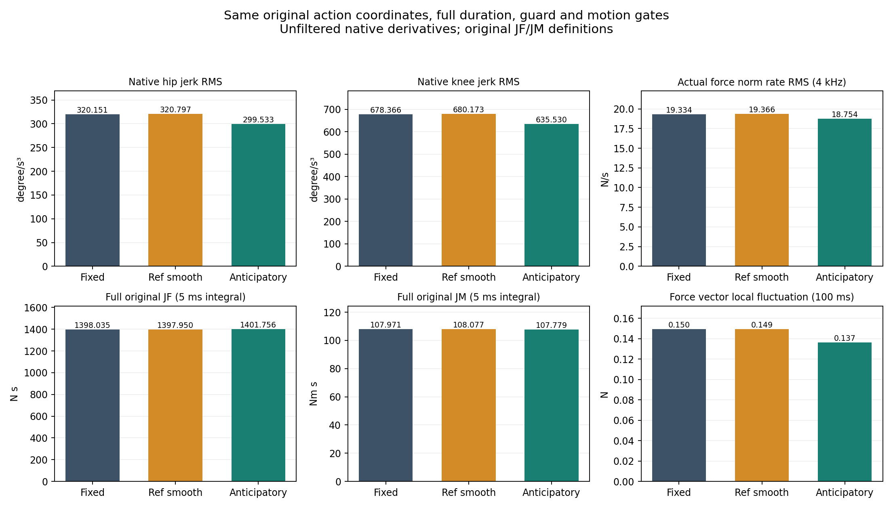
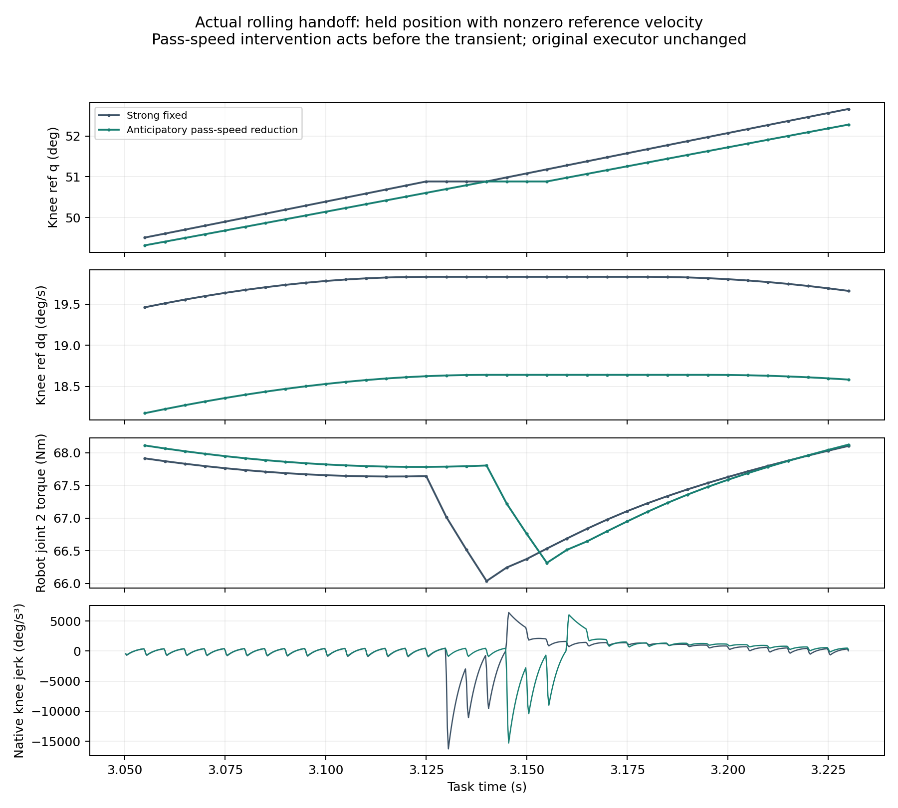

# 平顺性干预实际比较

参考、Human和wrench分别评价，失败及权限不齐探索不进入正式同权限排名。原未滤波native导数与原motion门保持。

| 身份 | 原门 | 权限 | JF N·s | JM Nm·s | native jerk RMS 髋/膝 °/s³ | 200Hz ‖F‖ rate RMS N/s | 4kHz ‖F‖ rate RMS N/s |
| --- | --- | --- | --- | --- | --- | --- | --- |
| ANT01_ANT_C19 | PASS | original domain | 1399.930374 | 108.081086 | 319.49/675.71 | 17.8724 | — |
| ANT01_ANT_ONLY | PASS | EXPLORATORY | 1397.949114 | 107.979259 | 320.16/678.33 | 17.7435 | — |
| ANT01_ANT_REF | FAIL | EXPLORATORY | 1397.499083 | 108.271447 | 329.25/667.71 | 17.7996 | — |
| ANT01_BEST | PASS | original domain | 1398.034615 | 107.971017 | 320.15/678.37 | 17.7435 | — |
| ANT01_B | PASS | original domain | 1436.456498 | 101.253695 | 305.08/714.73 | 19.3905 | — |
| ANT01_REF_HALF | FAIL | EXPLORATORY | 1397.583704 | 108.263219 | 329.25/667.76 | 17.7999 | — |
| COMPOSE01_B | PASS | original domain | 1436.456498 | 101.253695 | 305.08/714.73 | 19.3905 | 20.9137 |
| COMPOSE01_PAIR01 | PASS | original domain | 1406.093249 | 106.066137 | 296.04/633.96 | 16.7600 | 18.2222 |
| CORE01_BEST | PASS | original domain | 1398.034615 | 107.971017 | 320.15/678.37 | 17.7435 | — |
| CORE01_B | PASS | original domain | 1436.456498 | 101.253695 | 305.08/714.73 | 19.3905 | — |
| CORE01_C19 | FAIL | original domain | 1399.857062 | 108.090021 | 885.97/1955.25 | 26.2841 | — |
| CORE01_H150 | PASS | original domain | 1402.643211 | 107.072272 | 319.30/675.35 | 17.8396 | — |
| CORE01_KNOWN_AVOID | PASS | original domain | 1399.846021 | 108.089362 | 319.49/675.68 | 17.8723 | — |
| HANDOFF01_BEST | PASS | original domain | 1398.034615 | 107.971017 | 320.15/678.37 | 17.7435 | 19.3341 |
| HANDOFF01_BOTHHALF | PASS | original domain | 1399.794462 | 107.906134 | 309.76/656.28 | 17.5036 | 19.0283 |
| HANDOFF01_BOTHLOW | PASS | original domain | 1401.756380 | 107.779354 | 299.53/635.53 | 17.2949 | 18.7538 |
| HANDOFF01_B | PASS | original domain | 1436.456498 | 101.253695 | 305.08/714.73 | 19.3905 | 20.9137 |
| HANDOFF01_OLOW | PASS | original domain | 1400.392567 | 108.128124 | 306.80/654.35 | 17.3199 | 18.8462 |
| HANDOFF01_RLOW | PASS | original domain | 1399.398428 | 107.622247 | 313.20/660.23 | 17.7192 | 19.2440 |
| PPOCHECK_BEST | PASS | original domain | 1398.034615 | 107.971017 | 320.15/678.37 | 17.7435 | 19.3341 |
| PPOCHECK_B | PASS | original domain | 1436.456498 | 101.253695 | 305.08/714.73 | 19.3905 | 20.9137 |
| PPOCHECK_FROZEN_MEAN | PASS | original domain | 1399.918272 | 107.492306 | 319.39/676.46 | 17.7838 | 19.3655 |
| PPOCHECK_FROZEN_PLUS_RULE | PASS | original domain | 1401.225670 | 107.091388 | 313.38/660.87 | 17.7330 | 19.2597 |
| SMOOTH01_BEST | PASS | original domain | 1398.034615 | 107.971017 | 320.15/678.37 | 17.7435 | — |
| SMOOTH01_B | PASS | original domain | 1436.456498 | 101.253695 | 305.08/714.73 | 19.3905 | — |
| SMOOTH01_PASS_FAST | FAIL | original domain | 1397.448384 | 108.078034 | 329.08/696.48 | 17.9975 | — |
| SMOOTH01_PASS_SLOW | PASS | original domain | 1399.933653 | 107.830484 | 309.12/654.75 | 17.4925 | — |
| SMOOTH01_REF_MINJ_0p25 | FAIL | EXPLORATORY | 1397.886521 | 108.112604 | 324.64/671.95 | 17.7547 | — |
| SMOOTH01_REF_MINJ_0p5 | FAIL | EXPLORATORY | 1397.583704 | 108.263219 | 329.25/667.76 | 17.7999 | — |
| SMOOTH01_REF_MINJ_1p0 | FAIL | EXPLORATORY | 1397.074012 | 108.496241 | 338.32/657.47 | 17.9553 | — |
| STRICT01_ANTREF | FAIL | original domain | 1397.930115 | 108.149856 | 321.88/682.92 | 17.8026 | 19.4086 |
| STRICT01_ANT | PASS | original domain | 1398.007158 | 107.973664 | 320.15/678.36 | 17.7435 | 19.3341 |
| STRICT01_BEST | PASS | original domain | 1398.034615 | 107.971017 | 320.15/678.37 | 17.7435 | 19.3341 |
| STRICT01_B | PASS | original domain | 1436.456498 | 101.253695 | 305.08/714.73 | 19.3905 | 20.9137 |
| STRICT01_REF025 | PASS | original domain | 1397.949604 | 108.076996 | 320.80/680.17 | 17.7690 | 19.3659 |
| STRICT01_REF050 | FAIL | original domain | 1397.957504 | 108.147215 | 321.88/682.93 | 17.8027 | 19.4086 |
| STRICT01_REF100 | FAIL | original domain | 1398.084987 | 108.241982 | 323.28/686.75 | 17.8689 | 19.4872 |

首版逐关节参考优化与未裁剪强固定相对参数的权限问题见[审查](audit/ACTION_PERMISSION_REVIEW.json)。STRICT01重新在原共同速度坐标和原相对坐标[-1,1]内执行；不能把原证书通过当成相同动作权限。

逐项RMS/峰值/分位数、tracking、excursion、overshoot、phase积分和各门余量见analysis/extended。实际参考提议、接受、激活及原始schedule见analysis/execution与runtime/source/results/*/summary.json。

最终冻结验证、失败分母与补充反事实见[冻结验证汇总](FROZEN_VALIDATION_SUMMARY.md)、[补充执行反事实](SUPPLEMENTARY_EXECUTION_COUNTERFACTUALS.md)和[力／力矩波动分解](WRENCH_COMPONENT_TRADEOFF.md)。主结果不使用未来资格mask，不改变原积分、原阈值或开发固定预算。
