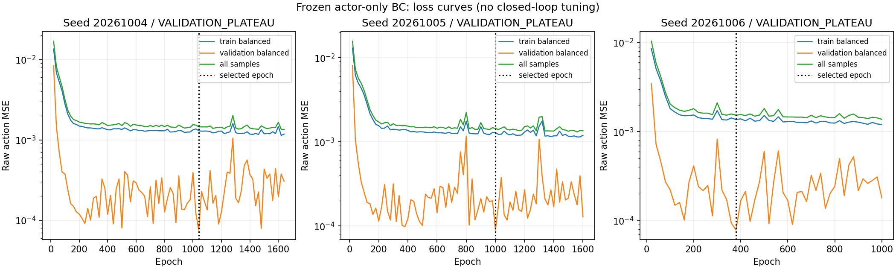
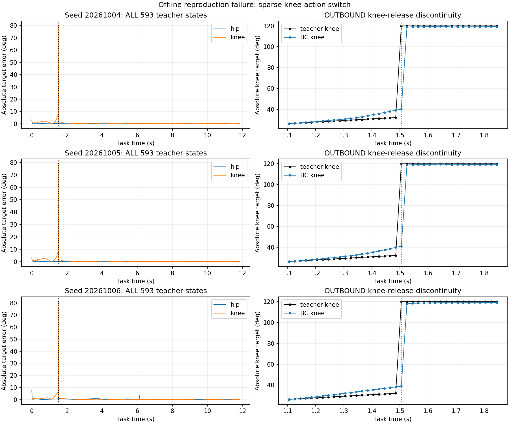

# Behavior Cloning Reproduction Gate v1

STATUS: BC_REPRESENTATION_FIT_FAILED

Representation verdict: FAIL

## Contract and provenance

Question: Can the unchanged deployable 55-D SAC actor representation autonomously reproduce the complete native teacher task?

Branch: `codex/bc-reproduction-gate-v1`; starting branch `codex/demo-assisted-sac-task-acquisition-v1`; HEAD `41cdddef117caa4b191a52129c4ff83e481fd5a8`. Three fixed initialization seeds; installed native SB3 Actor only. No critic, replay optimizer, reward optimization or SAC update. Fixed normalization and identity action scaling were verified. All original physical/safety/task/R2 sources stayed byte-identical. Teacher is offline supervision; the standalone evaluation process never opens the dataset while physics runs.

Validation is interpolation within one correlated, previously exposed successful trajectory. It is not an independent deployment or robustness test. Original phase/settling tolerances and .5 s continuous HOLD remain authoritative.

## Offline gate

Raw action units convert at 62.5 degrees per unit. Training and validation indices, objective, seeds, sampling, budgets and exact gate thresholds were frozen in PREREGISTRATION.json before any BC training or closed-loop result.

|Seed|Epochs / best|Stop|MAE|RMSE|Max error|OUTBOUND RMSE|HOLD RMSE|RETURN RMSE|Offline gate|
|---|---|---|---|---|---|---|---|---|---|
|20261004|1640 / 1040|VALIDATION_PLATEAU|0.00487763|0.03808998|1.27588698|0.05617458|0.00290313|0.00246549|False|
|20261005|1600 / 1000|VALIDATION_PLATEAU|0.00495908|0.03797088|1.26378545|0.05601939|0.00194649|0.00210288|False|
|20261006|1000 / 380|VALIDATION_PLATEAU|0.00617433|0.03911905|1.29642126|0.05764238|0.00302441|0.00344217|False|

Total/hip/knee MAE and RMSE, max error, near-bound rates and all exact teacher-state predictions are preserved per seed. Full epoch curves and selected actor checkpoints are saved. Native public predict output equals the trained deterministic forward action; CPU/CUDA consistency was checked.

## Closed loop

|Seed|Progress|Settled OUTBOUND|HOLD entry s|HOLD complete|RETURN entry s|RETURN complete|VALID|Termination|
|---|---|---|---|---|---|---|---|---|

STOP at the offline gate; no autonomous BC closed-loop evaluation was started.

No autonomous BC physics evaluation was run. Its settled OUTBOUND/HOLD/RETURN, progress and VALID fields are **not evaluated**, not zero-success results. The only physical rollout in this experiment is the teacher revalidation.

## Offline error diagnosis

The largest adjacent OUTBOUND teacher knee-target jump occurs between sample 74 (1.485 s) and sample 75 (1.505 s): -0.48623821 -> 0.92000002 raw action, or 87.890 degrees. Normalized observation L2 across those two states is 0.01135132; all 593 stored observations are distinct.

|Seed|Worst sample|Knee error (deg)|Fraction of total squared error|RMSE excluding that sample (diagnostic only)|
|---|---|---|---|---|
|20261004|75 at 1.505s|79.7429|94.61%|0.00885307|
|20261005|75 at 1.505s|78.9866|93.40%|0.00976063|
|20261006|75 at 1.505s|81.0263|92.61%|0.01064406|

The large-error switch sample is in training for all seeds. Its preceding sample is in validation under the preregistered every-fifth interleaving. The recorded validation-selected checkpoints smooth the action discontinuity. Previous-action features change on the following observation; simply reproducing that history performs well away from the one-off switch. This pattern warrants checking rare switch coverage and selection behavior before claiming an intrinsic actor capacity limit.

Classification A applies to the **selected checkpoints under this fixed supervised procedure**, not a proof that the network cannot express the teacher mapping. No identical-observation conflicting label pair was found. C (partial observability) and D (absolute-target sensitivity) are unproven. E (normalization/action-transform mismatch) is checked by fixed-scale schema and native forward/predict identity; teacher same-wrapper all-transition exact reproduction checks the baseline F (wrapper/action realization) route. Student off-trajectory action realization has not been tested.

No sample was removed from formal metrics or the gate. The diagnostic RMSE after removing the single worst sample is only a concentration statistic. No additional training, model selection, threshold change, closed-loop run or hyperparameter revision followed this audit.

## Independent replay and valid-only force characterization

null

## Scientific interpretation

- Teacher all-593-transition same-wrapper reproduction is independently VALID; normalization and native action transform checks pass.
- All three selected BC checkpoints miss the OUTBOUND knee-release jump at 1.505 s; this is the dominant offline error and BC closed-loop was not attempted.
- The preregistered fit gate failed. Sparse switch sampling/validation selection contributes; this run does not establish architecture impossibility or observation insufficiency.

## Preservation and checks

5133 historical files rehashed unchanged; preexisting index, HEAD and old branch ref preserved. No staging, commit, push, merge or reset. New branch creation was explicitly requested. Only the new teacher high-frequency trace/runtime archive is retained; there were no BC physical traces to prune. Per-seed offline prediction arrays, loss curves, plots, metrics and checkpoints remain. Details: FINAL_VERIFICATION.json, HIGH_FREQUENCY_RETENTION.json, ENVIRONMENT.json, EXPERIMENT_SOURCE_LOCK.json and PRESERVATION_BEFORE.json.

Mechanical checks: Python compile; native actor deterministic forward vs public predict and direct tanh(mean); frozen log_std gradients and weights; empty fresh Adam state; no critic; distinct initialization hashes; CPU/CUDA predictions; exact all-593-transition teacher observation/next-observation/raw/executed/phase/termination/reward reproduction; frozen independent physical evaluator; all seeds and failures reported. No BC hyperparameter retraining after closed-loop results.

Commands actually executed: launch.sh -> preflight.py, teacher.py, train.py, finish.py. The closed-loop branch of launch.sh remained closed. The later offline_audit.py performs read-only numeric diagnosis and plotting; its source hash is recorded in POST_FIT_OFFLINE_AUDIT.json. Runtime and complete logs are in FORMAL_RUN.log. No extra scientific experiment or automatic next phase is started.

## Next

Prioritize an offline observation/action/network fit audit of the 1.505 s knee-release switch and checkpoint-selection sensitivity; no longer SAC run.

STOP.
