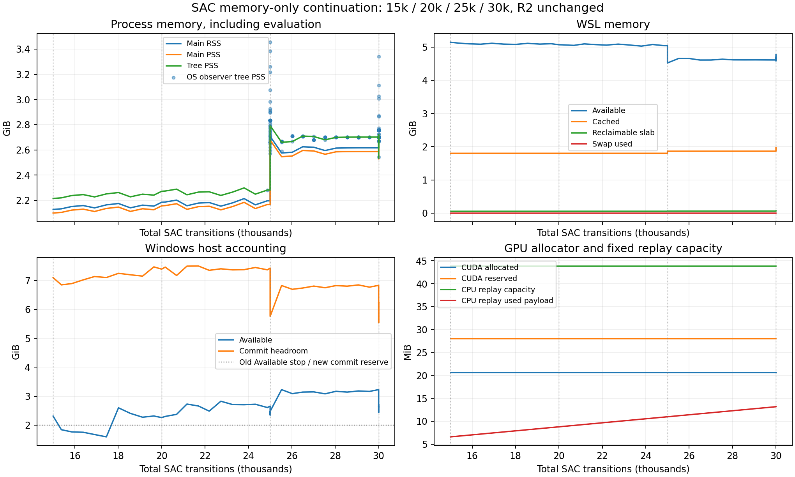

# SAC memory qualification v1

STATUS: SAC_MEMORY_QUALIFIED. Memory-only continuation reached30000; latest model, optimizer, replay and RNG are saved; STOP. No300k run started.

## Root cause and accounting

Replay is not the dominant RAM consumer. Actual buffer: n_envs=1, capacity100000, observation(55)float32, next observation(55)float32, action(2)float32, reward/done/timeout float32. Per transition: (55+55+2+1+1+1)*4 =460 bytes. Six preallocated arrays total46000000 bytes =43.87MiB. Original checkpoint12194 stored12193 transitions because SB3 callback resource-stop happens before the current transition is committed. No transition was invented to repair that offset. Replay loading made all capacity arrays resident, so subsequent collection up to30k had essentially no extra array allocation. Capacity stays100k at300k,500k and1M collected transitions; no buffer shrink is justified.

The original R2 guard required both Windows Available>=2GiB and WSL MemAvailable>=2GiB. At12194 it stopped on Windows1.806GiB despite WSL5.33GiB available and zero swap. It did not measure commit, PSS or cache; therefore that old event alone cannot identify a leak or reconstruct exact cache composition. Versioned startup/first-update samples identify the dominant process allocations. Windows and Linux figures describe overlapping guest/host memory and must not be added together; RSS double-counts shared pages, while the process-tree PSS sum apportions them. WSL Cached/Buffers/SReclaimable is reclaimable memory, with MemAvailable accounting for reclaimability; vmmem working set also includes guest kernel/cache and CUDA host mappings.

The first diagnostic assertion expected replay12194; it failed on the authentic12193 buffer before any update. The next resource-gated attempt stopped before updating. A subsequent first CUDA update grew RSS from~1.43GiB after reset to~1.90GiB, while replay changed by only one460-byte transition. Imports alone increased process PSS by~557MiB; replay load added~44MiB. PyTorch GPU tensor allocations/reservations are measured separately from nvidia-smi driver/context memory. Contemporary Windows video rendering separately drove commit headroom below2GiB; these were real pressure stops and not treated as SAC leaks. Checkpoint12196/update7194/replay12194 and RNG were preserved. Another resumed attempt reached13169/update8166/replay13166, then preserved state on another host-render commit spike. Version2 requires120 seconds of quiet before warm-up and parks simulation collection for transient pressure without advancing physical time, retaining the same pressure budgets; severe or persistent pressure still stops. No unrelated process was stopped. The final continuation resumed13169 to30000. No other heavy simulation or Human side-study was started.

|Stage|RSS / PSS MiB|Anonymous / file PSS MiB|GPU allocated / reserved MiB|
|---|---:|---:|---:|
|before_imports|28.3 / 26.2|19.2 / 7.0|None / None|
|after_torch_mujoco_imports|585.9 / 583.8|330.2 / 253.6|None / None|
|after_checkpoint_optimizer_load|844.3 / 842.0|449.5 / 316.5|3.416015625 / 6.0|
|after_replay_load|890.4 / 888.1|493.4 / 316.6|3.416015625 / 6.0|
|after_initial_reset|1466.9 / 1437.5|1063.3 / 296.2|3.416015625 / 6.0|
|milestone_12195|1669.6 / 1640.2|1243.4 / 318.9|11.54248046875 / 26.0|
|milestone_12196|1943.8 / 1914.5|1488.9 / 347.5|20.5966796875 / 28.0|

## Bounded milestones

|Step|Main RSS / PSS MiB|Tree PSS MiB|Windows Available / Commit / Headroom GiB|WSL Available / Cached GiB|GPU allocated / reserved MiB|Own / WSL / Windows processes|Training episodes / resets since 12194|Current segment cumulative / milestone interval steps/s|Replay stored / allocated MiB|
|---:|---:|---:|---|---|---|---|---|---|---|
|15000|2178.1 / 2148.7|2267.2|2.31 / 25.63 / 7.10|5.14 / 1.80|20.60 / 28.00|3 / 28 / 449|4 / 8|8.86 / 8.86|14996 / 43.87|
|20000|2236.4 / 2207.2|2325.7|2.26 / 25.34 / 7.39|5.07 / 1.80|20.60 / 28.00|3 / 28 / 442|14 / 18|8.77 / 8.74|19996 / 43.87|
|25000|2771.9 / 2741.9|2859.1|2.34 / 26.92 / 5.81|4.52 / 1.86|20.60 / 28.00|3 / 33 / 444|24 / 28|7.85 / 6.86|24996 / 43.87|
|30000|2678.9 / 2648.8|2766.1|3.23 / 25.90 / 6.83|4.61 / 1.86|20.60 / 28.00|3 / 31 / 444|34 / 38|8.01 / 8.42|29996 / 43.87|

Training reset totals include the three preserved resource-pressure attempts; raw attempt5 counters count only the continuous13169-to30000 segment. Evaluations add two resets at25k and two after30k, four in total. Across the full diagnostic since12194 there were 34 completed training episodes and 38 training resets; total physical resets including evaluations 42. Partial episodes stopped at resource/budget boundaries account for the reset/completion difference.

Full per-process RSS/PSS, anonymous/file PSS, swap/page-in/page-out, pressure, WSL MemAvailable/Cached/Buffers/SReclaimable/Shmem, Windows commit/limit/vmmem/process count, GPU allocated/reserved/max, episode/reset counts and replay arrays are in attempt5/MEMORY_SAMPLES.json. Periodic samples include reset churn;25k performs original frozen-learning NATIVE and MATCHED evaluation, followed by the final30k pair. Sampling is synchronous and included in measured throughput. Original campaign console rates divide total prior+steps by continuation time and are unsuitable for resume throughput; this table uses only new steps since13169, with earlier progress in the preserved attempts.

## Leak assessment and30k stability

Main RSS range during>=15k training: 2178.1–2771.9MiB. Main PSS range: 2148.7–2741.9MiB. Early15–20k mean PSS 2172.2MiB, late25–30k mean 2656.8MiB, delta 484.5MiB. PSS anonymous delta 485.3MiB; file delta -0.7MiB. The first full-trace evaluation raises the resident high-water baseline; compare subsequent reset windows rather than calling that first difference a leak. Post-evaluation25.5–27k to28–30k anonymous mean drift is 22.6MiB. No monotonic continuing episode growth is observed. This is bounded evidence; interpret transient peaks against returned baselines and the repeated final evaluation, not max-minus-min alone. The OS observer independently captures live evaluation child counts/peaks in EVALUATION_PEAK_SAMPLES.json; host/guest/process measurements are sequential, not one atomic snapshot.

Repeated evaluation peak:25k 3537.1MiB vs30k 3420.5MiB (lower). Final GC PSS 2589.2MiB; GC enabled and zero retained GC callbacks; planner child removed. The second evaluation cycle did not repeat the first resident-baseline jump. The anonymous high-water could include native allocator fragmentation/reuse; without a live native-heap profiler, that exact breakdown is not established and is not claimed.

Reset creates a fresh owner; close joins its thread and clears runtime capture. runtime finally closes planner lifecycle and removes GC callback; new WallPhysicsSession collects old cycles before disabling GC for the finite active session. GC at final close is diagnostic and no allocator trimming/CUDA empty-cache/swap/RAM expansion/cache dropping is used to manufacture stability. Original learning/evaluation logging remains in use. Source/contract remains byte-identical. Process lifetime observations and GPU allocator trends are in raw samples. No unbounded reset/evaluation/subprocess/trace retention was observed within this test; verify this statement against the trends and post-close samples in the result JSON.

## Memory budget and next step

|Collected transitions|Uncapped arrays MiB|Current100k allocated arrays MiB|
|---:|---:|---:|
|30000|13.16|43.87|
|100000|43.87|43.87|
|300000|131.61|43.87|
|500000|219.35|43.87|
|1000000|438.69|43.87|

Peak observed main RSS 3449.9MiB; peak owned-tree PSS 3537.1MiB; GPU max reserved 28.0MiB. For300k/500k/1M the conservative SAC-tree budgets are 4.50 / 4.50 / 4.50GiB; whole-WSL allowances are 6.00 / 6.00 / 6.00GiB, with Windows commit headroom>=2GiB. Budgets include25% above observed evaluation tree peak and projected logging, rounded upward to0.25GiB. The replay stays43.87MiB. Logging graph approximation: 3495bytes/episode and 449608bytes/evaluation; expected logs at300k/500k/1M are 13.1 / 21.3 / 41.7MiB. This approximation is file-backed, not live heap introspection. Under a one-step-per-episode sensitivity scenario episode logs alone could reach 0.98 / 1.63 / 3.25GiB: monitoring must remain active, and sustained extreme abort/reset cadence would justify a minimal streaming-log version before extending toward1M. That scenario did not occur in this bounded run; no logger change is needed before300k on the measured cadence.

These are projections under the same capacity, sequential evaluation and no competing heavy workload. Cache is reclaimable and overlaps process file PSS, so budget components are not blindly added as disjoint RSS. This nominal16GiB host /~7.62GiB WSL can support>=300k under the measured resource conditions; simultaneous video-render commit spikes were unsafe and are outside that assertion. Memory qualification does not assert SAC task success or guarantee time-to300k.

The measured evaluations timed out at10s; future successful full-task evaluations can have longer traces. Keep a5–6GiB SAC-tree transient contingency for the unchanged30s task deadline, rather than extrapolating4.5GiB as a guarantee for every future policy. This is a planning allowance, not a measured peak or a change to WSL RAM. Retain the pressure guard and evaluation peak observer for future training; reassess if that contingency is approached. No capacity reduction is indicated by the present data.

Minimal fix: resource policy only. Use Windows commit headroom plus WSL MemAvailable, new swap and other heavy simulation checks; Windows Available alone is a warning. Stop jointly low host/guest memory and preserve state. Existing guard thresholds are prospectively in RESOURCE_POLICY_V1.json. Do not reduce buffer or expand WSL RAM/swap. Next: directly resume the latest30k checkpoint with this versioned guard when training is separately requested; STOP now.

## Preservation and verification

Resume verification records existing Adam/entropy states and step counters before/after environment binding, restored RNG for subsequent pressure-stop continuations, replay shape/dtype/bytes and checkpoint hashes. Final state: 30000 steps, 24997 updates, 33 completed episodes and 34 resets in the last continuous segment. Checkpoint: `/home/hank/coding/adaptive-traction-mpc-learning/stages/stage5_personalized_motion_learning/results/single_human_sac_memory_v1/attempt5/seed_20261003/step_0030000.zip`; replay: `/home/hank/coding/adaptive-traction-mpc-learning/stages/stage5_personalized_motion_learning/results/single_human_sac_memory_v1/attempt5/seed_20261003/final_replay_buffer.pkl`; RNG plus immutable normalization/configuration/R2 lock snapshots are adjacent. SAVED_BUNDLE_VERIFICATION.json verifies saved ZIP CRC, all optimizer archive members and twelve unchanged SAC configuration fields against the12194 checkpoint. All 4076 existing tracked/untracked files and original saved states passed SHA256 preservation; scientific R2 lock, Git index and HEAD are unchanged. No Git mutation or deletion of old files; no reward/action/observation/period/normalization/plant/policy configuration change or side-study launch. Only newly generated evaluation runtime_artifacts.json files were replaced by verified lossless.gz archives through the unchanged existing archival routine.

New files only: scripts/single_human_sac_memory_v1 (memory-only orchestration, read-only peak observer, analysis, plotting and closeout), docs/single_human_sac_memory_v1 (prospective resource policy, complete accounting, preserved failed/pressure attempts, reports and bundle verification), results/single_human_sac_memory_v1 (continued checkpoints/replay/RNG and episode/evaluation evidence), and the Windows single_human_sac_memory mirror. No existing scientific source was edited and nothing was staged.

The4076-file check was made before global memory-state finalization. The separate final closeout verifies all4039 files present at the true user-task start and4075 immutable files from the intermediate bounded-test snapshot. This task's newly created top-level memory STATE.json is intentionally advanced to SAC_MEMORY_QUALIFIED; it did not exist at user-task start. The first closeout recheck initially flagged that own-state update; the scope was corrected to the true startup inventory plus an explicit own-state exception, without exempting any R2 scientific file or saved original model.

Commands: original deployed Python launched memory_test_v1.py in Ubuntu; read-only CIM accounting; installed SB3 buffers/reset/runtime lifecycle inspection; analyze_memory_v1.py closeout. Negative assertion and resource-pressure attempts remain in output/attempt2/attempt3/attempt4 and WSL versioned directories. No .wslconfig was present and no WSL resource setting was written. Report is accompanied by SAC_MEMORY_RESULT.json and full accounting; exact lifecycle conclusions must be bounded to this30k evidence.
