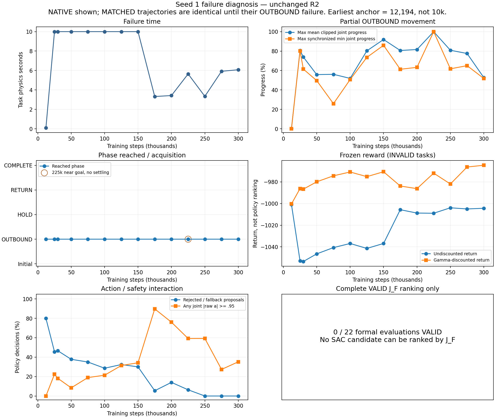
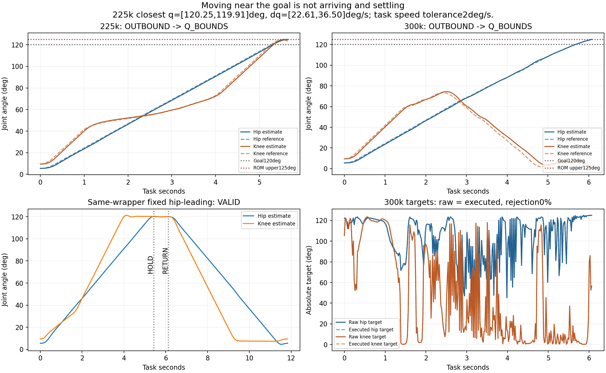
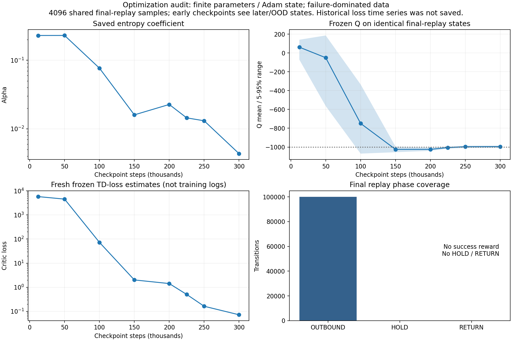

# Seed 1 / 300k failure diagnosis v1

STATUS：SAC_SEED1_300K_FAILURE_DIAGNOSED。诊断已完成并 STOP。本轮训练步数与 optimizer 更新均为 0；只执行了五个短 deterministic rollout。原 R2 scientific contract 和现有状态未改。

主要结论：SAC 学到了可执行的部分运动和减少 rejection 的行为，但没有学会完整任务。22 次正式评估全部停在 OUTBOUND；最终 replay 也没有 HOLD、RETURN 或完成奖励。根因以 **E：scratch exploration / 长时序 task acquisition failure** 为主，B 的稀疏任务获取信号/尺度和 C 的绝对 target/停稳接口难度为次。早期 D 很强，末期已不是主要解释。没有证据支持把本次失败首先归为 A 或 F。

唯一推荐下一步：**teacher/demo replay initialization**。保留当前 checkpoint 作为负面对照和部分能力证据，不直接续到 500k。另行前瞻冻结一个 demo-initialized SAC 任务获取试验，用本轮同 wrapper、独立物理 VALID 的 fixed hip-leading 完整轨迹初始化 replay，保持 reward、action、observation、period、normalization、plant、safety 和 R2 评价语义。建议使用新的 SAC 初始化来检验成功数据是否解除获取瓶颈；这不是本轮启动指令，也不自动执行。

## 1. 全部 22 次评估为何 INVALID

逐条已核验 trace SHA。11 个 checkpoint × NATIVE/MATCHED：10 次 TIMEOUT_OUTBOUND，12 次 Q_BOUNDS，HOLD 进入次数 0，RETURN 开始次数 0，VALID 0。11 对 TASK 物理轨迹逐数组差异 <1e-9，说明两个 scope 在发生 OUTBOUND 失败前相同；MATCHED 时间门槛并非这些失败的初始原因。没有按 INVALID 的截断 J_F 选择 best。

ALL_22_EVALUATION_AUDIT.json 包含每条的 raw/executed 分布（min、5/50/95 分位、mean、std、max）、target 角度分布、逐时间窗动作、rejection/fallback/modification、saturation、q/reference/tracking、estimated/true progress、goal proximity/velocity、force/moment/clearance、终止原因和 reward decomposition。CSV 提供排序紧凑表；原始 5ms trace、policy-rate action 和完整 summary 保持原样。

|Step|Scope|Failure time (s)|Reason|Max synchronized OUTBOUND progress|HOLD/RETURN|Rejection|Near-bound raw action|Return¹|J_F²|
|---:|---|---:|---|---:|---|---:|---:|---:|---:|
|50000|MATCHED|10.000|TIMEOUT_OUTBOUND|49.60%|0/0|37.80%|8.40%|-1046.477|853.204|
|50000|NATIVE|10.000|TIMEOUT_OUTBOUND|49.60%|0/0|37.80%|8.40%|-1046.477|853.204|
|75000|MATCHED|10.000|TIMEOUT_OUTBOUND|25.86%|0/0|35.00%|19.00%|-1040.680|554.462|
|75000|NATIVE|10.000|TIMEOUT_OUTBOUND|25.86%|0/0|35.00%|19.00%|-1040.680|554.462|
|100000|MATCHED|10.000|TIMEOUT_OUTBOUND|50.71%|0/0|28.60%|21.40%|-1036.883|815.230|
|100000|NATIVE|10.000|TIMEOUT_OUTBOUND|50.71%|0/0|28.60%|21.40%|-1036.883|815.230|
|125000|MATCHED|10.000|TIMEOUT_OUTBOUND|73.55%|0/0|32.40%|31.40%|-1041.435|885.814|
|125000|NATIVE|10.000|TIMEOUT_OUTBOUND|73.55%|0/0|32.40%|31.40%|-1041.435|885.814|
|150000|MATCHED|10.000|TIMEOUT_OUTBOUND|85.95%|0/0|30.00%|34.20%|-1036.870|667.447|
|150000|NATIVE|10.000|TIMEOUT_OUTBOUND|85.95%|0/0|30.00%|34.20%|-1036.870|667.447|
|175000|MATCHED|3.320|Q_BOUNDS|61.28%|0/0|5.42%|89.76%|-1005.669|381.481|
|175000|NATIVE|3.320|Q_BOUNDS|61.28%|0/0|5.42%|89.76%|-1005.669|381.481|
|200000|MATCHED|3.420|Q_BOUNDS|63.26%|0/0|14.04%|76.02%|-1008.784|392.685|
|200000|NATIVE|3.420|Q_BOUNDS|63.26%|0/0|14.04%|76.02%|-1008.784|392.685|
|225000|MATCHED|5.645|Q_BOUNDS|100.00%|0/0|6.38%|59.22%|-1008.944|523.961|
|225000|NATIVE|5.645|Q_BOUNDS|100.00%|0/0|6.38%|59.22%|-1008.944|523.961|
|250000|MATCHED|3.340|Q_BOUNDS|61.74%|0/0|0.00%|59.28%|-1003.897|384.187|
|250000|NATIVE|3.340|Q_BOUNDS|61.74%|0/0|0.00%|59.28%|-1003.897|384.187|
|275000|MATCHED|5.920|Q_BOUNDS|65.02%|0/0|0.00%|27.36%|-1004.984|487.746|
|275000|NATIVE|5.920|Q_BOUNDS|65.02%|0/0|0.00%|27.36%|-1004.984|487.746|
|300000|MATCHED|6.075|Q_BOUNDS|51.82%|0/0|0.00%|35.20%|-1004.342|425.229|
|300000|NATIVE|6.075|Q_BOUNDS|51.82%|0/0|0.00%|35.20%|-1004.342|425.229|

¹ 原保存评估未保存逐步 reward；按冻结公式、5ms causal q/force 和 policy-rate action 复原，300k 已通过新 same-wrapper exact reward 逐项验证。OUTBOUND potential 取最近 5ms 同时刻 causal sample。² J_F 单位 N·s，仅作失败诊断；所有这些任务 INVALID，不能排名。Near-bound 定义任一 joint |a|≥0.95，不是声称发生软件 clipping。

## 2. 10k → 50k → 100k → 200k → 300k 是否实际进步

**没有 exact 10k checkpoint evaluation。最接近的保存 early anchor 是 12,194；不能冒称 10k。** 本表使用 synchronized progress=max_t min_j clip((q_j−start_j)/(goal_j−start_j),0,1)，避免平均进度被一个关节拉高；这是位置 proxy，不等于停稳或成功。

|实际保存 step|NATIVE failure time|Synchronized progress|Closest max-joint goal error (deg)|Rejection|阶段|
|---:|---:|---:|---:|---:|---|
|12194|0.095|0.00%|114.434|80.00%|OUTBOUND|
|50000|10.000|49.60%|57.966|37.80%|OUTBOUND|
|100000|10.000|50.71%|56.235|28.60%|OUTBOUND|
|200000|3.420|63.26%|42.145|14.04%|OUTBOUND|
|300000|6.075|51.82%|54.478|0.00%|OUTBOUND|

12,194 的 deterministic policy 在 0.095s 因 waypoint 远离 phase goal 的旧安全/候选约束中止。之后能推动身体进入更大 ROM，并把 rejection 降低，说明不是完全没有学到动作效果。然而进度非单调：25k 同步进度约80.13%，150k约85.95%，225k的位置进度曾达到100%，300k却只有51.82%。225k最接近目标时 q≈[120.25,119.91]°，dq≈[22.61,36.50]°/s，远高于 2°/s 的任务停稳要求；11 个 5ms sample 在双关节1°位置盒内，但位置与速度同时合格的 sample 为0。所有正式评估都没有 settled reference proxy。

300k 最终 estimated q≈[125.02,0.78]°：hip 持续向上，knee 先上升到约74.52°，随后反向接近下界；并非完整的 OUTBOUND→HOLD→RETURN。其 reference tracking RMSE≈[0.62,2.52]°，物理状态大体跟随 reference，不能把动作“没落实”当主要解释。

训练 completed episodes 共873，成功0。末段250k–300k有182个 episode，175个 Q_BOUNDS、4个 OUTBOUND timeout、3个 acceleration limit。return 变好主要伴随 rejection 罚分减少和失败轨迹改变，不能等价于 acquisition 改善。也没有足够证据判断只需更多相同步数就能成功。

## 3. EXACT SAME Gym / R2 evaluation wrapper 对照

本轮使用未修改 sac_env.SACExpertEnv，policy period=.020s、同 commissioning_only Frozen Human、同 reset seed、同 load_case_options；评价调用 campaign_r2.metric，正是正式 tr.evaluate 绑定的函数。策略使用原 qualify.policy 的 fixed_hip_lead。资源 probe 在 policy boundary 等待时不推进科学模拟物理时钟。未绕开 safety、未延长30s deadline、未放宽到达/速度/dwell/ROM标准。

|新复放|Scope|VALID|Duration (s)|OUTBOUND/HOLD/RETURN (s)|J_F (N·s)|F/M peak|Return|
|---|---|---|---:|---|---:|---|---:|
|SAC300k|NATIVE|False|6.075|6.075/0.000/0.000|425.229|125.94N / 18.09Nm|-1004.342|
|early_failure|NATIVE|False|0.000|0.000/0.000/0.000|0.000|78.89N / 12.65Nm|-1000.211|
|fixed_hip_lead|MATCHED|True|19.015|9.005/1.005/9.005|1344.897|118.43N / 17.02Nm|485.438|
|fixed_hip_lead|NATIVE|True|11.835|5.430/0.700/5.705|877.723|118.43N / 17.02Nm|490.586|
|no_motion|NATIVE|False|10.000|10.000/0.000/0.000|788.940|78.89N / 12.65Nm|-1007.901|

fixed comparator 在两个 scope 均 COMPLETE、独立物理 PASS。300k 使用当时真正被评价的 step_0300000.zip（periodic），复放 duration、J_F、termination reason、reward total 与归档一致。step_0300000_final.zip 是另一个包含末次更新的续训状态，本轮没有覆盖它。已知有效 comparator 不失败，因此无需第六个 nominal rollout。

OUTBOUND→HOLD 除物理 estimated q/dq 到达条件外，还要求 reference-owned continuation 完成，目标位于 goal box，参考速度/加速度归零。连续更换 absolute target 并高速经过目标不会进入 HOLD。这是原冻结语义；没有证据把这些条件诊断为 bug。Q_BOUNDS 是0..125°硬 ROM判断；记录的越界值与这个判断一致，未做事后容差放宽。

## 4. 冻结 reward 的离线与复放审计

r = −ΔJ_F/100 + 5(γΦ_next−Φ_current) +500·complete −1000·failure −0.2·rejection。γ=exp(−.020/150)，吸收 terminal Φ=0；moment 没有 reward 权重，但物理 moment/force/ROM/clearance hard gates 保持不变。

|轨迹|Force|Shaping|Completion|Failure|Rejection|Undiscounted total|Actual discounted total|
|---|---:|---:|---:|---:|---:|---:|---:|
|SAC300k NATIVE|-4.2523|-0.0899|0.0|-1000.0|0.0|-1004.3422|-964.6103|
|early_failure NATIVE|0.0000|-0.0109|0.0|-1000.0|-0.2|-1000.2109|-1000.2109|
|fixed_hip_lead MATCHED|-13.4490|-1.1134|500.0|0.0|0.0|485.4376|427.7088|
|fixed_hip_lead NATIVE|-8.7772|-0.6367|500.0|0.0|0.0|490.5861|453.5614|
|no_motion NATIVE|-7.8894|-0.0116|0.0|-1000.0|0.0|-1007.9010|-943.2755|

完整成功在实际折扣和非折扣下都远高于 SAC failure、early-abort 和 no-motion；没有发现全局奖励把失败排在完整有效任务之上。历史原始冻结 adversary 也保留：skip_hold−1012.63、incomplete_return−1014.51、repeated rejection after prefix−1058.84；先 stall3s 再成功为+487.93。它们是已有资格证据，不是本轮新训练/新复放。

**但在没有成功样本的子集内，学习信号很弱且失败行为可有不同偏好。** 300k SAC 折扣回报−964.61，no-motion−943.28；后者对本次折扣目标更好。非折扣时 early-abort−1000.21 比其他失败更高；实际折扣时它反而低于较晚失败，不能声称算法全局最偏好 early-abort。

potential 的 discounted sum 在吸收 terminal 下严格 telescopes 为−5Φ_initial（本轮≈−0.010866），不会永久奖励一次经过目标的位置进度；非折扣总 shaping 还含−5(1−γ)Σ中间Φ。因此它能改变一步 TD 信号，但不能提供一个替代 settled HOLD/RETURN 的 episode reward。所有失败都受−1000主项主导，force几分、rejection几十分快速变化，而+500 completion 从未出现于训练；这是 acquisition/credit bottleneck 的证据，不能据此证明应该改 reward 或把正确 PBRS 当 bug。

## 5. Action / safety 学习难度

action 是两个 absolute joint target，a∈[−1,1]→q_target∈[0,125]°：a=0表示62.5°，不是 no-motion；120°对应a=.92，a=1对应125°。Δa=.001对应Δtarget=.0625°；没有单位/符号/映射错误证据。executed_action 是 accepted/fallback **target**，不是20ms后的实际 q、reference q或torque；这些分别存在 trace。

300k deterministic raw/executed 两个数组完全相同，rejection/modification/fallback均0；raw任一joint |a|≥.95 的比例35.20%。raw hip/knee 在轨迹上的std约.336/.739，不是单一常数动作塌缩。hip target最大约124.90°、knee target最小约.25°；reference OTG的限速/C2状态连续性使身体运动平滑，但不把这些提案自动变成正确 phase sequence。近hard ROM目标加tracking误差会触发实际Q_BOUNDS；“ACCEPTED reference certificate”不是完整任务成功或真实物理永不越界的保证。

|训练动作段|保存动作数|Rejection|Near-bound raw|成功 episode|
|---|---:|---:|---:|---:|
|early_learned_5k_50k|44055|38.833%|23.641%|0/116|
|final_250k_300k|49698|0.984%|44.181%|0/182|
|late_150k_250k|100000|15.511%|57.465%|0/336|
|middle_50k_150k|100000|34.168%|33.170%|0/227|
|random_initial_0_5k|5000|40.760%|10.320%|0/12|

初始5000 random actions的40.76%遭rejection，证明随机探索受到强状态依赖 safety过滤；同一raw action的结果也依赖历史reference/velocity/acceleration。末段250k–300k training rejection已约0.984%，而failure仍主要ROM越界，因此当前不能把 D 判成主因。原先 actor action 存在 replay，next observation 的 previous_raw 与其完全一致；没有raw/executed错存造成action学习失配的证据。

本轮没有追加tiny-action physics sensitivity sweep。已有冻结20ms authority资格证据中动作切换被接受、物理可响应；历史记录显示下一个5ms reference变化、约10ms physical effect（限已测试情形）。本轮teacher和300k reference tracking进一步排除“所有小/learned action没有物理效果”。不能由此保证任何小动作在任何状态都可辨识/有效；微小target、OTG限速、接近phase timeout、fallback会使动作效果的时序学习困难。

## 6. SAC optimization / replay 健康度

对八个 checkpoint只读加载，在相同4096个 final-replay state上计算新 frozen Q/TD/loss/entropy；没有调用 learn/train/backward/optimizer.step。早期checkpoint面对较晚数据属于分布外比较，不能把此曲线称为历史训练loss下降。历史 callback STATE被覆盖，没有完整critic/actor loss时间序列，无法排除早期暂态不稳定。

300k periodic：Q(raw replay) mean=-995.058，range=[-1014.363,-983.544]；frozen critic loss=0.072328，actor loss=995.070；alpha=0.00435741，sample differential entropy=-1.9698，target entropy=−2。网络参数和Adam状态全部finite。actor loss约995主要由−Q尺度决定，不应当作数值爆炸。没有支持F为当前主因的positive evidence；Q集中于失败值也不能称为成功。

最终100k replay：{'HOLD': 0, 'OUTBOUND': 100000, 'RETURN': 0}；失败terminal 375，completion rewards 0；task elapsed mean=2.901s，95分位=6.065s。q coverage覆盖大部分OUTBOUND ROM，不只初始几个状态，却完全缺失成功的settled HOLD/RETURN后续状态。50.064%的raw action至少一个joint靠近边界；previous_rejection约4.051%。Timeout标志不用于bootstrap，handle_timeout_termination=False且stored timeouts全0，与冻结finite-task semantics一致。

历史 alpha 快照从12,194约.229降至300k约.00436；当前entropy接近目标且pre-squash std非零，不能仅因alpha小就断言exploration崩溃。critic面对没有成功回报的数据学到接近−1000的value，更符合失败数据主导而非Q发散。

## 7. A–H 根因判定

- **A**：Not supported as primary cause: same-wrapper fixed comparator VALID in both scopes;300k reproducible; independent physics agrees. No exact R2 source defect established.
- **B**：Secondary acquisition difficulty/scale, not demonstrated complete-task reward misranking. Success +485..491 vs failures around-1000; absorbing potential gives tiny net shaping and no settled-arrival bonus; all-failure replay offers weak sequence credit.
- **C**：Secondary representation difficulty, not mapping/units bug: broad0..125deg independent targets, near-bound proposals, changing knee direction, and settling a target/reference before phase transition.
- **D**：Strong early distortion (random40.76%,50k deterministic37.8% rejection), but not current dominant cause: final training0.984%,275k/300k deterministic0%.
- **E**：Primary: scratch exploration/task acquisition never produced HOLD/RETURN/completion evidence; final replay entirely OUTBOUND,873 successful training episodes=0.
- **F**：No positive explosion/nonfinite evidence; finite Adam/network, Q about-995, final frozen TD/loss small, entropy near target. Historical loss time series not retained, so cannot exclude earlier instability.
- **G**：Limited partial motion and rejection-avoidance learning, but no sustained complete-task acquisition.225k passes near goal at excessive speed;300k regresses. Blind budget extension not justified.
- **H**：Mean clipped q progress can report1.0 during overshoot; it is not settled arrival, HOLD, valid success, or a policy-ranking score.

这些是证据支持的机制分类，不是完成 ablation 后的因果贡献比例。单一 exposed Human、单一Seed，不推断跨Human或硬件安全。当前partial-learning证据不足以支持“直接500k一定解决”。

## 8. 唯一下一步建议与 checkpoint 处理

**CURRENT CHECKPOINT：KEEP。** 保留300k final/periodic、225k partial-progress、全部失败replay/optimizer/RNG和原始R2证据作为负面对照；不是建议继续失败策略训练。

**NEXT RECOMMENDED EXPERIMENT：teacher/demo replay initialization。** 本轮已经产生同wrapper、VALID、causal-only 的完整NATIVE teacher transition593条，以及MATCHED953条，独立保存且未注入当前replay。下一轮先前瞻冻结版本化demo-initialized SAC试验，以新的policy/critic初始化和已验证完整轨迹提供全phase/reward支持，明确 demo ingestion、sampling/retention 和训练预算；沿用原SAC算法、reward/action/observation/period/normalization/safety/R2评价，不加入truth、BC或其它算法。避免把仅593条 demo 随意追加进当前100k失败buffer后宣称完成demo-initialization：会被稀释。具体sampling/retention必须在下一轮开始前写明，当前没有实施或选择比例。

成功判据应先是合法OUTBOUND到达停稳、连续HOLD、RETURN和独立VALID replay，最后才比较完整J_F；以原scratch300k负面结果作参照。若此受控试验仍不能获取任务，才据新证据决定后续接口/奖励revision；本轮没有提出多个并行实验，没有自动开始R3训练。

## 9. 执行、保护与文件索引

Branch=codex/single-human-sac-expert-v1；HEAD=41cdddef117caa4b191a52129c4ff83e481fd5a8。4219个原文件哈希核验通过；Git index/HEAD不变。Scientific variables、物理plant、adaptation、各算法参数和配置未改；没有stage/commit/push/reset/stash/delete原文件。新文件只位于本轮版本化docs/scripts/results以及Windows诊断目录。

资源门槛第一次在任何physics推进前检测到外部Human side-study并拒绝启动。用户选择等待其自然结束；进程自然退出后才运行五个rollout，并每100 policy steps检查资源。没有停止、修改或启动side-study。总新诊断transition2351条，训练0步/更新0次；所有physics owner退出。第一次resource拒绝记录保留。清单脚本另有两次schema/NaN序列化修复，属于离线diagnostic harness，不改科学源；未丢弃原失败实验。

实际命令入口（均由固定WSL Python运行）：inventory_v1.py → audit_saved_v1.py → run_diagnostics_v1.py（含首次preflight拒绝）→ sac_health_v1.py → training_action_audit_v1.py → finish_analysis_v1.py → plot_diagnosis_v1.py → verify_diagnosis_v1.py → write_report_v1.py。前后原文件哈希、每项source行号、全输入路径和结果SHA见下面JSON。

- ALL_22_EVALUATION_AUDIT.json / .csv：22条完整审计。
- EARLY_AND_MEMORY_EVALUATION_AUDIT.json：12,194、25k、30k，未混作22次正式评价。
- NATIVE_TREND_WITH_DISCOUNTED_RETURN.json：原始/折扣回报与进度趋势。
- DIAGNOSTIC_*_NATIVE/MATCHED.json：五次同wrapper结果与独立物理审计。
- FROZEN_REWARD_REPLAY_AUDIT.json / HISTORICAL_REWARD_AUDIT.json：本轮exact和历史adversary reward。
- REPLAY_COVERAGE.json / TRAINING_ACTION_AND_REWARD_TREND.json：状态/动作覆盖与random/learned分段。
- SAC_HEALTH_SNAPSHOTS.json：Q/alpha/entropy/frozen loss/finite Adam。
- SOURCE_EVIDENCE.json / DIAGNOSTIC_PLAN.json / FINAL_VERIFICATION.json：源码行证据、预先界定budget、原状态保护。
- DIAGNOSTIC_RESOURCE_SAMPLES.jsonl / POST_DIAGNOSIS_RESOURCE_ACCOUNTING.json：资源与退出状态。
- EVIDENCE_MANIFEST.json：报告、脚本、图、JSON/CSV及teacher transition的SHA。

WSL evidence root：/home/hank/coding/adaptive-traction-mpc-learning/stages/stage5_personalized_motion_learning/docs/single_human_sac_seed1_300k_failure_diagnosis_v1；raw new rollout/transition/trace root：/home/hank/coding/adaptive-traction-mpc-learning/stages/stage5_personalized_motion_learning/results/single_human_sac_seed1_300k_failure_diagnosis_v1。Windows review root：C:/Users/HankL/Desktop/Coding/adaptive_traction_mpc/single_human_sac_failure_diagnosis/output。

STOP：本轮任务完成；不启动新的训练，不跑500k。
